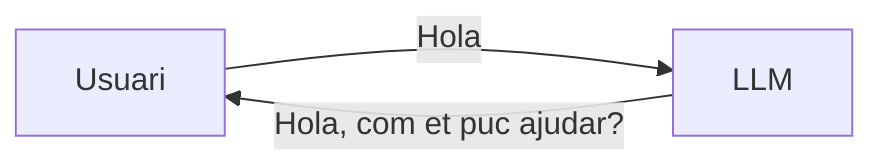
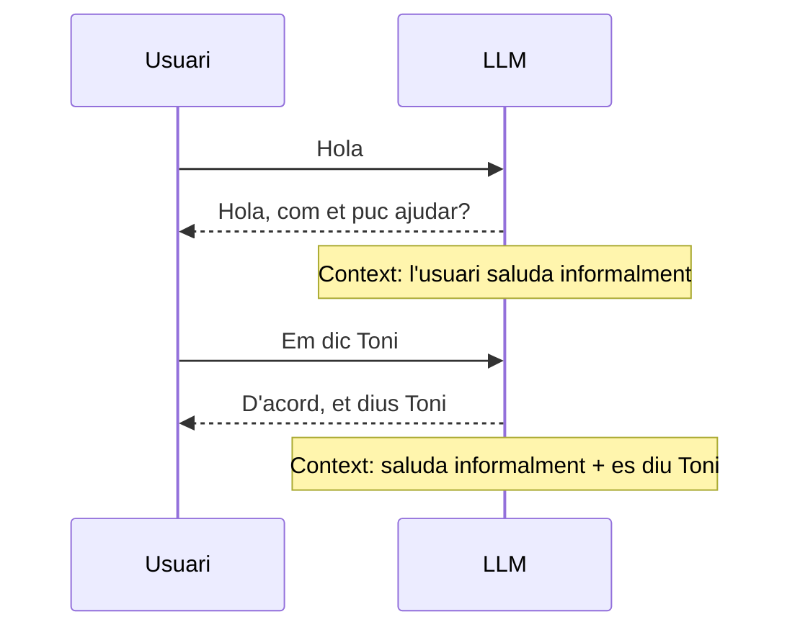
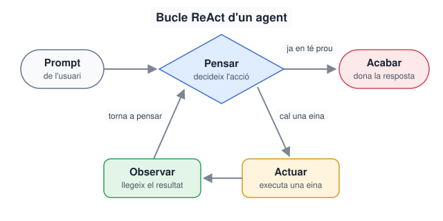
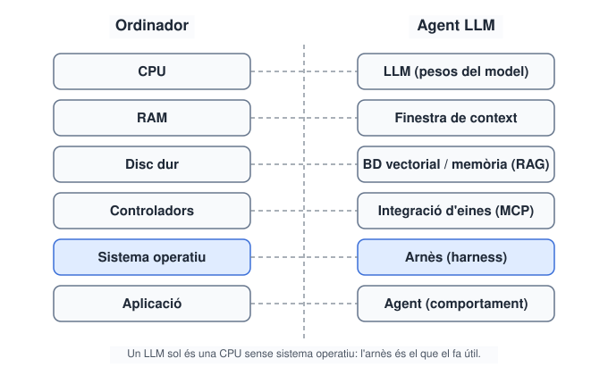
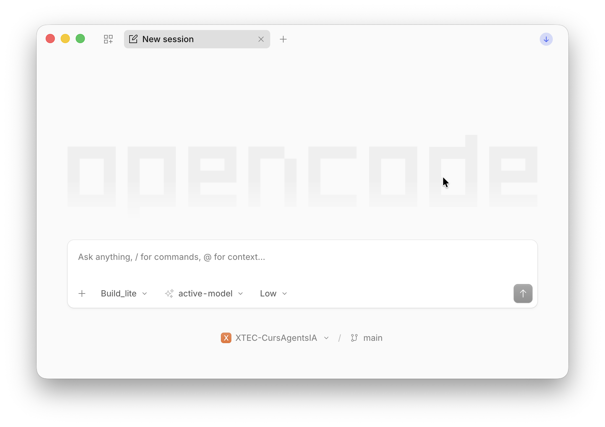
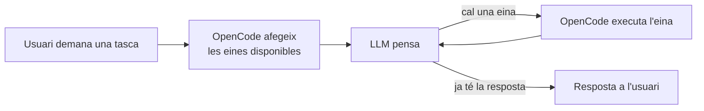
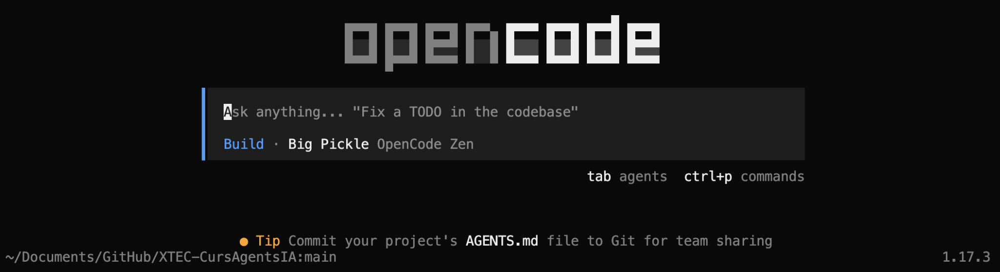
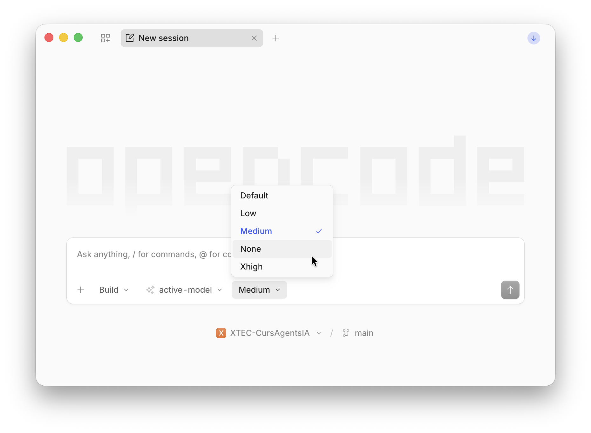
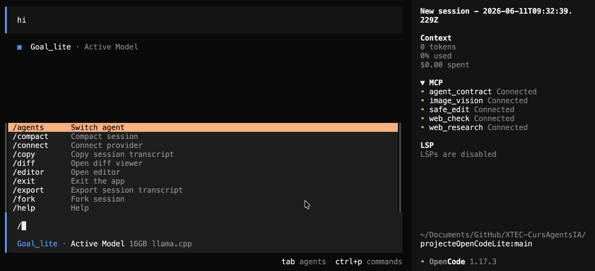

# 01 · Introducció als agents IA i OpenCode

> **Objectius de la sessió**
> - Entendre què és un agent: LLM, context, bucle ReAct i eines.
> - Instal·lar OpenCode, connectar-lo a un proveïdor i entendre `opencode.json`.
> - Guardar les claus d'API de manera segura i crear el primer repositori del curs.

| Bloc | Temps |
|---|---|
| Explicació · part A: agents basats en LLMs (§1–7) | 30 min |
| Explicació · part B: OpenCode (§8–17) | 25 min |
| Activitat · instal·lar OpenCode i connectar-lo al servidor IETI (§9–10) | 20 min |
| Activitat · pràctica: prompts *one-shot* | 60 min |
| Activitat · tasca T1 | 30 min |
| **Total a classe** | **2 h 45 min** (55 min d'explicació i 1 h 50 min d'activitat) |

Material de consulta, que no s'explica a classe: la taula de claus d'`opencode.json` (§11), les opcions d'`opencode run` (§16) i els exemples de branques de git (§17).

## Part A · Agents IA basats en LLMs

### 1. Les peces d'un agent

Per fer funcionar un agent calen quatre peces. Al llarg del curs les veurem totes:

| Peça | Exemples | Sessió |
|---|---|---|
| Aplicació de l'agent | OpenCode, Claude Code, Codex, una app pròpia amb *function calling* | 01, 02, 03 |
| Model | DeepSeek, Qwen, Gemma, GPT, Claude | 03, 08 |
| Servidor d'inferència | Ollama, vLLM, llama.cpp | 03, 08 |
| Infraestructura | Docker, GPU, xarxa, proxy | 08 |

### 2. LLM (Large Language Model)

Un LLM és un model que, donada una entrada de text, genera una resposta. Per si sol és un **chatbot**: respon, però no fa res.



### 3. El pensament dels models

Amb el mode *thinking* actiu, el model analitza la petició abans de respondre:

> *Pensament:* «L'usuari saluda de manera informal amb "Hola", pot voler una resposta informal».

Tipus de pensament:

| Tipus | Què fa | Exemple |
|---|---|---|
| Sense pensament | Respon directament a partir del càlcul intern | «17 és primer» |
| Raonament explícit | La resposta inclou el raonament | «Per saber si 17 és primer miro si és divisible per 2, 3 o 5. No ho és, per tant és primer» |
| Cadena de pensament | El model planifica abans de respondre, però aquest pensament no forma part de la resposta | (pensament ocult o plegat a la interfície) |

### 4. Tokens i context

- Un **token** és un fragment de text (una paraula, part d'una paraula o un signe). Els models llegeixen i generen tokens, i molts proveïdors cobren per token.
- El **context** és tota la informació que rep el model en una crida: instruccions, historial de la conversa, pensaments, resultats d'eines, fitxers llegits…
- La **finestra de context** és el màxim de tokens que el model pot processar alhora (per exemple 32k, 64k, 128k).

El model **no recorda** res entre crides: cada vegada se li torna a enviar tot el context acumulat.



### 5. Chatbot vs agent

> **Un chatbot parla. Un agent actua.**

L'any 2022 l'article acadèmic **ReAct** (*Reasoning and Acting*) va definir el funcionament dels agents: el model entra en un bucle on pensa, actua amb una eina i observa el resultat, fins que decideix que ha acabat.



Exemple amb el prompt *«Inspecciona aquest projecte»*:

| Pas | Què passa |
|---|---|
| Pensar | «Executaré `tree` per veure l'organització d'arxius i carpetes» |
| Actuar | `bash tree` |
| Observar | Veu que hi ha un arxiu `AGENTS.md` i decideix el pas següent: llegir-lo |
| … | El bucle continua fins que té prou informació per respondre |

### 6. Eines (tools)

Un agent pot fer tantes accions com eines tingui definides. Les més habituals:

| Eina | Acció |
|---|---|
| `read` | Llegir un arxiu |
| `edit` / `write` | Modificar o crear un arxiu |
| `bash` | Executar una comanda |
| `websearch` | Buscar a internet |

Perquè funcioni, el model ha de saber **formatar correctament** la petició d'una eina. Només els models entrenats per fer *tool calling* serveixen per treballar amb agents:

```json
{
  "tool": "edit_file",
  "path": "src/Main.java",
  "line": 10,
  "content": "System.out.println(\"Hello, World!\");"
}
```

Important: **el model no executa res**. Només escriu una petició estructurada; és l'aplicació de l'agent qui decideix si l'executa. Ho programarem nosaltres mateixos a la sessió 03.

### 7. Un primer cop d'ull a l'arnès (harness)

> *«Most agent failures are not model failures anymore, they are context failures.»* — Philipp Schmid

L'**arnès** és el conjunt de peces que envolten l'agent perquè treballi de manera controlada, segura i verificable: decideix quin context s'envia al model, quines eines té i com es verifiquen els resultats. És el tema de la sessió 02.



---

## Part B · OpenCode

### 8. Eines agèntiques

Codex, Claude Code, OpenCode, Hermes o Pi són eines que connecten un model d'IA amb el nostre projecte perquè pugui llegir fitxers, entendre el context, proposar i fer canvis, executar comandes i ajudar-nos a desenvolupar.

**OpenCode** (<https://opencode.ai/>) és una eina agèntica de terminal, de codi obert, que permet canviar de model fàcilment (*model switching*).



| Concepte | Què és |
|---|---|
| OpenCode | L'eina concreta que fem servir |
| Model LLM | El model que respon (DeepSeek, Qwen, Big Pickle…) |
| Agent | Qui decideix les accions |
| Harness | Qui controla com treballa l'agent |



### 9. Instal·lació i primera arrencada

Instal·la OpenCode 2 seguint les instruccions de <https://opencode.ai/>. Amb l'instal·lador (Linux, macOS o WSL) o amb npm (qualsevol sistema amb Node.js):

```bash
curl -fsSL https://opencode.ai/install | bash
# o bé
npm install --global @opencode/cli
```

> **Node.js.** Instal·la ja la versió **24.22 o superior** (LTS, des de <https://nodejs.org>): la necessiten els MCPs dels temes 05 i 06, i així no caldrà canviar-la a mig curs. Comprova-ho amb `node --version`.

Tanca i torna a obrir el terminal i comprova la versió, que ha de ser 2.x:

```bash
opencode --version
```

OpenCode és una interfície de terminal que també accepta el ratolí. S'executa dins de la carpeta del projecte amb `opencode`:

```bash
cd /ruta/al/projecte
opencode
```



Elements de la barra d'estat:

| Element | Significat |
|---|---|
| `Build` | Agent escollit |
| Model actiu | Model al qual estem connectats |
| `~/…` | Carpeta del projecte |
| `X MCP` | MCPs disponibles (sessió 04) |
| Versió | Versió d'OpenCode |


### 10. Connectar amb un proveïdor

#### Servidor IETI

El servidor **IETI Agents** és el servidor de models del curs, de l'**Institut Esteve Terradas i Illa**. És un proxy compatible amb l'API d'OpenAI que dona accés als models que fem servir a classe.

1. Entra a <https://agents.ieti.site> amb el teu compte (o amb el compte de Google de l'institut) i segueix-hi les instruccions per obtenir la teva clau (`ieti_sk_…`).
2. Executa l'script de configuració des de la terminal (Linux, macOS o WSL; cal `python3` 3.9 o superior):

   - Linux/MacOS
   ```bash
   ieti_setup=$(curl -fsSL --connect-timeout 10 --max-time 30 --max-redirs 3 --max-filesize 65536 'https://agents.ieti.site/downloads/set_agents_opencode.sh') && bash -c "$ieti_setup"
   ```

   - Windows PowerShell
   ```powershell
   $p=Join-Path $env:TEMP ('ieti-set-agents-server-'+[Guid]::NewGuid().ToString('N')+'.ps1'); try { Invoke-WebRequest -UseBasicParsing -TimeoutSec 30 -ErrorAction Stop -Uri 'https://agents.ieti.site/downloads/set_agents_opencode.ps1' -OutFile $p; & powershell.exe -NoProfile -ExecutionPolicy Bypass -File $p } finally { Remove-Item -LiteralPath $p -Force -ErrorAction SilentlyContinue }
   ```

3. Reinicia OpenCode.

**Què fa l'script.** Configura OpenCode de manera **global** per al teu usuari, no per a un projecte concret. Així el servidor IETI apareix a tots els projectes:

| Pas | Què fa |
|---|---|
| Llegeix els models | El servidor li diu quins models tens disponibles i el context, la sortida màxima, les eines i el raonament de cadascun |
| Guarda la clau | A `~/.config/ieti-agents/agents_server_key`, amb permisos només per a tu (`600`) |
| Escriu la configuració | Afegeix el proveïdor `ieti-agents` a `~/.config/opencode/opencode.json`, amb `"apiKey": "{file:…/agents_server_key}"`. La resta de la configuració es manté |
| Tria un model | Si no tenies cap model per defecte, posa el primer model del servidor IETI |

> Torna a executar l'script per actualitzar els models disponibles si han canviat.

> La clau queda fora de qualsevol repositori, a la teva carpeta d'usuari. A l'`opencode.json` global només hi ha la referència `{file:…}` (vegeu l'apartat 12). L'script no toca l'`opencode.json` de cap projecte.

#### OpenCode ZEN (gratuït)

<https://opencode.ai/zen> ofereix models gratuïts amb límit de consultes per hora.

1. Crea una API key a ZEN i guarda-la en un lloc segur:
   - [OpenCode ZEN](https://www.opencode.ai/zen)
   - User Account (botó de dalt a la dreta, i opció "Account")
   - Personal API Keys (opció "Add API Key")
2. A OpenCode escriu `/connect` i escull **OpenCode ZEN**.
3. Enganxa la clau.
4. Escull un model *Free* (per exemple *Big Pickle*).

#### Altres serveis econòmics

| Servei | Accés |
|---|---|
| <https://opencode.ai/zen> | API, models gratuïts |
| <https://build.nvidia.com/> | API, models gratuïts |
| <https://www.deepseek.com/en/> | API, preus molt baixos |
| <https://platform.xiaomimimo.com/> | API, preus molt baixos |
| <https://www.minimax.io/> | API o subscripció (moltes consultes per hora) |

OpenCode també es pot connectar a Codex, Gemini, Copilot…

Des de la línia de comandes:

```bash
opencode auth login
opencode auth logout
```

### 11. Anatomia de `opencode.json`

OpenCode llegeix dos arxius i els combina: la **configuració global** de l'usuari, que val per a tots els projectes, i l'`opencode.json` de l'arrel de cada projecte. Si una clau és a tots dos llocs, guanya la del projecte.

**L'`opencode.json` del projecte.** Només hi va el que és propi del projecte. Com que el servidor IETI ja és a la configuració global (apartat 10), n'hi ha prou amb això:

```json
{
  "$schema": "https://opencode.ai/config.json",
  "model": "ieti-agents/active-model",
  "default_agent": "build",
  "instructions": ["AGENTS.md"]
}
```

> ⚠️ **No tornis a definir el proveïdor `ieti-agents` a l'`opencode.json` del projecte.** Com que guanya el projecte, la definició nova substituiria la que ha escrit l'script, amb la seva clau, i el servidor deixaria de respondre.

**El proveïdor, a la configuració global.** Això és el que l'script del servidor IETI escriu a `~/.config/opencode/opencode.json` (els models i els límits reals els diu el servidor). No cal escriure-ho a mà, però convé saber-ho llegir: és el mateix format que farem servir per a un servidor propi (sessió 08).

```json
{
  "providers": {
    "ieti-agents": {
      "name": "IETI Agents",
      "package": "@opencode/ai/providers/openai-compatible",
      "settings": {
        "baseURL": "https://agents.ieti.site/v1",
        "apiKey": "{file:/Users/<tu>/.config/ieti-agents/agents_server_key}",
        "timeout": 900000,
        "chunkTimeout": 600000
      },
      "models": {
        "active-model": {
          "name": "Active Model",
          "limit": { "context": 65536, "output": 8192 },
          "capabilities": {
            "input": ["text", "image"],
            "output": ["text"],
            "tools": true,
            "reasoning": { "supported": true, "effort": ["low", "medium", "high"] }
          }
        }
      }
    }
  }
}
```

L'script escriu la ruta de la clau **absoluta**, amb la teva carpeta d'usuari: `/Users/<tu>/…` a macOS, `/home/<tu>/…` a Linux i `C:/Users/<tu>/…` a Windows.

| Clau | Per a què serveix |
|---|---|
| `model` | Model per defecte (`proveïdor/model`) |
| `default_agent` | Agent amb què s'inicia (sessió 02) |
| `enabled_providers` | Opcional: limita la llista de proveïdors que es mostren, per exemple `["ieti-agents"]` |
| `instructions` | Arxius que l'agent llegeix sempre (normalment `AGENTS.md`) |
| `providers.*.package` | Adaptador: `@opencode/ai/providers/openai-compatible` per a qualsevol API tipus OpenAI |
| `settings.baseURL` / `apiKey` | On i amb quina clau es fan les crides |
| `settings.timeout` / `chunkTimeout` | Temps màxim (en ms) de tota la petició i d'espera entre dos fragments de la resposta |
| `limit.context` | Context total que té el model al servidor |
| `limit.output` | Màxim de tokens que el model pot generar en una resposta. OpenCode ho fa servir per calcular el pressupost de context i quan compactar |
| `capabilities.input` / `output` | Formats d'entrada i sortida (text, imatge) |
| `capabilities.tools` | El model sap cridar eines |
| `capabilities.reasoning` | El model raona. `effort` crea les variants de raonament que es poden triar (`ieti-agents/active-model#high`). Si només hi poses `"supported": true`, no se'n crea cap |

> Aquest és el format d'**OpenCode 2**. OpenCode 2 encara llegeix el format d'OpenCode 1 (`provider`, `npm`, `options`, `modalities`, `tool_call`), i el trobaràs en molts exemples a internet, però **ignora** el camp `"reasoning": true` dels models: només en deixa un avís al registre. OpenCode 1 no entén el format nou. Dins d'un mateix proveïdor, no barregis els dos formats.

> Per a OpenAI-compatible no hi ha cap manera estàndard de descobrir automàticament aquests paràmetres: cal escriure'ls a mà i han de coincidir amb el servidor. A la sessió 08 veurem com es corresponen amb els paràmetres de vLLM.

**Paràmetres habituals.** A més del model i dels proveïdors, a `opencode.json` s'hi configura com es comporta l'agent en aquell projecte. L'arxiu també es pot dir `opencode.jsonc`: és el mateix JSON, però accepta comentaris.

```jsonc
// opencode.jsonc: és JSON, però accepta comentaris
{
  "model": "ieti-agents/active-model",          // model per defecte
  "default_agent": "build",                     // agent inicial
  "instructions": ["AGENTS.md"],                // sempre al context
  "permissions": [                              // demana abans del push
    { "action": "shell",                        // eina: terminal
      "resource": "git push *",                 // quina ordre
      "effect": "ask" }                         // allow · ask · deny
  ],
  "watcher": { "ignore": ["node_modules/**"] }, // carpetes ignorades
  "formatter": true,                            // format automàtic
  "snapshots": true                             // permet desfer canvis
}
```

| Clau | Per a què serveix |
|---|---|
| `model` | Model per defecte del projecte (`proveïdor/model`) |
| `default_agent` | Agent amb què s'inicia la sessió: `build` o `plan` (apartat 13) |
| `instructions` | Arxius que l'agent llegeix sempre, normalment `AGENTS.md` (sessió 02) |
| `permissions` | Regles que permeten (`allow`), prohibeixen (`deny`) o fan demanar confirmació (`ask`) abans que l'agent faci servir una eina. A l'exemple, OpenCode pregunta abans de qualsevol `git push` |
| `watcher.ignore` | Carpetes i arxius que OpenCode no vigila |
| `formatter` | Amb `true`, formata els arxius que l'agent escriu o edita |
| `snapshots` | Activa o desactiva les còpies que permeten desfer els canvis de l'agent |

On és la configuració global a cada sistema:

| Sistema | Configuració | Credencials |
|---|---|---|
| Linux / macOS | `~/.config/opencode` | `~/.local/share/opencode/auth.json` |
| Windows | `$env:USERPROFILE\.config\opencode` | `$env:LOCALAPPDATA\opencode\auth.json` |

### 12. Claus d'API segures

Mai no posis una clau directament a `opencode.json`: acabaria publicada a GitHub.

**Opció 1: variables d'entorn.** Les claus van a `keys.env` (amb un `keys.env.example` sense valors reals) i s'arrenca OpenCode amb un script que les carrega abans. En tens un exemple a [`assets/projecteTeach/`](assets/projecteTeach/) (`run_opencode.sh`, `run_opencode.ps1` i `keys.env.example`); per fer-lo servir en un altre projecte, copia-hi aquests tres arxius:

```bash
bash run_opencode.sh        # Windows: .\run_opencode.ps1
```

A `opencode.json` s'hi fa referència amb `{env:NOM_VARIABLE}`. A l'exemple, l'única clau que es carrega així és la d'OpenCode ZEN (`OPENCODE_ZEN_API_KEY`): el servidor IETI ja el configura el seu script, de manera global, i el projecte no en repeteix el proveïdor.

**Opció 2: carpeta `.secrets/` del projecte (recomanada al curs).** La clau va a un arxiu dins de `.secrets/`, a l'arrel del projecte, i l'`opencode.json` del projecte hi fa referència. Així no calen variables d'entorn i funciona també amb **OpenCode Desktop**.

> **Per al servidor IETI no cal fer res d'això.** El seu script (apartat 10) ja guarda la clau a la teva carpeta d'usuari i configura el proveïdor de manera global. `.secrets/` és per a les credencials que només fa servir **un projecte concret**: un servidor de models propi (sessió 08), les credencials de Google (sessió 05)…



**Com funciona.** OpenCode substitueix `{file:ruta}` pel contingut de l'arxiu quan carrega la configuració. La ruta és relativa a `opencode.json`. Per tant, la clau viu en un arxiu que git ignora (és a la carpeta del projecte, però no entra al repositori) i a `opencode.json` només hi ha la referència. Per fer-ho (Linux, macOS o WSL; a Windows, crea l'arxiu amb l'editor, sense salt de línia final):

```bash
mkdir -p .secrets
printf '%s' 'LA_TEVA_CLAU' > .secrets/agent_key   # printf sense salt de línia final
chmod 600 .secrets/agent_key                      # només tu la pots llegir
echo ".secrets/" >> .gitignore
```

Per exemple, un proveïdor que només fa servir aquest projecte (un servidor propi, com el de la sessió 08). Fixa't que té un nom diferent de `ieti-agents`:

```json
"providers": {
  "servidor-propi": {
    "package": "@opencode/ai/providers/openai-compatible",
    "settings": {
      "baseURL": "http://IP:8000/v1",
      "apiKey": "{file:.secrets/agent_key}"
    }
  }
}
```

Comprova que la clau no entrarà al repositori:

```bash
git check-ignore -v .secrets/agent_key   # ha de mostrar la línia del .gitignore
git status                               # .secrets/ no hi ha d'aparèixer
```

| | `{env:NOM}` (opció 1) | `{file:ruta}` (opció 2) |
|---|---|---|
| On és la clau | Variable d'entorn carregada des de `keys.env` | Arxiu a `.secrets/` |
| Cal un script per arrencar | Sí (`run_opencode.sh`) | No |
| OpenCode Desktop | Només si la variable ja existeix al sistema | Sí |

Al llarg del curs totes les credencials (GitHub, Google…) aniran a `.secrets/`, una per arxiu.

> ⚠️ `keys.env` i `.secrets/` **sempre** al `.gitignore`.

```gitignore
keys.env
.secrets/
```

### 13. Agents per defecte: `build` i `plan`

| Agent | Ús |
|---|---|
| `build` | Agent per defecte, treballa sobre el projecte |
| `plan` | Planifica sense modificar res |

Per a tasques complexes: explica què vols amb `plan`, revisa la planificació i després canvia a `build` perquè la implementi. Es canvia d'agent amb **MAJ + TAB** (només a l'OpenCode de terminal) o `/agents`.

### 14. Comandes i dreceres

| Comanda | Acció |
|---|---|
| `/connect` | Connectar amb un proveïdor |
| `/agents` | Canviar d'agent |
| `/models` | Llistar els models disponibles i canviar de model |
| `/init` | Iniciar un projecte (genera `AGENTS.md`) |
| `/new` | Nova sessió de xat |
| `/sessions` | Canviar de sessió |
| `/thinking` | Mostrar/amagar el pensament |
| `/compact` | Resumir el context |
| `/mcp` | Llistar els MCPs |
| `/help`, `/exit` | Ajuda, sortir |

**Mode shell `!`**: executa una comanda i n'afegeix la crida i el resultat al context.

```text
!ls
Revisa l'historial de la conversa on vaig fer un ls
```

**Referència a arxius `@`**:

```text
Llegeix @docs/start.md i segueix les instruccions d'inicialització
```

### 15. Estadístiques i context



| Dada | Significat |
|---|---|
| context | % del context ocupat. **Compacta abans del 50%** |
| tokens | Tokens consumits (alguns proveïdors cobren per token) |
| MCPs | MCPs disponibles al projecte |

```bash
opencode stats --days 7
```

La barra lateral només apareix si hi ha prou espai (redueix la mida de lletra amb `Ctrl` + `-`).

### 16. OpenCode des de la línia de comandes

```bash
# Des del projecte
cd /ruta/al/projecte
opencode run "Llegeix AGENTS.md i resumeix les normes del projecte"

# Des de fora del projecte: entra-hi només per a aquesta ordre
(cd /ruta/al/projecte && opencode run "Llegeix AGENTS.md i resumeix les normes del projecte")

# Amb un model concret
opencode run -m local-vllm/Qwen3.6-27B "Crea un fitxer clock.html amb un rellotge analògic"

# Sortida JSON
opencode run --format json "Resumeix els canvis pendents"

# Amb un agent concret (sessió 02)
opencode run --agent plan "Proposa un pla per afegir un filtre per alumne"

# Adjuntant un fitxer
opencode run --file PLAN.md "Resumeix aquest pla en cinc línies"
```

Això permet integrar OpenCode en scripts i automatismes (sessió 07).

### 17. Git sense comandes

Amb un agent ja no cal recordar la sintaxi de git, però sí entendre'n el funcionament:

```text
Fes un commit i un push del codi actual a la branca main.
```
```text
Crea una nova branca de desenvolupament anomenada "bug-estil-verd" i fes-la la branca de treball.
```
```text
Fes que la branca "bug-estil-verd" parteixi de l'últim commit de "main".
```

#### Un projecte nou a GitHub per a cada sessió

La pràctica de cada sessió comença en un **repositori nou i buit**: així cap prova arrossega arxius, configuració o arnès de la sessió anterior. Els noms segueixen el patró `ia-<sessió>-<tema>` (per exemple `ia-01-one-shot`). El projecte «Lliuraments», en canvi, es fa tot en un sol repositori, `lliuraments`, amb una etiqueta per tasca (ho expliquem al final d'aquest apartat).

**Des de la web de GitHub:** *New repository* → nom del repositori → marca *Add a README file* (així el repositori ja té la branca `main`) → *Create repository*. Després, a la terminal:

```bash
git clone https://github.com/<usuari>/ia-01-one-shot.git
cd ia-01-one-shot
opencode
```

**Amb la CLI de GitHub (`gh`):** fa el mateix en una línia. El primer cop cal `gh auth login`.

```bash
gh repo create ia-01-one-shot --private --add-readme --clone
cd ia-01-one-shot
opencode
```

El primer que ha de tenir el projecte és un `.gitignore` amb `.secrets/` i `keys.env` (apartat 12). Pots demanar-ho a l'agent. Executa aquest prompt a OpenCode dins del projecte (el tens també a [prompts-01-agents-opencode.md](assets/prompts-01-agents-opencode.md)):
```text
Crea un .gitignore per a aquest projecte que ignori .secrets/, keys.env, *.env, node_modules/ i .DS_Store. Després fes-ne commit amb el missatge "chore: add .gitignore" i fes push.
```

#### «Lliuraments»: un sol repositori, una etiqueta per tasca

El projecte del curs creix tasca a tasca en **un sol repositori**, `lliuraments`, que crees a la T1 i fas servir fins a la T8. Així els secrets, les dependències i la configuració dels MCPs es preparen un sol cop. Per deixar constància de cada lliurament, en acabar cada tasca es crea una **etiqueta** de git (`t1`, `t2`… `t8`): una foto del repositori en aquell moment.

Demana-ho a l'agent en acabar cada tasca (canvia el número):

```text
Fes un commit de tots els canvis, crea l'etiqueta t1 i fes push de la branca main i de les etiquetes.
```

A mà és `git tag t1` i `git push origin main --tags`. L'enllaç de cada lliurament és `https://github.com/<usuari>/lliuraments/tree/t1`, i és el que posaràs al [projecte final](Projecte%20final.md).

Les pràctiques continuen en repositoris `ia-<sessió>-<tema>` a part, excepte les de les sessions 05 i 06, que es fan directament a `lliuraments`.

---

## Pràctica

**Objectiu:** comprovar què fa un agent amb una sola petició (*one-shot*) i quantes correccions calen perquè el resultat sigui l'esperat.

1. Instal·la OpenCode i connecta't al **servidor IETI** amb l'script de [agents.ieti.site](https://agents.ieti.site) (apartat 10). És una configuració global: només cal fer-ho un cop. Comprova amb `/models` que surten els models `ieti-agents`.
2. Crea a GitHub un repositori nou i buit `ia-01-one-shot`, clona'l i obre-hi OpenCode (apartat 17). Demana a l'agent el `.gitignore` i una carpeta `webs/` buida. Tria un model del servidor IETI.
3. Obre l'arxiu [one-shot-prompts.md](assets/one-shot-prompts.md) i tria'n **com a mínim tres**:
   - un dels que tenen correccions d'exemple (rellotge, snake o trencaclosques);
   - un que hagi de buscar a internet (el temps, guia de viatge, museus, pescamines…);
   - un joc o editor amb canvas (paint, marcianets, asteroides…).
4. Per a cada prompt:
   - Obre una sessió nova (`/new`) i enganxa'l **tal qual** amb l'agent `build`.
   - Obre el resultat al navegador i prova'l. Fes una **captura del primer resultat**, abans de corregir res: `captures/<nom>-1.png`.
   - Si no fa el que demanava el prompt, demana la correcció a l'agent, com les línies `modify` de l'arxiu. No toquis el codi a mà.
   - Repeteix fins que funcioni com s'esperava i fes una **captura del resultat final**: `captures/<nom>-final.png`.
   - Mira les estadístiques de la sessió: tokens i percentatge de context.
5. Escriu `INFORME.md` amb una secció per prompt:

   | Camp | Què hi poses |
   |---|---|
   | Model | El model del servidor IETI que has fet servir |
   | Prompt | El prompt inicial |
   | Primer resultat | Captura `-1` i què funcionava i què no |
   | Correccions | Cada prompt de correcció, per ordre, i què ha arreglat (o espatllat) |
   | Resultat final | Captura `-final`, i si s'ha aconseguit del tot |
   | Cost | Nombre de prompts, tokens i % de context |

   Acaba amb una valoració curta: quins prompts han sortit bé a la primera, quins no, i per què creus que ha estat així (prompt ambigu, cerca web, massa coses alhora…).
6. Fes servir `!git status` i després demana a l'agent que faci el commit de `webs/`, `captures/` i `INFORME.md` i el push a `main`.

**Lliurable:** enllaç al repositori `ia-01-one-shot` de GitHub, amb les webs, les captures i `INFORME.md`.

## Tasca de la sessió · Projecte «Lliuraments» (T1)

L'enunciat de la T1 és a [enunciats/01 - Tasca T1.md](../enunciats/01%20-%20Tasca%20T1.md).

## Resum

- Un LLM genera text; un agent fa servir un LLM dins d'un bucle pensar → actuar → observar.
- El model només *demana* eines; l'aplicació les executa.
- El context ho és tot: com més net i curt, millor treballa el model.
- OpenCode es configura amb `opencode.json`; les claus van a `.secrets/` o a variables d'entorn, mai al repositori.
