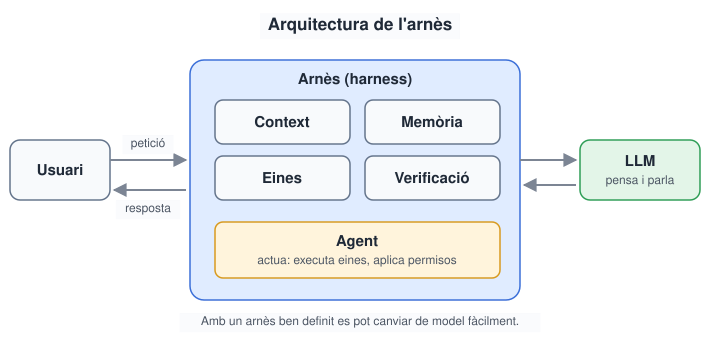
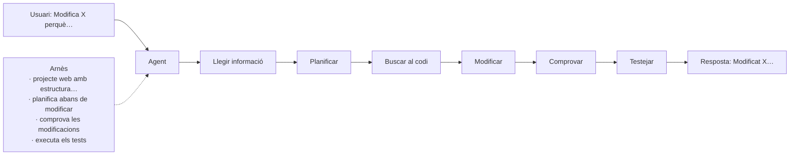
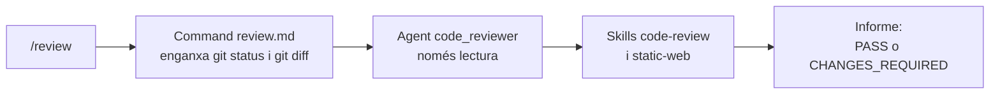
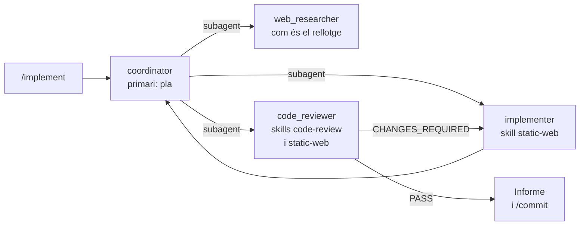
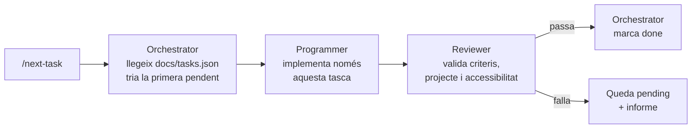

# 02 · Harness Engineering

> **Objectius de la sessió**
> - Entendre les peces d'un arnès: `AGENTS.md`, agents, skills, commands i tools.
> - Veure un equip d'agents en marxa (`/implement`) i compartir l'arnès amb `.agents/`.
> - Construir un arnès SDD mínim que implementa i valida una tasca cada cop (`/next-task`).

| Bloc | Temps |
|---|---|
| Explicació · les peces de l'arnès (§1–9) | 45 min |
| Explicació · l'arnès d'exemple en marxa, guiat (§10) | 15 min |
| Activitat · pràctica: arnès SDD, passos 0–5 (§11) | 60 min |
| Activitat · pràctica: validació, tasques i un `/next-task`, passos 6–8 (§11) | 25 min |
| Activitat · tasca T2 | 30 min |
| **Total a classe** | **2 h 55 min** (1 h d'explicació i 1 h 55 min d'activitat) |
| Fora de classe | Res. Opcional: la resta de tasques de la pràctica i de la T2 |

## 1. Què és l'arnès

Un arnès és el conjunt de peces que envolten un agent perquè pugui treballar de manera **controlada, segura i verificable**. És tota la informació que no volem repetir a cada conversa.



L'arnès s'encarrega de:

- Definir un flux o manera de treballar.
- Capturar les respostes de tipus *tool* del model.
- Decidir si estan ben formatades i si són coherents amb les eines del sistema.
- Decidir si hi ha permisos per executar l'acció.
- Executar l'ordre i afegir el resultat al context.

> **Important:** amb un arnès ben definit podem canviar de model fàcilment.

Exemple: sense arnès, a cada petició cal explicar «planifica abans de modificar, comprova els canvis, executa els tests». Amb arnès, aquestes normes ja hi són:



### La paradoxa de l'arnès

> Com més senzill és l'arnès (menys explicacions, menys eines), millor funciona l'agent.
> Com més curt és el context, millor funciona la IA.

L'objectiu no és escriure molt, sinó escriure **el mínim necessari i ben organitzat**.

---

## 2. Estructura de carpetes

```text
AGENTS.md              instruccions generals del projecte
opencode.json          configuració d'OpenCode (models, MCPs)
.opencode → .agents    enllaç simbòlic (secció 9)
.agents/
├── agents/            agents i subagents especialitzats
├── skills/            habilitats reutilitzables
├── commands/          ordres personalitzades (/nom)
├── plugins/           eines pròpies (TypeScript/JavaScript)
└── mcp/               servidors MCP propis (sessió 04)
```

OpenCode busca les peces a `.opencode/`; altres eines fan servir `.agents/` o `.claude/`, però els conceptes són els mateixos. **Al curs, l'arnès viu a `.agents/`** i `.opencode` és un enllaç simbòlic a aquesta carpeta: OpenCode el troba igual i les altres eines també. A la secció 9 veurem com es crea l'enllaç i què es pot compartir entre eines.

Agents, skills i commands són arxius Markdown amb una **capçalera YAML** (*frontmatter*) que com a mínim inclou una `description`. Les eines pròpies, en canvi, són plugins escrits en TypeScript o JavaScript.

## 3. `AGENTS.md`

Fitxer a l'arrel del projecte amb les normes generals. **Funció principal: evitar que el model improvisi.**

```text
AGENTS.md
├── Objectiu i estructura del projecte
├── Normes de programació i estil
├── Permisos i límits (què està prohibit)
├── Protocol d'edició segura
├── Criteris de verificació
└── Flux de treball i ús d'agents, skills i eines
```

Exemples de normes útils:

| Norma | Exemple |
|---|---|
| Edició segura | Evita canvis grans i revisa cada fitxer modificat |
| Estil | Mantén el mateix estil de noms, carpetes i format |
| Dependències | No afegeixis llibreries externes sense permís |
| Verificació | Executa les proves abans de donar una tasca per acabada |
| Resposta | Explica només els canvis importants i els fitxers tocats |

### `ARCHITECTURE.md` amb Mermaid

Els `.md` accepten diagrames **Mermaid**, ideals per documentar les dependències del projecte:

```text
Genera o actualitza l'arxiu ARCHITECTURE.md. Assegura't que hi ha un diagrama Mermaid amb les relacions entre els objectes del projecte.
```

Afegeix a `AGENTS.md` que cal actualitzar `ARCHITECTURE.md` a cada canvi d'arquitectura.

## 4. Agents (`.agents/agents/`)

Cada fitxer descriu un **rol**. L'agent principal pot delegar feina a subagents especialitzats, com un equip: un programa, un altre revisa, un altre comprova la seguretat.

```text
.agents/agents/
├── coordinator.md        primari: planifica i delega
├── implementer.md        subagent: fa el canvi
├── code_reviewer.md      subagent: revisa sense editar
├── project_explorer.md   subagent: troba on és cada cosa
└── web_researcher.md     subagent: busca a la web
```

Un agent pot definir:

| Element | Exemple |
|---|---|
| Funció concreta | Revisar sempre el codi abans d'acabar |
| Instruccions pròpies | Fer servir l'eina de verificació |
| Permisos | Executar l'eina però no modificar codi |
| Criteris de revisió | L'eina ha de tornar `{ "result": "OK" }` |
| Format de resposta | Informe estructurat en JSON |

Els **subagents** només reben la informació que necessiten. Així no embruten el context principal i gasten menys tokens.

### Per què subagents: cada un, només el context que necessita

Cada subagent comença amb un **context nou i curt**: les seves instruccions, `AGENTS.md` i el que li envia qui el crida. No veu la conversa, ni els arxius que han llegit els altres agents, ni els intents fallits.

| | Agent sol | Amb subagents |
|---|---|---|
| Què té al context | Tota la conversa: peticions, arxius llegits, errors, correccions… | Només la seva tasca, el pla i els arxius que li calen |
| Com treballa | Amb molta informació que no ve al cas, es despista i oblida normes | Concentrat en una sola cosa, amb les seves normes i skills |
| Què torna | Tot queda al context principal | Un resum curt amb format fix (`status: …`) |

És la [paradoxa de l'arnès](#la-paradoxa-de-larnès) aplicada a cada agent: com més curt i més just és el context, millor treballa. A més, el context principal es manté net i dura més abans d'omplir-se.

La contrapartida: com que el subagent no veu la conversa, **qui el crida li ha d'enviar tot el que necessita** (la petició, el pla, els arxius). Per això [`coordinator.md`](.agents/agents/coordinator.md) diu *«Send it the request, the plan and the files involved: it does not see this conversation»*, i per això cada subagent acaba amb un format de resposta fix.

### Capçalera d'un agent

```yaml
---
description: Explore the project read-only and answer codebase questions.
mode: subagent
permissions:
  - action: "*"
    resource: "*"
    effect: deny
  - action: read
    resource: "*"
    effect: allow
  - action: grep
    resource: "*"
    effect: allow
  - action: glob
    resource: "*"
    effect: allow
  - action: shell
    resource: "git status *"
    effect: allow
  - action: shell
    resource: "git diff *"
    effect: allow
---
```

Atribut recomanat: `description` (és el que llegeix el model per decidir quin subagent crida). `mode` pot ser `primary`, `subagent` o `all`; si no l'indiques, és `primary`. Convé posar-lo sempre per deixar clar el rol.

`permissions` és una llista ordenada de regles. Cada regla té tres camps:

| Camp | Què és | Exemples |
|---|---|---|
| `action` | L'eina o acció | `read`, `grep`, `glob`, `edit`, `shell`, `subagent`, `skill`, `webfetch`, `websearch`, o `<servidor>_<eina>` per a un MCP |
| `resource` | Sobre què s'aplica: una ruta, una ordre, el nom d'un agent o d'una skill. Accepta `*` | `"*"`, `"git status *"`, `"code_reviewer"` |
| `effect` | Què passa | `allow`, `ask` (demana permís) o `deny` |

> **Format d'OpenCode 2.** En molts exemples d'internet trobaràs el format d'OpenCode 1: `permission` (un objecte), `bash` en lloc de `shell`, `task` en lloc de `subagent`, i `tools`. OpenCode 2 encara el llegeix, però el considera obsolet, i cada arxiu es llegeix en un sol format: no barregis camps dels dos en una mateixa capçalera.

> **Ordre de les regles:** quan diverses regles coincideixen, **guanya l'última**. Per això la regla general va primer i les excepcions després. Un agent nou ho té **tot permès** per defecte: si vols que només pugui fer unes quantes coses, comença amb la regla que ho denega tot (`action: "*"`, `resource: "*"`, `effect: deny`) i afegeix a sota el que sí que pot fer. Si la posessis al final, no podria fer res.

### Exemples d'agents

**Arnès d'exemple d'aquesta carpeta** · a [`.agents/agents/`](.agents/agents/)

Un equip de cinc agents curts, en anglès com la resta de prompts de l'arnès: un agent **primari** que coordina i quatre **subagents**. Fixa't sobretot en els permisos: cada agent només té les eines que li calen.

| Agent | Funció | Permisos destacats |
|---|---|---|
| [`coordinator`](.agents/agents/coordinator.md) · primari | Planifica la petició, la delega a `implementer`, la fa revisar a `code_reviewer` i en fa l'informe | No pot editar; `subagent` només cap als quatre subagents; `shell` només `git status` i `git diff` |
| [`implementer`](.agents/agents/implementer.md) | Fa un canvi petit i diu quins arxius ha tocat | Pot editar; `shell` demana permís excepte `ls`, `node --check` i `npm test`; només la skill `static-web` |
| [`project_explorer`](.agents/agents/project_explorer.md) | Troba on és cada cosa al projecte i com es relacionen els arxius | `read`, `grep`, `glob`; no pot editar ni executar res |
| [`web_researcher`](.agents/agents/web_researcher.md) | Respon una pregunta externa amb fonts | Només `webfetch` i `websearch`; no veu el projecte |
| [`code_reviewer`](.agents/agents/code_reviewer.md) | Revisa un canvi i informa dels problemes, sense corregir-los | Només lectura (ni `edit` ni `shell`), i només les skills `code-review` i `static-web` |

Tots acaben amb un **format de resposta fix** (`status: …` i una línia per troballa). L'agent que els crida rep un resum curt i previsible, no tot el que han llegit.

**Projecte d'estudi (`projecteTeach`)** · a [`assets/projecteTeach/`](assets/projecteTeach/)

| Agent | Funció |
|---|---|
| `guided-teacher` | A partir d'una lliçó, fa preguntes i ajuda a estudiar |
| `lesson-reviewer` | Revisa que les lliçons siguin assequibles |
| `lesson-selector` | Escull una lliçó a partir d'un prompt |

Cada lliçó té tres arxius: la teoria de la lliçó, `exercises` (activitats pràctiques) i `assessment` (criteris per valorar si s'han assolit els resultats d'aprenentatge). Com la resta d'arnesos del curs, els agents són a `.agents/agents/` i `.opencode` és un enllaç a `.agents`. Si en copiar la carpeta l'enllaç no es conserva (passa a Windows sense el mode de desenvolupador), torna'l a crear com a la secció 9. Per fer-ho servir: copia la carpeta `assets/projecteTeach/` fora del repositori de teoria, obre-hi OpenCode (`cd projecteTeach` i `opencode`), escull `guided-teacher` amb TAB i demana «Anem a estudiar css-flexbox». Amb `"default_agent": "guided-teacher"` a `opencode.json` ja s'inicia amb aquest agent.

**Altres idees d'agents de desenvolupament**

| Agent | Instruccions clau |
|---|---|
| `backend-developer` | Segueix l'estructura existent, respecta els noms, no reescriguis codi no relacionat, executa els tests |
| `test-engineer` | Crea tests útils (casos normals, límit i d'error), prefereix JUnit simple, informa del resultat |
| `api-agent` | Revisa endpoints REST: validació, format de resposta, gestió d'errors |
| `security-agent` | Revisa validació d'entrades, SQL injection, contrasenyes, autorització. No modifica res si no se li demana |
| `release-agent` | Compila, executa tests, revisa el README i llista els riscos pendents |
| `database-agent` | Revisa entitats, repositoris, SQL i validació de dades sense tocar la lògica de negoci |
| `accessibility` | Comprova l'ús amb teclat i lectors de pantalla |
| `architect` | Proposa l'estructura de carpetes abans de començar |

## 5. Skills (`.agents/skills/`)

Les skills donen **experiència en un camp concret** del projecte. L'agent decideix *quan i per què* aplicar una skill; la skill defineix *les normes, passos o criteris*.

Cada skill és una carpeta amb un arxiu `SKILL.md`. Exemples d'aquesta carpeta, a [`.agents/skills/`](.agents/skills/):

```text
.agents/skills/
├── code-review/SKILL.md      checklist per revisar un canvi
├── static-web/SKILL.md       normes de les webs de webs/ (HTML, CSS i JS sense dependències)
└── commit-message/SKILL.md   format dels missatges de commit
```

Una skill pot tenir: objectiu, quan es fa servir, procediment i resultat esperat. Les tres d'exemple segueixen aquest esquema.

```yaml
---
name: static-web
description: Rules for small static websites in the webs/ folder (plain HTML, CSS and JavaScript, no build step). Use it when creating, modifying or reviewing a page in webs/.
---
```

L'identificador de la skill és el **nom de la carpeta** (en minúscules i guions); `name` només és l'etiqueta que es mostra, i convé que sigui igual. L'atribut imprescindible és `description`: sense ella, la skill no s'anuncia al model. La `description` és l'única part que l'agent veu abans de carregar la skill: ha de dir **de què tracta i quan s'ha de fer servir**.

Relació agent ↔ skill: l'agent diu *quan* cal la skill, i els permisos limiten *quines* pot carregar. A [`code_reviewer`](.agents/agents/code_reviewer.md):

```yaml
permissions:
  - action: "*"
    resource: "*"
    effect: deny
  # … read, grep i glob
  - action: skill
    resource: "code-review"
    effect: allow
  - action: skill
    resource: "static-web"
    effect: allow
```

```text
- Load the `code-review` skill and follow its checklist.
- If the change touches HTML, CSS or JavaScript, also load the `static-web` skill and check its rules.
```

`static-web` també és útil per a l'agent `build` quan crea una web nova (per exemple, els [prompts one-shot](assets/one-shot-prompts.md) de la sessió 01): la carrega pel seu compte quan la tasca toca `webs/`.

Altres idees: `localstorage-review`, `responsive-layout`, `form-validation`, `json-schema-design`, `error-handling`.

## 6. Commands (`.agents/commands/`)

Ordres que l'usuari executa amb `/nom` i que encapsulen un procediment repetit. El nom de l'arxiu és el nom de la comanda. Exemples d'aquesta carpeta, a [`.agents/commands/`](.agents/commands/):

| Comanda | Què fa | Agent |
|---|---|---|
| [`/implement <petició>`](.agents/commands/implement.md) | Implementa un canvi petit amb l'equip: planifica, implementa, revisa | `coordinator` (primari) |
| [`/review`](.agents/commands/review.md) | Revisa els canvis sense commit | `code_reviewer` (subtasca) |
| [`/explain <tema>`](.agents/commands/explain.md) | Explica com funciona una part del projecte | `project_explorer` (subtasca) |
| [`/commit`](.agents/commands/commit.md) | Fa el commit seguint la skill `commit-message` | l'agent actual |

```markdown
---
description: Review the current uncommitted changes with the code_reviewer agent.
agent: code_reviewer
subagent: true
---

Review the uncommitted changes in this project. $ARGUMENTS

Changed files:

!`git status --short --untracked-files=all`

Diff:

!`git diff HEAD`
```

Atribut obligatori: `description`. `agent` és opcional: si no s'indica, la comanda s'executa amb l'agent actual; si és un subagent, s'executa en una sessió filla, en segon pla (`subagent: true` ho força, encara que l'agent sigui primari). El cos de l'arxiu és el prompt que s'envia, i pot fer servir:

| Marca | Què fa | Exemple |
|---|---|---|
| `$ARGUMENTS` | El text que escrius després de la comanda | `/explain com es desen les notes` |
| `$1`, `$2`… | Cada argument per separat | `/compara main dev` |
| `` !`ordre` `` | Executa l'ordre i n'enganxa la sortida al prompt | `` !`git diff HEAD` `` |

Amb `` !`git diff HEAD` `` el revisor rep el diff ja fet, i per això pot treballar sense permís de `shell`. `git diff` no mostra els arxius nous que encara no són a git: per això la comanda també enganxa la llista de `git status`, amb `--untracked-files=all`, i el revisor els llegeix amb `read`. Dins d'una comanda desada, `@arxiu` no s'expandeix: és text normal. Si cal el contingut d'un arxiu, demana a l'agent que el llegeixi o enganxa'l amb `` !`cat arxiu` ``.

Cadena completa:



Altres idees: `/review-current-task`, `/check-harness`, `/generate-tasks`, `/verify-app`, `/update-readme`.

## 7. Eines pròpies (`.agents/plugins/`)

Eines pròpies que l'agent pot cridar com qualsevol altra eina. A OpenCode 2 les registra un **plugin**: un arxiu **TypeScript o JavaScript** dins de `.agents/plugins/` (OpenCode el veu a `.opencode/plugins/` i el carrega sol). El plugin defineix cada eina amb un nom, una descripció, l'esquema dels arguments (JSON Schema, com a la sessió 03) i una funció `execute`.

```text
.agents/plugins/
├── validate-json.ts     valida arxius .json
└── code-stats.ts
```

```ts
import { Plugin } from "@opencode/plugin"
import { readFile } from "node:fs/promises"

export default Plugin.define({
  id: "validate-json",
  async setup(ctx) {
    await ctx.tool.transform((editor) => {
      editor.add({
        name: "validate_json",
        description: "Validate that a JSON file parses correctly",
        input: {
          type: "object",
          properties: { path: { type: "string", description: "Path to the JSON file" } },
          required: ["path"],
          additionalProperties: false,
        },
        async execute(input) {
          const { path } = input as { path: string }
          JSON.parse(await readFile(path, "utf8"))
          return { content: `${path} is valid JSON` }
        },
      })
    })
  },
})
```

> A OpenCode 1 les eines pròpies eren arxius a `.opencode/tools/` fets amb el helper `tool()` de `@opencode-ai/plugin`. Aquell format no funciona a OpenCode 2: cal passar-les a un plugin com el de dalt.

Un script qualsevol (`scripts/check.sh`) no es registra com a eina: l'agent el pot executar amb `shell`, però llavors depèn dels permisos de `shell`.

Idees: `validate-tasks-json`, `html-checker`, `css-stats`, `link-checker`, `file-size-checker`.

Per a eines més complexes o que s'han de poder fer servir des d'altres agents, millor un **MCP** (sessió 04).

## 8. Resum de les peces

| Peça | Qui la fa servir | Quan |
|---|---|---|
| `AGENTS.md` | Tots els agents | Sempre (és al context) |
| agent | L'usuari (TAB) o un altre agent | Quan cal un rol concret |
| skill | Un agent | Quan la tasca toca aquell camp |
| command | L'usuari (`/nom`) | Procediments repetits |
| tool / MCP | Un agent | Accions concretes i verificables |

## 9. Compartir l'arnès amb altres eines (`.agents/`)

Si fas servir més d'un agent (OpenCode, Claude Code, Codex…), no vols mantenir dues còpies de les mateixes instruccions. `.agents/` és una carpeta neutra, no lligada a cap eina, on es poden guardar les peces comunes.

### Què llegeix OpenCode sense fer res

| Peça | On la busca OpenCode | Cal enllaç? |
|---|---|---|
| Instruccions | `AGENTS.md` (OpenCode 2 no llegeix `CLAUDE.md`) | No: `AGENTS.md` ja és el format comú |
| Skills | `.opencode/skills/`, `.agents/skills/` i `.claude/skills/` (i les equivalents globals a `~/`) | No |
| Agents | Només `.opencode/agents/` (i `~/.config/opencode/agents/`) | Sí |
| Commands | Només `.opencode/commands/` (i `~/.config/opencode/commands/`) | Sí |
| Plugins (eines pròpies) | Només `.opencode/plugins/` | Sí (i només els entén OpenCode) |
| MCPs, `opencode.json` | `opencode.json` a l'arrel | No: són configuració pròpia d'OpenCode |

Proposta del curs: **tot l'arnès viu a `.agents/`** (agents, commands, skills, plugins) i `.opencode` és només un **enllaç simbòlic** a `.agents`. Així hi ha una sola còpia, OpenCode la veu com a `.opencode/` i les altres eines la troben a `.agents/`.

```text
projecte/
├── AGENTS.md
├── opencode.json
├── .agents/            ← carpeta real
│   ├── agents/
│   ├── commands/
│   ├── skills/
│   └── plugins/
└── .opencode → .agents ← enllaç
```

### Crear l'enllaç

Executa-ho des de l'arrel del projecte. Si un projecte ja té un `.opencode/` real (per exemple, un projecte anterior al curs), primer canvia-li el nom a `.agents`; si no, crea `.agents` buida. A l'exemple de la secció 10, el pas 2 ja crea l'enllaç.

**Linux / macOS**

```bash
mv .opencode .agents          # si ja existeix .opencode/; si no: mkdir .agents
ln -s .agents .opencode
ls -l                         # ha de mostrar: .opencode -> .agents
```

L'ordre és `ln -s DESTÍ NOM_DE_L_ENLLAÇ`: primer la carpeta real, després el nom de l'enllaç. La ruta del destí és relativa a la carpeta on es crea l'enllaç; com que totes dues són a l'arrel, n'hi ha prou amb `.agents`, i l'enllaç continua funcionant si mous o clones el projecte.

**Windows (PowerShell)**

```powershell
Rename-Item .opencode .agents          # si ja existeix .opencode\; si no: New-Item -ItemType Directory .agents
cmd /c mklink /D .opencode .agents
Get-Item .opencode | Select-Object LinkType, Target
```

Fem servir `mklink` (a través de `cmd /c`) perquè desa la ruta relativa tal com l'escrius, igual que `ln -s`. Amb `New-Item -ItemType SymbolicLink`, Windows PowerShell 5.1 resol la ruta relativa respecte a la carpeta actual i la desa com a absoluta.

A Windows, crear enllaços simbòlics necessita el **mode de desenvolupador** activat (*Configuració › Sistema › Per a desenvolupadors*) o obrir PowerShell com a administrador. Si no és possible, l'alternativa és una *junction*, que no necessita permisos: `cmd /c mklink /J .opencode .agents`. Windows la desa amb la ruta absoluta, de manera que es trenca si mous el projecte i no es desa a git.

### Enllaços i git

- Git desa l'enllaç com un enllaç, no com una còpia de la carpeta. A Linux i macOS funciona sense fer res.
- A Windows, Git només recrea els enllaços si està activat: `git config --global core.symlinks true` (i el mode de desenvolupador). Si no, en clonar el repositori apareix un arxiu de text amb la ruta en lloc de la carpeta.
- Les *junctions* no es desen a git: cada persona les ha de crear després de clonar.
- **Fes sempre servir les rutes de `.agents/`**, als prompts i a git. Git no accepta rutes que passen per un enllaç: `git add .opencode/commands/next-task.md` falla amb *beyond a symbolic link*; cal `git add .agents/commands/next-task.md` (o `git add -A`). Per això tots els prompts del curs escriuen `.agents/…`.

### Què no és fiable

- **El format dels agents no és el mateix a totes les eines.** A OpenCode la capçalera fa servir `mode`, `permissions` i `model` amb noms de proveïdor d'OpenCode; Claude Code, per exemple, fa servir `tools` i altres noms de model. Un agent compartit pot funcionar a una eina i a l'altra perdre els permisos sense avisar. Comparteix agents només si fas servir els camps comuns (`description` i el text de les instruccions) i deixa els permisos a cada eina.
- **Els commands** tenen el mateix problema: `agent`, `subagent` o els arguments (`$ARGUMENTS`) no s'interpreten igual a totes les eines.
- **Els enllaços simbòlics no estan documentats a OpenCode.** Avui funcionen perquè el sistema operatiu els resol, però no hi ha cap garantia. Si un agent o una skill no apareix, comprova primer l'enllaç (`ls -l` o `Get-Item`).
- **Cada skill es troba dues vegades.** OpenCode busca skills a `.opencode/skills/` i també a `.agents/skills/`, i amb l'enllaç són la mateixa carpeta. Són el mateix arxiu, de manera que el contingut no pot ser diferent, però no està documentat si OpenCode les compta un cop o dues. Si veus una skill repetida o un avís de nom duplicat, és per això.
- **Arxius propis d'OpenCode dins `.agents/`.** Si fas servir plugins (secció 7), OpenCode hi pot crear `package.json` i `node_modules/`. Afegeix `.agents/node_modules/` al `.gitignore`. L'MCP propi de la sessió 04 també viu aquí (`.agents/mcp/task-contract/`).
- **Les altres eines veuen agents amb format d'OpenCode.** Vegeu el primer punt: és el preu de tenir una sola carpeta.
- **`CLAUDE.md` no es llegeix.** OpenCode 1 el feia servir si no hi havia `AGENTS.md`; OpenCode 2 només llegeix `AGENTS.md`. Posa-hi les instruccions comunes i no esperis que es combinin amb les d'un altre arxiu.

---

## 10. L'arnès d'exemple en marxa

Fins ara hem vist les peces per separat. Ara les fem treballar juntes en un projecte real: demanem una web i observem com el `coordinator` delega, com els subagents carreguen skills i com el revisor torna el canvi si no és correcte.

Aquest repositori és el mateix que farem servir a la pràctica (secció 11).

> **Quin repositori?** En aquesta sessió en fas servir dos, i no es barregen mai:
>
> | Repositori | Què hi va |
> |---|---|
> | `ia-02-harness-sdd` (nou) | L'exemple (secció 10) i la pràctica de la calculadora de notes (secció 11) |
> | `lliuraments` (el de la T1) | La tasca T2 |
>
> Obre sempre OpenCode dins de la carpeta del repositori on vols treballar.

### Pas 1 · Repositori nou i buit

Crea a GitHub un repositori nou i buit `ia-02-harness-sdd`, clona'l i obre OpenCode **dins de la carpeta del repositori** (`cd ia-02-harness-sdd` i `opencode`), com a la sessió 01 (apartat 17). Tot el que fem a partir d'ara (l'exemple i la pràctica) s'executa en aquesta carpeta. Demana a l'agent el `.gitignore` amb el mateix prompt de la sessió 01.

### Pas 2 · Copia l'arnès d'exemple

Copia la carpeta [`.agents/`](.agents/) del material del curs a l'arrel del repositori i crea l'enllaç (secció 9):

```bash
cp -R <material-del-curs>/.agents .
ln -s .agents .opencode
```

A PowerShell: `Copy-Item -Recurse <material-del-curs>\.agents .` i `cmd /c mklink /D .opencode .agents`.

Surt d'OpenCode i torna-hi a entrar perquè carregui l'arnès. Amb TAB hauria d'aparèixer l'agent `coordinator`; escrivint `/` hi ha d'haver `/implement`, `/review`, `/explain` i `/commit`.

### Pas 3 · Demana una implementació

Executa aquest prompt a OpenCode dins del projecte (`ia-02-harness-sdd`). El tens també a [prompts-02-harness.md](assets/prompts-02-harness.md):
```text
/implement Crea un fitxer nou anomenat clock.html a la carpeta webs que mostri un rellotge analògic circular, dibuixat en un canvas i actualitzat cada segon. Ha de semblar un rellotge de les estacions de tren suïsses: busca a internet com són. Escriu el codi, els noms i els comentaris en anglès.
```

És el mateix encàrrec del rellotge de la sessió 01 (allà el prompt era en anglès, a `assets/one-shot-prompts.md`). Llavors el feia `build` sol; ara el fa un equip.

### Pas 4 · Què has d'observar



| Què | On es veu a OpenCode |
|---|---|
| **Agent primari** | La comanda s'executa amb el `coordinator`: el seu nom surt al costat de les respostes |
| **Pla** | El pla curt que escriu el `coordinator` abans de delegar |
| **Subagents** | Cada crida `subagent` obre una sessió filla amb el nom del subagent. Pots entrar-hi per veure què ha fet i tornar a la sessió principal |
| **Skills** | Dins de la sessió filla, una crida `skill` amb `static-web` o `code-review` |
| **Permisos** | Si l'`implementer` vol executar una ordre que no és a la llista, OpenCode te'n demana permís. El `coordinator` no pot editar: si ho intenta, no pot |
| **Bucle de revisió** | Si el revisor respon `CHANGES_REQUIRED`, el `coordinator` torna les línies de problema a l'`implementer` (com a màxim dues vegades) |
| **Context net** | A la sessió principal només arriben les respostes curtes amb format fix (`status: …`), no tot el que han llegit els subagents. Cada subagent ha treballat amb un context curt i just (secció 4) |

Obre `webs/clock.html` al navegador. Compara-ho amb el resultat de la sessió 01: ha calgut corregir menys? Quants tokens ha gastat (ho mostra la informació de la sessió)?

### Pas 5 · Revisa i fes el commit

1. `/review`: torna a revisar els canvis, ara amb el diff enganxat per la comanda.
2. `/commit`: proposa un missatge seguint la skill `commit-message` i el mostra abans de fer el commit.
3. Demana el push a `main`.

## 11. Pràctica: arnès SDD mínim

**SDD** (*Spec Driven Development*): les tasques escrites defineixen què s'ha de construir i com es valida. En aquesta sessió construïm l'arnès que implementa **una** tasca cada cop amb `/next-task`. A la sessió 07 farem que treballi sol, amb les tasques en fitxers Markdown (`tasks/T*.md`).



### Què desenvoluparem

**L'app:** una calculadora de notes web (`webs/grades.html` i `webs/grades.js`). L'usuari afegeix assignatures amb una nota de 0 a 10, veu la llista, la mitjana amb un decimal i si aprova (Aprovat o Suspès), i les notes es desen a `localStorage`.

**Com s'organitza:** l'app no la programes tu. Tu prepares l'arnès i els agents fan l'app, tasca a tasca, tot al repositori `ia-02-harness-sdd`.

| Quan | Passos | Què fas |
|---|---|---|
| A classe, primer bloc (60 min) | 0–5 | Muntes l'arnès SDD: estructura, agents, `/next-task`, skills i `AGENTS.md` |
| A classe, segon bloc (25 min) | 6–8 | Hi afegeixes la validació amb `npm test`, crees les 5 tasques amb un prompt i executes `/next-task` un cop (T01). La resta de tasques són opcionals |

> 📋 **Tots els prompts, a punt per copiar:** [prompts-02-harness.md](assets/prompts-02-harness.md). Hi ha els de l'exemple, els passos 1–8 i la T2 ja adaptada.

> **Els prompts s'executen a OpenCode, dins el projecte.** Els blocs `text` dels passos 1–7 són prompts: copia'ls i enganxa'ls a OpenCode, obert a la carpeta del repositori `ia-02-harness-sdd`. No són ordres del terminal ni s'enganxen a un xat web: és l'agent d'OpenCode qui crea i modifica els arxius del projecte on l'has obert.
>
> ```bash
> cd ia-02-harness-sdd
> opencode
> ```
>
> Només les ordres dels blocs `bash` i `powershell` (com les del pas 0) s'executen al terminal.

### Pas 0 · El repositori de l'exemple (`ia-02-harness-sdd`), sense l'arnès d'exemple

Continua al repositori `ia-02-harness-sdd` de la secció 10. L'arnès SDD el construeixes tu des de zero, així que buida la carpeta `.agents/` (l'arnès d'exemple el tens al material del curs i a l'historial de git). L'enllaç `.opencode` es queda i continua apuntant a `.agents/`, de manera que no cal tornar-lo a crear. El rellotge de `webs/` també es queda:

A Linux/MacOS:
```bash
rm -r .agents/*
```

A Windows Powershell:
```powershell
Remove-Item -Recurse .agents\*
```

Surt d'OpenCode i torna-hi a entrar: si no, continua tenint carregats els agents i les comandes de l'arnès d'exemple.

### Pas 1 · Estructura

Executa aquest prompt a OpenCode dins del projecte:
```text
Aquest repositori encara no té cap arnès d'OpenCode. Crea un arnès bàsic d'OpenCode amb aquestes carpetes buides, cadascuna amb un fitxer .gitkeep perquè git les conservi:
./.agents/agents
./.agents/commands
./.agents/skills
./.agents/plugins
./docs
./webs
```

L'enllaç `.opencode` ja hi és des del pas 0: comprova amb `ls -l` o `Get-Item .opencode` que apunta a `.agents`. Si no hi és, crea'l tu mateix (secció 9): `ln -s .agents .opencode` a Linux/macOS o `cmd /c mklink /D .opencode .agents` a PowerShell de Windows. Sense l'enllaç, OpenCode no veu els agents ni les comandes.

### Pas 2 · Agents

Executa aquest prompt a OpenCode dins del projecte:
```text
Crea tres fitxers d'agent per a aquest projecte de Spec Driven Development: .agents/agents/orchestrator.md, .agents/agents/programmer.md i .agents/agents/reviewer.md.
L'orchestrator ha de llegir docs/tasks.json, trobar la primera tasca pendent, demanar al programmer que la implementi, demanar al reviewer que la verifiqui, i només marcar-la com a feta quan tots els criteris d'acceptació es compleixin.
El programmer ha d'implementar només la tasca actual, fer canvis petits, no fer servir dependències i informar dels fitxers que ha canviat.
El reviewer ha de revisar els fitxers canviats, verificar els criteris d'acceptació, comprovar que el projecte continua funcionant, comprovar l'accessibilitat bàsica i informar de si la tasca es pot marcar com a feta.
Cada fitxer ha de tenir una capçalera d'OpenCode 2 amb description, mode i permissions: l'orchestrator té mode primary; el programmer i el reviewer, mode subagent. permissions és una llista de regles amb action, resource i effect (allow, ask o deny); les accions són read, grep, glob, edit, shell, subagent i skill. No facis servir el format antic (permission, bash, task, tools). Guanya l'última regla que coincideix: posa primer la regla que ho denega tot (action "*", resource "*", effect deny) i després el que cada agent sí que pot fer. Si cal, busca a la documentació d'OpenCode 2.
Escriu en anglès el contingut dels fitxers que creïs. Els noms de fitxers, carpetes, funcions i variables, i les claus JSON, també en anglès.
Encara no implementis l'app web. Crea només el flux d'agents.
```

Comprova les capçaleres: han de fer servir `permissions` (no `permission`), i el `reviewer` no ha de tenir cap regla que li permeti `edit`.

### Pas 3 · Comanda `/next-task`

Executa aquest prompt a OpenCode dins del projecte:
```text
Crea només aquest fitxer: .agents/commands/next-task.md, amb agent: orchestrator a la capçalera.
Quan s'executa /next-task, l'orchestrator coordina el flux, delega la implementació al programmer i la verificació al reviewer, i és l'únic rol que pot actualitzar docs/tasks.json.
Flux:
- Llegeix docs/tasks.json i troba la primera tasca amb "status": "pending". Si no n'hi ha cap, informa'n i atura't.
- Passa al programmer només el títol i els criteris d'acceptació d'aquesta tasca.
- No et saltis tasques i no implementis més d'una tasca. Fes canvis petits.
- Passa la tasca i els fitxers canviats al reviewer, que verifica cada criteri d'acceptació.
- Si es compleixen tots els criteris, canvia només l'estat d'aquesta tasca a "done". Si no, deixa-la "pending" i informa del que falta.
Escriu en anglès el contingut dels fitxers que creïs. Els noms de fitxers, carpetes, funcions i variables, i les claus JSON, també en anglès.
Ara no implementis cap tasca del projecte.
```

Valida que la capçalera és correcta:

```yaml
---
description: Find the first pending task in docs/tasks.json, implement it, verify every acceptance criterion, and mark it done or keep it pending.
agent: orchestrator
---
```

### Pas 4 · Skills

Executa aquest prompt a OpenCode dins del projecte:
```text
Crea una skill nova d'OpenCode anomenada project-design a .agents/skills/project-design/SKILL.md.
Serveix per millorar el disseny visual d'interfícies i pàgines. L'agent ha de crear una interfície neta, minimalista i fàcil d'usar:
disseny senzill, espaiat suficient, mides de lletra llegibles, botons fàcils de veure i de clicar, colors coherents.
Escriu en anglès el contingut dels fitxers que creïs. Els noms de fitxers, carpetes, funcions i variables, i les claus JSON, també en anglès.
Crea només el fitxer de la skill. No modifiquis el codi de l'app.
```

Executa aquest prompt a OpenCode dins del projecte:
```text
Crea una skill nova d'OpenCode anomenada code-review a .agents/skills/code-review/SKILL.md.
Serveix per revisar canvis de codi en una app web estàtica senzilla a webs/, feta amb HTML, CSS i JavaScript. Ha de comprovar:
els criteris d'acceptació de la tasca actual, que les funcionalitats existents no s'han trencat, que l'HTML, el CSS i el JS són senzills i llegibles, i que localStorage es fa servir de manera segura. Ha d'evitar refactoritzacions grans i preferir correccions petites i concretes.
Escriu en anglès el contingut dels fitxers que creïs. Els noms de fitxers, carpetes, funcions i variables, i les claus JSON, també en anglès.
Crea només el fitxer de la skill. No modifiquis el codi de l'app.
```

Compara el resultat amb la skill d'exemple del material del curs [`.agents/skills/code-review/SKILL.md`](.agents/skills/code-review/SKILL.md): té objectiu, quan es fa servir, procediment i resultat?

Després, executa aquest prompt a OpenCode dins del projecte:
```text
Llegeix la carpeta de skills i explica als agents com fer-les servir. Assegura't que cada agent sap quina skill ha de fer servir. Escriu en anglès el que afegeixis als fitxers dels agents. No creïs skills noves.
```

### Pas 5 · `AGENTS.md`

Executa aquest prompt a OpenCode dins del projecte:
```text
Crea AGENTS.md documentant l'arnès d'OpenCode d'aquest projecte.
Deixa clar que el flux de tasques només s'executa quan faig servir /next-task o demano explícitament continuar el desenvolupament de tasques. Amb els prompts normals (salutacions, preguntes, depuració) respon amb normalitat i no toquis docs/tasks.json.
Inclou-hi:
- docs/tasks.json és la font de veritat de les tasques.
- /next-task tria la primera tasca pendent, implementa només aquesta tasca, verifica els criteris d'acceptació i la marca com a feta només si tots es compleixen.
- l'orchestrator coordina, el programmer implementa i el reviewer verifica.
- Skills disponibles: project-design, code-review.
Escriu AGENTS.md en anglès.
Ara no implementis l'aplicació.
```

### Pas 6 · Validació real

> Els passos 6–8 són el segon bloc de la pràctica a classe (25 min). La T2 repeteix el mateix flux al projecte «Lliuraments».

> **On s'executa OpenCode:** sempre a la carpeta del repositori `ia-02-harness-sdd`. L'agent crea i modifica els arxius de la carpeta on l'has obert, així que abans de cada prompt comprova que hi ets:
>
> ```bash
> cd ia-02-harness-sdd
> opencode
> ```

Sense proves, el reviewer només pot *revisar* el codi: no el pot *validar*. Abans de crear les tasques, preparem l'arnès perquè cada tasca es pugui comprovar amb tests.

> **Per què `npm test`?** No cal instal·lar res: el *test runner* `node:test` ja ve amb Node. El `package.json` no té dependències, només defineix `"test": "node --test"`. Així `npm test` és sempre la mateixa ordre, la que executa el reviewer i la que farem servir als projectes següents.

Executa aquest prompt a OpenCode dins del projecte:
```text
Actualitza l'arnès perquè cada tasca es pugui validar, no només revisar:
- El programmer manté la lògica de l'app com a funcions pures a webs/grades.js (un mòdul ES), separada del codi del DOM, i afegeix tests a tests/grades.test.mjs amb node:test i node:assert. La lògica que fa servir localStorage el rep com a paràmetre, perquè els tests puguin passar-ne un de fals.
- Afegeix un package.json mínim sense dependències, amb "type": "module" i l'script "test": "node --test".
- El reviewer pot executar npm test (regla amb action shell, resource "npm test *" i effect allow), n'ha d'incloure la sortida a l'informe, i una tasca només és "done" si els tests passen.
- Afegeix a AGENTS.md una secció "Validation" amb aquestes regles.
Escriu en anglès el contingut dels fitxers que creïs. Els noms de fitxers, carpetes, funcions i variables, i les claus JSON, també en anglès.
Ara no implementis cap funcionalitat de l'app.
```

Comprova que el `reviewer` continua sense poder editar i que ara pot executar `npm test`.

### Pas 7 · Les tasques, amb un prompt

L'app de la pràctica és una **calculadora de notes** (`webs/grades.html`): l'alumne afegeix assignatures amb una nota de 0 a 10 i veu la llista, la mitjana i si aprova. Es pot dividir en cinc tasques petites, cadascuna amb una funció que es pot provar:

| Tasca | Què fa | Funció amb test |
|---|---|---|
| T01 | Formulari (assignatura, nota, botó *Afegeix*) i llista de notes | `addGrade(list, subject, grade)` |
| T02 | Només accepta notes de 0 a 10 i mostra un error si no | `isValidGrade(value)` |
| T03 | Mostra la mitjana amb un decimal | `average(list)` |
| T04 | Mostra *Aprovat* si la mitjana és 5 o més, i *Suspès* si no | `result(avg)` |
| T05 | Desa les notes a `localStorage` i les recupera en recarregar | `saveGrades(storage, list)`, `loadGrades(storage)` |

`docs/tasks.json` encara no existeix: el crea l'agent amb aquest prompt.

Executa aquest prompt a OpenCode dins del projecte:
```text
Crea docs/tasks.json per a aquest projecte de Spec Driven Development: un array JSON on cada tasca té id, title, status i acceptance (una llista de comprovacions que es poden verificar).
L'app és una calculadora de notes: webs/grades.html i webs/grades.js, HTML, CSS i JavaScript sense backend ni dependències. L'usuari afegeix assignatures amb una nota de 0 a 10 i veu la llista i la mitjana.
Crea exactament aquestes cinc tasques, en aquest ordre, totes amb status "pending":
T01 Pàgina amb un formulari (assignatura, nota, botó Afegeix) i la llista de notes. Funció addGrade(list, subject, grade).
T02 Rebutja les notes que no siguin números de 0 a 10 i mostra un missatge d'error. Funció isValidGrade(value).
T03 Mostra la mitjana amb un decimal. Funció average(list).
T04 Mostra "Aprovat" si la mitjana és 5 o més, i "Suspès" si no. Funció result(avg).
T05 Desa les notes a localStorage i les recupera en recarregar. Funcions saveGrades(storage, list) i loadGrades(storage).
Cada tasca ha d'incloure el criteri "npm test passes and includes a test for <its function>".
Escriu els títols i els criteris en anglès, excepte els textos "Aprovat" i "Suspès", que són els que veu l'usuari.
Ara no implementis l'app.
```

Obre `docs/tasks.json` i comprova que hi ha les cinc tasques `pending`, cadascuna amb criteris que es poden comprovar.

### Pas 8 · Executar

1. Surt d'OpenCode i torna-hi a entrar perquè carregui l'arnès actualitzat.
2. Executa `/next-task`: l'orchestrator ha de triar la T01 i delegar-la al programmer i al reviewer.
3. Comprova `docs/tasks.json`: la T01 ha passat a `done`? L'informe del reviewer inclou la sortida de `npm test`?
4. Opcional: repeteix `/next-task` fins que les cinc tasques siguin `done`. A la sessió 07 automatitzarem aquest bucle. Per veure l'app, serveix el projecte per HTTP: en un altre terminal, des de `ia-02-harness-sdd`, executa `npx serve .` i obre `http://localhost:3000/webs/grades.html`. Com que `grades.js` és un mòdul ES, obrir l'HTML amb doble clic (`file://`) no funciona.
5. Si una tasca queda `pending`, llegeix l'informe del reviewer i decideix si cal corregir la tasca o l'arnès.
6. Demana a l'agent el commit i el push a `main`. Lliura l'enllaç al repositori `ia-02-harness-sdd`.

## Tasca de la sessió · Projecte «Lliuraments» (T2)

**Objectiu:** arnès SDD al projecte i la primera funcionalitat implementada i validada.

> 📋 Els prompts de la T2, en ordre i ja adaptats, són a [prompts-02-harness.md](assets/prompts-02-harness.md).

**Repositori:** `lliuraments`, el mateix de la T1. Obre-hi OpenCode (`cd lliuraments` i `opencode`), no al de la pràctica: tot el que demana la tasca es crea allà.

1. Crea la carpeta de l'arnès i l'enllaç (secció 9): `mkdir -p .agents && ln -s .agents .opencode`. A PowerShell: `New-Item -ItemType Directory -Force .agents; cmd /c mklink /D .opencode .agents`.
2. Crea-hi l'arnès de la pràctica (orchestrator, programmer, reviewer, `/next-task`, skills `code-review` i `project-design`, `AGENTS.md`) amb els prompts dels passos 1–6. Els passos 1–5 es fan servir sense canvis; el pas 6, ja adaptat a «Lliuraments» (`webs/lliuraments.js` i `tests/lliuraments.test.mjs`), és a [prompts-02-harness.md](assets/prompts-02-harness.md), apartat T2.6.
3. Crea les tasques amb un prompt a partir de `PLAN.md`, el pla que vas escriure a la T1.

   Executa aquest prompt a OpenCode dins del projecte (`lliuraments`):
   ```text
   Llegeix PLAN.md i crea docs/tasks.json amb el mateix format que la pràctica (id, title, status, acceptance). Crea només aquestes tres tasques, totes amb status "pending":
   T01 Mostra la llista de pràctiques ordenada per data límit. Funció sortByDueDate(practices).
   T02 Per a cada pràctica, una taula d'alumnes amb l'estat: delivered, late o pending. Funció isLate(date, dueDate).
   T03 Un resum per alumne: quantes pràctiques té lliurades, tard i pendents. Funció summary(student, deliveries).
   La lògica va a webs/lliuraments.js com a funcions pures, amb tests a tests/lliuraments.test.mjs. Cada tasca ha d'incloure el criteri "npm test passes and includes a test for <its function>".
   Escriu els títols i els criteris en anglès.
   Ara no implementis l'app.
   ```

4. Surt d'OpenCode, torna-hi a entrar i executa `/next-task` **una vegada**: implementa i valida la T01. Si falla, llegeix l'informe del reviewer i decideix si cal corregir la tasca o l'arnès. Per veure la web, executa `npx serve .` en un altre terminal, des de `lliuraments`, i obre `http://localhost:3000/webs/…`: la pàgina llegeix `data/lliuraments.json`, i això no funciona obrint l'HTML amb doble clic (`file://`).
5. Demana a l'agent el commit, l'etiqueta `t2` i el push (sessió 01, apartat 17).

**Lliurable:** enllaç a l'etiqueta `t2` de `lliuraments`, amb l'arnès a `.agents/`, `AGENTS.md`, `docs/tasks.json` amb la T01 `done` i `npm test` en verd.

**Ampliació (opcional):** executa `/next-task` dues vegades més per fer la T02 i la T03.

## Resum

- L'arnès és el «sistema operatiu» de l'agent: context, eines, memòria i verificació.
- `AGENTS.md` fixa les normes; agents, skills i commands les especialitzen.
- Una tasca només està feta quan s'ha **validat**.
