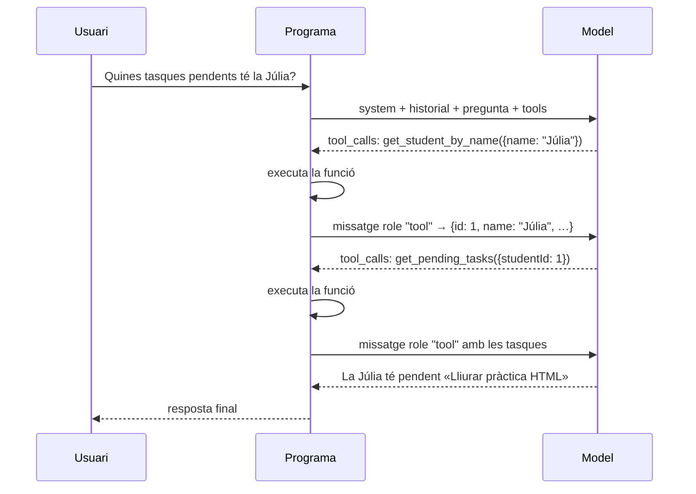

# 03 · Function calling i models locals

> **Objectius de la sessió**
> - Entendre com un model demana executar funcions del nostre programa.
> - Programar, pas a pas, una eina de línia de comandes amb *function calling*.
> - Fer servir un model petit en local amb Ollama.

| Bloc | Temps |
|---|---|
| Explicació · part A: function calling (§1–8) | 30 min |
| Explicació · part B: models locals (§9) | 10 min |
| Activitat · pràctica 1: eina CMD (`app/`), passos 1–8 | 60 min |
| Activitat · l'eina CMD amb Ollama (part B) | 15 min |
| Activitat · tasca T3 | 25 min |
| **Total a classe** | **2 h 20 min** (40 min d'explicació i 1 h 40 min d'activitat) |
| Fora de classe | Res. Opcional: l'ampliació de la T3 |

Abans de classe: instal·la Ollama i descarrega el model (`ollama pull granite4.1:3b`, uns 2 GB).

La mida dels models, la quantització i quin model cap a cada màquina es veuen a la [sessió 08](08%20-%20Servidors%20d'inferència.md).

---

## Part A · Function calling

### 1. Tool calling i function calling

El model pot demanar a l'aplicació que cridi una eina: llegir o escriure fitxers, executar comandes, consultar una API o una base de dades, validar una resposta…

| | El model demana… | Exemple |
|---|---|---|
| **Tool calling** | Una eina externa genèrica | `bash tree`, `read_file` |
| **Function calling** | Una funció concreta del nostre programa | `get_pending_tasks({ studentId: 1 })` |

A l'API és el mateix mecanisme (el camp `tools` de la petició i els `tool_calls` de la resposta): la diferència és només d'ús, segons si l'eina és genèrica o una funció del nostre programa.

> **Important:** el model no crida funcions directament. Només escriu una petició estructurada. **El nostre programa decideix si l'executa.**

### 2. Eines conversacionals

*Function calling* permet substituir menús per converses:

| Eina CMD clàssica | Eina CMD conversacional |
|---|---|
| `1 - Alumnes`<br>`2 - Tasques`<br>`3 - Incidències`<br>`0 - Sortir`<br>`Escull una opció: 1` | `Descriu la següent acció:`<br>`> Quines tasques pendents té la Júlia?` |

Altres usos: automatismes (impressió, domòtica, sensors), càlculs especialitzats (simulacions, finances), serveis web (correu, panells), documentació (revisar o generar documents).

### 3. El bucle de function calling



1. El programa envia la pregunta al model (i l'afegeix a l'historial, que és l'array `messages` de la petició).
2. El model no sap quin `studentId` té la Júlia: demana `get_student_by_name({ name: "Júlia" })`.
3. El programa executa la funció i afegeix el resultat a l'historial com a missatge `role: "tool"`.
4. El programa torna a cridar el model, que ara demana `get_pending_tasks({ studentId: 1 })`.
5. El programa l'executa i retorna el resultat: `{ "studentId": 1, "tasks": [{ "title": "Lliurar pràctica HTML", "status": "pending" }, …] }`
6. El model, que ara veu dades reals, dona la resposta final.

Per això el programa ha de fer un **bucle**: mentre el model demani eines, les executa i el torna a cridar. Cal posar-hi un màxim de voltes perquè un model que s'encalla no el faci girar sense fi.

### 4. Crida a un model OpenAI-compatible

Gairebé tots els servidors (OpenAI, vLLM, Ollama, llama.cpp, el proxy del curs) accepten el format **OpenAI chat completions**.

```js
const response = await fetch(OPENAI_BASE_URL, {
  method: "POST",
  headers: {
    "Content-Type": "application/json",
    ...(OPENAI_API_KEY && { Authorization: `Bearer ${OPENAI_API_KEY}` })   // només si hi ha clau
  },
  body: JSON.stringify({
    model: OPENAI_MODEL,
    messages,
    tools: TOOL_DEFINITIONS,
    tool_choice: "auto",
    temperature: Number(TEMPERATURE),   // de settings.env
    max_tokens: Number(MAX_TOKENS),
    // stream: true   → rep la resposta a trossos mentre es genera
  })
});
```

| Camp | Significat |
|---|---|
| `model` | Nom del model al servidor |
| `messages` | Historial (system + conversa) |
| `tools` | Funcions disponibles |
| `tool_choice` | `"auto"`: el model decideix si crida una eina o respon text |
| `temperature` | 0 = respostes estables i estructurades; 1 = més creatives |
| `max_tokens` | Màxim de tokens de la resposta |
| `stream` | Rebre la resposta per parts (no ho farem servir) |

#### Què hi ha dins de `messages` i `tools`

Cada volta del bucle és un viatge d'anada i tornada:

| | Direcció | Què conté |
|---|---|---|
| **Petició** | programa → model | El `body`: `model`, `messages`, `tools`, `tool_choice`… |
| **Resposta** | model → programa | Un sol missatge `assistant`: text **o** `tool_calls` |

La resposta del servidor arriba dins de `choices[0].message`. A la primera crida de l'exemple de la Júlia (§3), el model no respon amb text: demana una funció.

```js
// RESPOSTA de la 1a crida (model → programa)
const data = await response.json();
data.choices[0].message;
// {
//   role: "assistant", content: null,
//   tool_calls: [{ id: "call_1", type: "function",
//     function: { name: "get_student_by_name", arguments: "{\"name\":\"Júlia\"}" } }]
// }
```

`messages` és l'historial, i viatja **sencer a cada petició**. Hi ha missatges escrits pel programa i missatges que són respostes anteriors del model, copiades tal qual. Així és el `messages` de la **segona petició**:

```js
// PETICIÓ de la 2a crida (programa → model): camp messages
const messages = [
  { role: "system",                                      // escrit pel programa
    content: "You are an assistant for a teacher… Never invent student data." },
  { role: "user",                                        // escrit pel programa (la pregunta)
    content: "Quines tasques pendents té la Júlia?" },
  { role: "assistant", content: null,                    // RESPOSTA del model a la 1a crida, copiada
    tool_calls: [{ id: "call_1", type: "function",
      function: { name: "get_student_by_name",
                  arguments: "{\"name\":\"Júlia\"}" } }] },
  { role: "tool", tool_call_id: "call_1",                // escrit pel programa: resultat de la funció
    content: "{\"id\":1,\"name\":\"Júlia\",\"group\":\"1r DAW\",…}" }
];
```

El model no recorda res entre crides. Per això el programa li torna a enviar la seva pròpia resposta anterior (`assistant`) al costat del resultat (`tool`).

`TOOL_DEFINITIONS` és sempre el mateix a cada crida. Té una entrada per funció, amb el format del §5. El model només veu aquestes descripcions, mai el codi de les funcions:

```js
const TOOL_DEFINITIONS = [
  { type: "function",
    function: {
      name: "get_student_by_name",
      description: "Finds a student by name. Returns the student or an error.",
      parameters: { type: "object", additionalProperties: false,
        properties: { name: { type: "string", description: "Student name" } },
        required: ["name"] } } },
  { type: "function",
    function: {
      name: "get_pending_tasks",
      description: "Returns the pending tasks of a student.",
      parameters: { type: "object", additionalProperties: false,
        properties: { studentId: { type: "integer", description: "Student identifier" } },
        required: ["studentId"] } } }
  // … una entrada per a cada funció: get_incidents, add_incident, create_family_message
];
```

Amb aquestes dues variables, la **petició** que viatja al servidor és un sol JSON: `{ "model": "...", "messages": [ ...4 missatges... ], "tools": [ ...5 funcions... ], "tool_choice": "auto", ... }`. La **resposta** a aquesta segona petició torna a ser un missatge `assistant`. El model ja sap que la Júlia té l'`id` 1, així que demana `get_pending_tasks({ studentId: 1 })`. El programa l'executa i fa una tercera petició, i aquesta vegada la resposta és el text final.

### 5. Com es descriu una funció al model

Per cada funció: nom, descripció, paràmetres i quins són obligatoris.

```js
{
  type: "function",
  function: {
    name: "get_pending_tasks",
    description: "Returns the pending tasks of a student.",
    parameters: {
      type: "object",
      additionalProperties: false,
      properties: {
        studentId: { type: "integer", description: "Student identifier" }
      },
      required: ["studentId"]
    }
  }
}
```

La `description` és el que el model llegeix per decidir quan fer servir la funció: ha de ser clara.

### 6. Missatge `system`

Sempre el primer missatge de l'historial. Explica què és l'aplicació, el paper del model, quines funcions pot demanar, què no pot fer, en quin idioma respondre i que **no pot inventar dades**.

```js
const SYSTEM_MESSAGE = {
  role: "system",
  content: `You are an assistant for a teacher using a command-line student management demo.
The user may write in Catalan, Spanish, or English. Always answer in the same language as the user.
You cannot access school data directly. You can only request the available functions.
Use function calling when you need student information, pending tasks, incidents, or family message drafts.
Never invent student data. Never say that an email has been sent. Only prepare draft messages.`
};
```

### 7. Rols de l'historial (`messages`)

Cada missatge de l'array `messages` porta un rol:

| Rol | Contingut |
|---|---|
| `system` | Instruccions generals i informació del projecte |
| `user` | Missatges de l'usuari |
| `assistant` | Respostes del model: text o peticions d'eines (`tool_calls`) |
| `tool` | Resultat real d'executar una eina |

Una resposta pot contenir **diverses** crides, cadascuna amb el seu `id`. Per exemple, amb la pregunta «Quines tasques pendents tenen la Júlia i el Marc?», el model necessita els dos ids i els demana a la mateixa resposta:

```js
// RESPOSTA del model (choices[0].message)
{
  role: "assistant",
  content: null,
  tool_calls: [
    { id: "call_1", type: "function",
      function: { name: "get_student_by_name", arguments: "{\"name\":\"Júlia\"}" } },
    { id: "call_2", type: "function",
      function: { name: "get_student_by_name", arguments: "{\"name\":\"Marc\"}" } }
  ]
}
```

El programa executa les dues crides i afegeix a `messages` un missatge `tool` per a cadascuna, amb el **mateix id** de la crida a què respon:

```js
// escrit pel programa, després del missatge assistant anterior
{ role: "tool", tool_call_id: "call_1", content: "{\"id\":1,\"name\":\"Júlia\",…}" },
{ role: "tool", tool_call_id: "call_2", content: "{\"id\":2,\"name\":\"Marc\",…}" }
```

A la volta següent, el model ja té els dos ids i demana dues crides a `get_pending_tasks`. El `tool_call_id` és el que li permet saber quin resultat correspon a quina crida.

Fixa't que `arguments` és un **string JSON**: cal fer `JSON.parse`.

### 8. Seguretat: valida i limita

Les crides poden arribar mal formades o amb valors inesperats, sobretot amb models petits. Cada funció valida els seus arguments i, si alguna cosa no quadra, retorna un objecte d'error en lloc de llançar una excepció:

```js
function get_pending_tasks({ studentId }) {
  if (!Number.isInteger(studentId)) return { error: "studentId must be an integer" };
  const student = data.students.find(s => s.id === studentId);
  if (!student) return { error: "student not found" };
  return { studentId, tasks: data.tasks.filter(t => t.studentId === studentId && t.status === "pending") };
}
```

L'error torna al model com a missatge `tool`: pot corregir la crida o explicar-ho a l'usuari, i el programa no s'atura. A més, limita què pot demanar el model:

- No totes les funcions haurien d'estar disponibles.
- No s'executen comandes del sistema sense control.
- No s'escriuen fitxers fora de les carpetes permeses.
- No s'envien correus reals sense confirmació humana.

---

## Pràctica 1 · Eina CMD amb function calling (`ia-03-function-calling`)

Crea a GitHub un repositori nou i buit `ia-03-function-calling`, clona'l i obre-hi OpenCode, com a la sessió 01 (apartat 17). Demana a l'agent el `.gitignore` amb el prompt del pas 0 del [fitxer de prompts](assets/prompts-03-function-calling.md) (el mateix de la sessió 01): ignora `*.env` i `node_modules/`.

```bash
git clone https://github.com/<usuari>/ia-03-function-calling.git
cd ia-03-function-calling
opencode
```

Tota la sessió es fa en aquest repositori: l'eina CMD es crea a `app/` i a la part B la farem funcionar amb un model local. Construïm l'eina CMD amb OpenCode, prompt a prompt. Els blocs de text de cada pas són prompts: enganxa'ls a OpenCode, obert dins `ia-03-function-calling`. Després de cada pas, **llegeix el codi generat**.

> 📋 **Tots els prompts, a punt per copiar:** [`assets/prompts-03-function-calling.md`](assets/prompts-03-function-calling.md). Hi ha els passos 0–8 en ordre, cadascun amb el seu bloc i la comprovació. El repositori comença **buit**: no es copia cap projecte, tot el codi el genera OpenCode amb aquests prompts.

### Pas 1 · Projecte

Executa aquest prompt a OpenCode dins del projecte:
```text
Crea un projecte mínim de línia de comandes amb Node.js a la carpeta app/ d'aquest repositori.
- Node.js 20 o superior, mòduls ES, sense dependències i sense servidor web.
- No creïs agents, orquestradors, fitxers de tasques, revisors ni tests.
- Escriu en anglès el codi, els noms de funcions, variables i fitxers, els comentaris i els logs.
Crea només aquests fitxers:
- app/package.json:
{ "name": "function-calling-cli", "version": "1.0.0", "description": "Minimal function calling demo with student data",
  "main": "src/app.js", "type": "module", "scripts": { "start": "node ./src/app.js" } }
- app/settings.env amb exactament aquestes línies:
OPENAI_BASE_URL="https://agents.ieti.site/v1/chat/completions"
OPENAI_API_KEY=""
OPENAI_MODEL="active-model"
TEMPERATURE=0
MAX_TOKENS=800
- app/settings.env.example amb les mateixes variables i els mateixos valors (OPENAI_API_KEY es queda buida).
- app/src/app.js: defineix loadEnvSettings(), la crida i mostra "Function calling CLI demo".
  loadEnvSettings() llegeix app/settings.env (calcula la ruta a partir de import.meta.url, no del directori actual), ignora les línies buides i les que comencen per #, treu les cometes dels valors i desa cada VARIABLE=valor a process.env.
- app/README.md: com s'executa (cd app, npm start).
Encara no creïs src/llm.js, src/tools.js ni data/: els creen els passos següents.
Comprova que el .gitignore ignora app/settings.env (la regla *.env ja ho fa) però no app/settings.env.example.
```

Comprova-ho al terminal, des de la carpeta `ia-03-function-calling`:

```bash
cd app
npm start
```

Ha de mostrar `Function calling CLI demo`.

### Pas 2 · Dades

Executa aquest prompt a OpenCode dins del projecte:
```text
Crea app/data/students.json amb dades inventades d'alumnes per a una demo educativa. Ha de ser JSON vàlid amb aquesta forma:
{
  "students": [ { "id": 1, "name": "Júlia", "group": "1r DAW", "familyContact": "familia.julia@example.com" } ],
  "tasks": [ { "studentId": 1, "title": "Lliurar pràctica HTML", "status": "pending" } ],
  "incidents": [ { "studentId": 2, "text": "Ha arribat tard a classe", "date": "2026-06-23T05:58:30.856Z" } ]
}
Alumnes: id 1 Júlia (1r DAW), id 2 Marc (1r DAW), id 3 Aina (2n DAW), cadascun amb el seu familyContact.
Tasques, amb títols en català i "status" igual a "pending" o "done": Júlia 2 pendents i 1 feta, Marc 1 pendent i 1 feta, Aina 1 feta.
Incidències: només la del Marc de l'exemple.
Crea només aquest fitxer. No canviïs cap altre fitxer.
```

### Pas 3 · Funcions locals

Executa aquest prompt a OpenCode dins del projecte:
```text
Crea app/src/tools.js amb aquestes funcions locals. Cadascuna rep un sol objecte amb els arguments i retorna un objecte que es pugui convertir a JSON. No llancen mai excepcions: si hi ha un error, retornen { error: "message" }.
Llegeix i escriu app/data/students.json amb readFileSync i writeFileSync. Calcula la ruta a partir de import.meta.url, no del directori actual. Llegeix el fitxer a cada crida.
- get_student_by_name({ name }): busca l'alumne pel nom, sense distingir majúscules i minúscules. Retorna l'alumne o { error: "student not found" }.
- get_pending_tasks({ studentId }): retorna { studentId, tasks } només amb les tasques "pending" de l'alumne.
- get_incidents({ studentId }): retorna { studentId, incidents } amb les incidències de l'alumne, la més nova primer.
- add_incident({ studentId, text }): afegeix { studentId, text, date } amb la data actual en format ISO, desa el fitxer i retorna la incidència creada.
- create_family_message({ studentId, reason, tone }): només retorna un esborrany { to, subject, body } en català, adreçat al familyContact de l'alumne. No envia mai res.
Valida els arguments a cada funció: studentId ha de ser l'id enter d'un alumne que existeixi; name, text i reason han de ser strings no buits; tone és opcional (per defecte "amable"). Si alguna cosa no és vàlida, retorna { error: "..." }.
Exporta totes les funcions i també TOOLS: un objecte que associa el nom de cada funció amb la seva funció.
Actualitza app/src/app.js (mantén loadEnvSettings) perquè cridi aquestes funcions directament, sense cap model, i mostri cada resultat:
get_student_by_name({ name: "Júlia" }), get_pending_tasks({ studentId: 1 }), get_incidents({ studentId: 2 }), create_family_message({ studentId: 1, reason: "tasques pendents" }) i get_pending_tasks({ studentId: 99 }) per veure un error.
No cridis add_incident aquí.
Escriu en anglès el codi, els noms de funcions, variables i fitxers, els comentaris i els logs.
```

Comprova-ho des de `app/`: `npm start` ha de mostrar el resultat de cada funció i un `{ error: … }` per a l'alumne 99.

### Pas 4 · Definicions de les eines

Executa aquest prompt a OpenCode dins del projecte:
```text
A app/src/tools.js, afegeix i exporta TOOL_DEFINITIONS: un array amb una entrada per funció, amb aquest format:
{ type: "function", function: { name, description, parameters: { type: "object", additionalProperties: false, properties: { ... }, required: [ ... ] } } }
Paràmetres:
- get_student_by_name: name (string). Obligatori: name.
- get_pending_tasks: studentId (integer). Obligatori: studentId.
- get_incidents: studentId (integer). Obligatori: studentId.
- add_incident: studentId (integer), text (string). Obligatoris: studentId, text.
- create_family_message: studentId (integer), reason (string), tone (string, opcional). Obligatoris: studentId, reason.
Escriu les description en anglès i clares: han de dir quan s'ha de fer servir cada funció i que studentId s'obté amb get_student_by_name.
No canviïs les funcions locals ni app/src/app.js.
```

Obre `tools.js`: per cada funció ara hi ha una descripció JSON del que fa i dels seus paràmetres.

### Pas 5 · Missatge system

Executa aquest prompt a OpenCode dins del projecte:
```text
A app/src/app.js, mantén el codi que hi ha i afegeix una constant SYSTEM_MESSAGE = { role: "system", content: "..." } amb exactament aquest contingut, en anglès:
"You are an assistant for a teacher using a command-line student management demo. The user may write in Catalan, Spanish, or English. Always answer in the same language as the user. You cannot access school data directly. You can only request the available functions. Use function calling when you need student information, pending tasks, incidents, or family message drafts. Never invent student data. Never say that an email has been sent. Only prepare draft messages."
Afegeix també:
const messages = [ SYSTEM_MESSAGE, { role: "user", content: "Quines tasques pendents té la Júlia?" } ];
Mostra messages amb JSON.stringify(messages, null, 2). Encara no cridis cap model.
```

Comprova-ho: `npm start` mostra els dos missatges (`system` i `user`) en JSON.

### Pas 6 · Crida al model

Executa aquest prompt a OpenCode dins del projecte:
```text
Crea app/src/llm.js, que exporti una funció async callModel(messages).
- Llegeix OPENAI_BASE_URL, OPENAI_API_KEY, OPENAI_MODEL, TEMPERATURE i MAX_TOKENS de process.env dins de callModel, no al principi del fitxer (app.js carrega settings.env després dels imports).
- Si falta OPENAI_BASE_URL o OPENAI_MODEL, llança un error clar.
- OPENAI_BASE_URL ja és la URL completa (acaba en /v1/chat/completions): envia-hi la petició POST i no hi afegeixis cap ruta.
- Capçaleres: Content-Type: application/json. Afegeix Authorization: Bearer <clau> només si OPENAI_API_KEY no és buida.
- Body: { model: OPENAI_MODEL, messages, tools: TOOL_DEFINITIONS, tool_choice: "auto", temperature: Number(TEMPERATURE), max_tokens: Number(MAX_TOKENS) }. Importa TOOL_DEFINITIONS de ./tools.js.
- Fes servir el fetch integrat de Node. Si la resposta no és ok, llança un error amb l'estat i el text de la resposta.
- Mostra "REQUEST SENT TO MODEL" amb el body i "MODEL RESPONSE" amb el missatge retornat, tots dos amb JSON.stringify(..., null, 2).
- Retorna data.choices[0].message.
Encara no canviïs app/src/app.js.
Escriu en anglès el codi, els noms de funcions, variables i fitxers, els comentaris i els logs.
```

Encara no s'executa. Obre `app/src/llm.js` i comprova que llegeix la URL, el model i la clau de `process.env`, i que no hi ha cap clau escrita al codi.

### Pas 7 · Detectar i executar crides

**Abans d'aquest pas, posa la teva clau a `app/settings.env`.** Fins ara no s'havia cridat cap model; a partir d'aquí, sí.

L'eina necessita la teva clau del servidor IETI (`ieti_sk_…`), la mateixa de la sessió 01. L'script del servidor IETI la va guardar a la teva carpeta d'usuari. Mostra-la al terminal:

```bash
cat ~/.config/ieti-agents/agents_server_key
```

```powershell
Get-Content "$HOME\.config\ieti-agents\agents_server_key"
```

Si no hi és, la trobaràs a <https://agents.ieti.site>.

> Aquí la clau no va a `.secrets/` perquè no la llegeix OpenCode, sinó el nostre programa, que carrega `settings.env`. La regla és la mateixa: l'arxiu amb la clau és al `.gitignore` i al repositori només hi ha l'exemple sense valors.

Obre `app/settings.env` amb l'editor i enganxa la clau entre les cometes de `OPENAI_API_KEY`:

```ini
OPENAI_API_KEY="ieti_sk_…"
```

- **Fes-ho tu, a l'editor.** No enganxis la clau al xat d'OpenCode.
- **Només a `settings.env`.** A `settings.env.example` la línia es queda com `OPENAI_API_KEY=""`.
- **Comprova que no es pujarà:** `git check-ignore -v app/settings.env` ha de mostrar la regla `*.env` del `.gitignore`.

Després, executa aquest prompt a OpenCode dins del projecte:
```text
Actualitza app/src/app.js:
- Esborra les crides directes temporals del pas 3 i la sortida de messages del pas 5. Mantén loadEnvSettings, SYSTEM_MESSAGE i messages.
- Crida callModel(messages) una sola vegada, amb top-level await.
- Si el missatge retornat té tool_calls, per a cada crida: mostra TOOL CALL DETECTED amb el nom i els arguments; converteix function.arguments amb JSON.parse (si falla, el resultat és { error: "invalid JSON arguments" }); executa TOOLS[name](args) (si el nom no és a TOOLS, el resultat és { error: "unknown function" }); mostra FUNCTION EXECUTED amb el resultat.
- Encara no tornis els resultats al model.
- Si no hi ha tool_calls, mostra message.content.
Escriu en anglès el codi, els noms de funcions, variables i fitxers, els comentaris i els logs.
```

Comprova-ho: `npm start` ha de mostrar `REQUEST SENT TO MODEL`, `MODEL RESPONSE` i `TOOL CALL DETECTED` amb `get_student_by_name`, i després el resultat de la funció.

### Pas 8 · Tancar el bucle

Executa aquest prompt a OpenCode dins del projecte:
```text
Actualitza app/src/app.js per completar el bucle de function calling:
1. Agafa el missatge de l'usuari de la línia de comandes: process.argv.slice(2).join(" "). Si és buit, mostra com s'utilitza el programa (npm start -- "question") i surt. Fes-lo servir en lloc de la pregunta fixa de messages.
2. Crida callModel(messages).
3. Si la resposta té tool_calls: afegeix a messages el missatge assistant una sola vegada, tal com ha arribat. Executa cada crida com al pas 7 i, per a cadascuna, afegeix { role: "tool", tool_call_id: <id d'aquesta crida>, content: JSON.stringify(result) }. Després torna al punt 2.
4. La primera resposta sense tool_calls és la resposta final: mostra-la i acaba.
Permet com a màxim 5 crides al model; si s'arriba al límit, mostra un error i acaba.
Mostra aquests logs: USER MESSAGE, REQUEST SENT TO MODEL, MODEL RESPONSE, TOOL CALL DETECTED, FUNCTION EXECUTED, TOOL RESULT SENT BACK TO MODEL, FINAL MODEL RESPONSE.
Fes el codi senzill: un sol bucle a app.js i cap fitxer nou.
Escriu en anglès el codi, els noms de funcions, variables i fitxers, els comentaris i els logs.
```

Prova-ho al terminal, des de la carpeta `ia-03-function-calling/app` (una pregunta per execució):

```bash
npm start -- "Quines tasques pendents té la Júlia?"
npm start -- "Quines tasques pendents tenen la Júlia i el Marc?"
npm start -- "Prepara un missatge amable per a la família de la Júlia perquè té tasques pendents"
npm start -- "Registra una incidència del Marc: no ha portat el material de classe"
npm start -- "Quina és l'última incidència del Marc?"
```

Mira els logs: a la primera pregunta el model fa dues voltes (`get_student_by_name` i després `get_pending_tasks`) abans de respondre. A la segona, cada volta porta **dues** crides a la mateixa resposta, una per alumne.

Cada execució comença una conversa nova: el programa no recorda les preguntes anteriors. Una eina interactiva hauria de guardar l'historial i limitar-lo perquè el context no creixi sense fi.

---

## Part B · Models locals

### 9. No cal un servidor remot

Per a *function calling* n'hi ha prou amb un model petit en local. Fem servir **Ollama**: instal·la'l des de <https://ollama.com/download> (Linux, macOS o Windows). Un cop instal·lat, queda en marxa com a servei a `http://127.0.0.1:11434`; si no ho està, arrenca'l amb `ollama serve`. Descarrega el model abans de classe: són uns 2 GB.

```bash
ollama pull granite4.1:3b
ollama list
```

Fem servir l'eina CMD de la Pràctica 1. Edita `app/settings.env`: comenta les línies del proxy i activa les d'Ollama (sense clau). No cal canviar cap línia de codi: el format de la petició és el mateix.

```ini
# Proxy del curs
# OPENAI_BASE_URL="https://agents.ieti.site/v1/chat/completions"
# OPENAI_MODEL="active-model"
# OPENAI_API_KEY="<la teva clau>"

# Ollama local
OPENAI_BASE_URL="http://127.0.0.1:11434/v1/chat/completions"
OPENAI_MODEL="granite4.1:3b"
OPENAI_API_KEY=""
```

Torna a fer les mateixes preguntes, des de `ia-03-function-calling/app`:

```bash
npm start -- "Quines tasques pendents té la Júlia?"
npm start -- "Quines tasques pendents tenen la Júlia i el Marc?"
```

Compara els logs amb els del proxy. Un model petit pot trigar més, equivocar-se d'arguments o fer una volta de més. Per això cal validar els arguments i limitar el nombre de voltes.

---

## Tasca de la sessió · Projecte «Lliuraments» (T3)

**Objectiu:** que l'eina CMD de la pràctica respongui una pregunta sobre les dades del projecte «Lliuraments».

**Repositori:** `lliuraments`. Obre-hi OpenCode (`cd lliuraments` i `opencode`). Fes-ho amb l'agent **`build`**, directament, sense `/next-task`: aquesta tasca no passa per l'arnès de la T2.

> 📋 Els prompts de la T3 són a [prompts-03-function-calling.md](assets/prompts-03-function-calling.md), apartat T3.

1. **Copia l'eina de la pràctica** a la carpeta `cli/` del projecte. Al terminal, des de `lliuraments` (les dues carpetes són de costat):

   ```bash
   cp -R ../ia-03-function-calling/app cli
   ```

   A PowerShell: `Copy-Item -Recurse ..\ia-03-function-calling\app cli`. La còpia inclou `cli/settings.env`, amb la teva clau: comprova amb `git check-ignore -v cli/settings.env` que queda ignorat.

2. **Canvia les funcions** amb un sol prompt. El bucle i la crida al model no es toquen:

   ```text
   La carpeta cli/ és una eina de línia de comandes amb function calling copiada d'un altre projecte. Adapta-la a aquest projecte:
   - Esborra cli/data/ i les funcions d'alumnes, tasques i incidències de cli/src/tools.js.
   - Afegeix-hi una sola funció, get_student_summary({ name }): llegeix data/lliuraments.json de l'arrel del repositori (ruta a partir de import.meta.url, a cada crida), busca l'alumne pel nom sense distingir majúscules i minúscules i retorna { student: { id, name, group }, delivered, late, pending }: quantes pràctiques ha lliurat dins del termini, quantes tard i quantes no ha lliurat. Si name no és un string no buit o l'alumne no existeix, retorna { error: "..." }. No llança mai excepcions.
   - Actualitza TOOLS i TOOL_DEFINITIONS perquè només continguin aquesta funció, amb una description clara en anglès.
   - Canvia SYSTEM_MESSAGE de cli/src/app.js per aquest text: "You are an assistant for a teacher using a command-line tool about assignment deliveries. Always answer in the same language as the user. You cannot access the data directly. You can only request the available functions. Never invent data."
   - No canviïs cli/src/llm.js ni el bucle de cli/src/app.js.
   Escriu en anglès el codi, els noms i els comentaris.
   ```

3. **Prova-ho** amb el nom d'un alumne del teu `data/lliuraments.json`:

   ```bash
   cd cli
   npm start -- "Quantes pràctiques té pendents la Júlia?"
   ```

   Desa a `docs/cli-exemple.md` la pregunta, la resposta i el model que has fet servir.

4. Demana a l'agent el commit, l'etiqueta `t3` i el push (sessió 01, apartat 17).

**Lliurable:** enllaç a l'etiqueta `t3` de `lliuraments`, amb `cli/` funcionant i `docs/cli-exemple.md`.

**Ampliació (opcional):** afegeix-hi `get_practices()` i `get_pending_students({ practicaId })`, un test per funció a `tests/`, i prova l'eina amb Ollama canviant `cli/settings.env` (part B).

## Resum

- El model retorna `tool_calls`; el programa executa, afegeix el resultat com a `role: "tool"` i torna a cridar el model, en bucle fins que respon amb text (amb un màxim de voltes).
- `SYSTEM_MESSAGE` sempre al principi; valida sempre els arguments.
- Un model local petit amb Ollama és suficient per a *function calling*.
