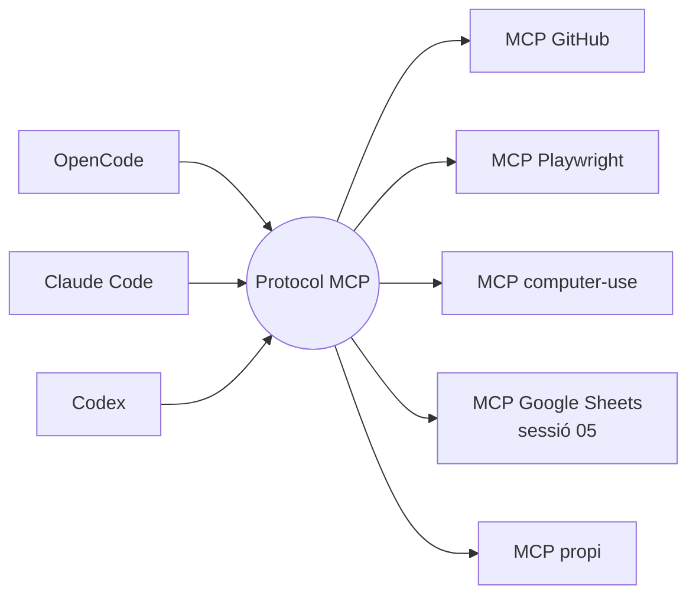
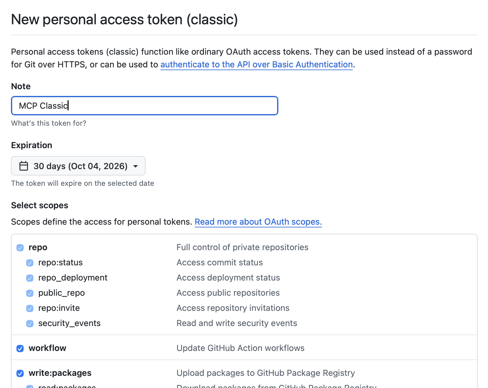
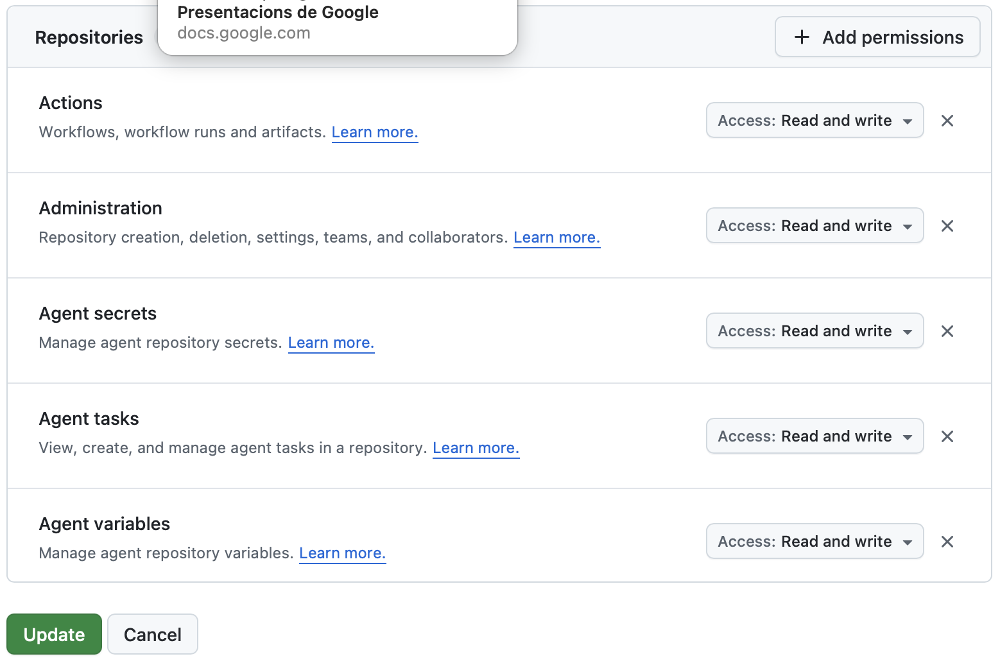
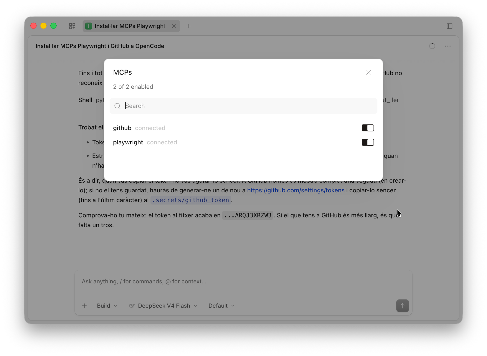

# 04 · MCPs: GitHub, Playwright i MCP propi

> **Objectius de la sessió**
> - Entendre què és el *Model Context Protocol* i quan fer-lo servir en lloc d'una tool.
> - Instal·lar i fer servir MCPs públics: GitHub, Playwright i `computer-use` (control de l'escriptori).
> - Crear un MCP propi.
>
> Els MCPs de Google (Sheets i Gmail) són a la [sessió 05](05%20-%20Serveis%20de%20Google%20per%20a%20agents.md).

| Bloc | Temps |
|---|---|
| Explicació · què és MCP (§1) | 10 min |
| Explicació · presentació de cada bloc: GitHub, Playwright i `task-contract` | 15 min |
| Explicació · MCP d'escriptori `computer-use`, com a demostració del professor (§5) | 15 min |
| Activitat · token i instal·lació dels MCPs (§2) | 30 min |
| Activitat · MCP de GitHub: crear issues (§3) | 15 min |
| Activitat · MCP de Playwright (§4) | 20 min |
| Activitat · MCP propi `task-contract` (§6) | 30 min |
| Activitat · tasca T4 | 20 min |
| **Total a classe** | **2 h 35 min** (40 min d'explicació i 1 h 55 min d'activitat) |
| Fora de classe | Res. Opcional: l'ampliació de la T4 |

> 📋 **Tots els prompts, a punt per copiar:** [`assets/prompts-04-mcp.md`](assets/prompts-04-mcp.md). Hi ha els de la pràctica i els de la T4. Són en català, però demanen en **anglès** el codi, els noms de fitxers i funcions i el contingut dels fitxers que crea l'agent.

---

## 1. Què és MCP

Un **MCP** és un petit servidor que exposa eines seguint un protocol estàndard, de manera que **qualsevol agent** (Codex, Claude Code, OpenCode…) les pot descobrir i executar.

- La definició és independent de l'agent.
- Pot ser **local** (un procés a la nostra màquina) o **remot** (un servidor a internet).
- No és un `.md`: és un projecte (Node.js, Python, Java…) amb un `README.md` que n'explica l'ús.



### Tool o MCP?

| | Eina pròpia (plugin a `.agents/plugins/`) | MCP |
|---|---|---|
| Mida | Script petit | Servidor |
| Portabilitat | Només OpenCode | Qualsevol agent |
| Ús | Tasca molt concreta (validar un JSON) | Servei complet (GitHub, BD, ERP) |

### Exemples

| MCP | Per a què |
|---|---|
| GitHub | Operar amb repositoris, issues, actions |
| Base de dades | Consultar una BD local o remota |
| Sistema intern | Operar amb un ERP d'empresa |
| API externa | Accés controlat a un servei remot |
| Documents | Consultar documents indexats (RAG, sessió 06) |
| Validació | Assegurar que les respostes segueixen un format |

Catàlegs: el registre oficial <https://registry.modelcontextprotocol.io/> i <https://mcpmarket.com/>. En aquesta sessió:

- **github**: l'agent opera amb GitHub com a plataforma (repositoris, issues, actions…).
- **playwright**: l'agent «veu» pàgines web en un navegador real, llegeix els logs i hi interactua.
- **computer-use**: l'agent controla aplicacions de l'escriptori amb captures, clics i teclat.

---

## 2. Token i instal·lació dels MCPs

> **Repositori de la sessió:** crea a GitHub un repositori nou i buit `ia-04-mcp`, clona'l i obre-hi OpenCode (`cd ia-04-mcp` i `opencode`), com a la sessió 01 (apartat 17). Demana a l'agent el `.gitignore` amb el mateix prompt d'aquella sessió. Tota la pràctica (MCPs, issues, Playwright, `computer-use` i `task-contract`) es fa en aquesta carpeta.

### Token d'accés

| Tipus | Prefix | Permisos | Quan |
|---|---|---|---|
| Classic | `ghp_…` | Per *scopes* generals, a tots els teus repositoris | **Al curs**: un sol token serveix per a tots els repositoris, també els de pràctiques que crearàs més endavant |
| Fine-grained | `github_pat_…` | Per repositori i per permís, molt personalitzables | En un projecte real: només els repositoris i els permisos que calen |

**Classic**: *Settings › Developer settings › Personal access tokens › Tokens (classic) › Generate new token (classic)*. Marca només els *scopes* `repo`, `workflow` i `read:org`. Així el mateix token serveix per a `ia-04-mcp`, per a `lliuraments` i per als repositoris de les sessions següents, sense haver-lo de tocar cada vegada que en crees un.

> ⚠️ És un token de **proves**: qui el tingui pot llegir i modificar tots els teus repositoris, també els privats. Posa-hi una caducitat curta (per exemple, 30 dies), no el comparteixis mai i **revoca'l** en acabar el curs. En un projecte real, fes servir un token *fine-grained* amb *Only select repositories* i només els permisos que calguin.



**Fine-grained** (per a projectes reals): *Settings › Developer settings › Personal access tokens › Fine-grained tokens › Generate new token*. Tria els repositoris i els permisos un per un. És més segur, però cal afegir-hi cada repositori nou: per això al curs fem servir el *classic*.



Guarda el token **fora de qualsevol projecte**, a `~/.secrets/github_token` (només el valor, en una sola línia). Com que no és dins de cap repositori, no es pot pujar mai a GitHub per error. A macOS, amb el token copiat:

```bash
mkdir -p ~/.secrets && chmod 700 ~/.secrets
pbpaste > ~/.secrets/github_token && chmod 600 ~/.secrets/github_token
```

A Linux, escriu l'ordre, prem Enter, enganxa el token (no es veu) i torna a prémer Enter:

```bash
mkdir -p ~/.secrets && chmod 700 ~/.secrets
read -rs TOKEN && printf '%s' "$TOKEN" > ~/.secrets/github_token && unset TOKEN
chmod 600 ~/.secrets/github_token
```

A Windows (PowerShell), amb el token copiat:

```powershell
New-Item -ItemType Directory -Force "$HOME\.secrets" | Out-Null
[IO.File]::WriteAllText("$HOME\.secrets\github_token", (Get-Clipboard).Trim())
```

No el creïs amb un editor: molts hi afegeixen un salt de línia final (o l'extensió `.txt`), i el token deixa de funcionar.

### Instal·lar els MCPs

GitHub i Playwright els instal·lem **globalment**, a la configuració d'usuari d'OpenCode (`~/.config/opencode/opencode.json`): el mateix token serveix per a tots els repositoris i els farem servir en sessions posteriors. Així estan disponibles a tots els projectes, també a `lliuraments`, sense configurar-los cada vegada. OpenCode combina aquesta configuració amb l'`opencode.json` de cada projecte.

En canvi, `computer-use` i `task-contract` van **al projecte**: el primer és arriscat i només el volem activar quan cal, i el segon és un MCP propi de cada repositori.

OpenCode substitueix `{file:ruta}` pel contingut de l'arxiu (`~/` és la carpeta de l'usuari), de manera que el token no apareix mai a la configuració:

```json
"mcp": {
  "servers": {
    "github": {
      "type": "remote",
      "url": "https://api.githubcopilot.com/mcp/",
      "headers": {
        "Authorization": "Bearer {file:~/.secrets/github_token}"
      }
    },
    "playwright": {
      "type": "local",
      "command": ["npx", "@playwright/mcp@latest"]
    }
  }
}
```

> Aquest és el format d'OpenCode 2: els servidors van dins de `mcp.servers` i es connecten sols; per desactivar-ne un, `"disabled": true`. En molts exemples d'internet (format d'OpenCode 1) els trobaràs directament a `mcp` i amb `"enabled"`. OpenCode 2 encara els llegeix, però no barregis els dos formats en un mateix servidor.

Executa aquest prompt a OpenCode dins del projecte:
```text
Afegeix els MCPs de GitHub i de Playwright a la configuració global d'OpenCode (~/.config/opencode/opencode.json), perquè estiguin disponibles a tots els projectes, seguint la documentació oficial:
https://github.com/github/github-mcp-server
https://github.com/microsoft/playwright-mcp
Si el fitxer ja existeix, conserva'n la resta de configuració. No toquis l'opencode.json d'aquest projecte.
Per a l'MCP de GitHub, llegeix el token amb {file:~/.secrets/github_token} i no escriguis mai el token a cap fitxer de configuració.
Afegeix a l'AGENTS.md d'aquest projecte (crea'l si no existeix) aquesta secció, exactament en anglès:
# MCPs
- GitHub MCP: configured globally; the token is read from ~/.secrets/github_token. Never write the token in any file.
- Playwright MCP: available to inspect, debug and interact with websites.
```

El fitxer global és fora del projecte: OpenCode et demanarà permís per escriure-hi. Accepta-ho només per a aquest fitxer.

Reinicia OpenCode i comprova-ho amb `opencode mcp list` (al terminal): han de sortir `github` i `playwright` connectats. Com que són globals, també sortiran si executes `opencode mcp list` des de qualsevol altra carpeta.



Executa aquest prompt a OpenCode dins del projecte:
```text
Fes servir l'MCP de GitHub per obtenir les metadades del repositori git al qual pertany aquesta carpeta.
```

L'MCP no sap quina és «aquesta carpeta»: l'agent primer llegeix el `remote` de git i després fa la crida a GitHub. Mira-ho a la conversa.

---

## 3. MCP de GitHub: crear issues

`todo-app.html` és la pàgina inicial de la pràctica: una llista de tasques amb sis errors introduïts a propòsit. Abans del prompt, crea la carpeta `webs/` a `ia-04-mcp` i copia-hi [`assets/todo-app.html`](assets/todo-app.html).

Executa aquest prompt a OpenCode dins del projecte:
```text
Fes servir l'MCP de GitHub per crear sis issues separades al repositori actual sobre la pàgina @webs/todo-app.html, una per cada bug d'aquesta llista.
Escriu títols i descripcions en català, amb els passos per reproduir-lo, el comportament actual i l'esperat.
No modifiquis el codi ni creïs cap pull request.
1. Les tasques desades no es recuperen en tornar a obrir la pàgina.
2. Els filtres «Pendents» i «Completades» mostren les tasques invertides.
3. En esborrar una tasca, desapareixen totes les altres.
4. El comptador de tasques pendents mostra un valor incorrecte.
5. Es poden afegir tasques buides tot i mostrar-se un avís.
6. El botó «Esborra completades» no funciona.
```

Comprova a GitHub que s'han creat. El número de cada issue (`#1`, `#2`…) no té per què coincidir amb el de la llista.

---

## 4. MCP de Playwright

Playwright no obre URL `file://` (i els mòduls ES, `<script type="module">`, tampoc no funcionen des de `file://`). Cal servir la carpeta per HTTP. En un **altre terminal**, des de `ia-04-mcp`:

```bash
npx serve webs
```

Serveix al port 3000. Sense Node: `python3 -m http.server 3000 -d webs`. Deixa'l obert mentre treballes amb Playwright. La primera vegada, si Playwright respon que no troba el navegador, demana a l'agent que l'instal·li amb l'eina `browser_install` de l'MCP.

Executa aquest prompt a OpenCode dins del projecte:
```text
Fes servir l'MCP de Playwright per obrir http://localhost:3000/todo-app.html. Afegeix tres tasques, esborra'n una i explica què passa amb les altres. Fes una captura de pantalla i digues si es reprodueix el bug «En esborrar una tasca, desapareixen totes les altres».
```

**Opcional:** demana a l'agent que resolgui una de les issues, que ho comprovi amb Playwright i que la tanqui amb un commit `Fixes #N` i `git push` (on `N` és el número de la issue a GitHub).

---

## 5. MCP d'escriptori: `computer-use`

Playwright controla **un navegador**. [`computer-use-mcp`](https://github.com/zavora-ai/computer-use-mcp) va un pas més enllà: deixa que l'agent controli **l'escriptori** (macOS, Windows i Linux). Pot veure la pantalla amb captures, llegir la interfície de les aplicacions, fer clic, escriure, fer servir menús i dreceres, i gestionar finestres.

| | Playwright | `computer-use` |
|---|---|---|
| Què controla | Una pàgina web en un navegador | Qualsevol aplicació de l'escriptori |
| Com «veu» | El DOM i l'arbre d'accessibilitat de la pàgina | Accessibilitat del sistema, captures de pantalla i OCR |
| Quan | Provar webs | Apps sense API ni web (escriptori, programes antics) |
| Risc | Baix: només el navegador | **Alt**: fa el mateix que tu amb el ratolí i el teclat |

> ⚠️ **No és un entorn aïllat.** Per defecte és permissiu: pot executar scripts del sistema i llegir o escriure qualsevol fitxer al qual tinguis accés. Fes-lo servir només per a l'exercici, amb una llista d'aplicacions permeses, i **desactiva'l** quan acabis. Mentre treballa, no toquis el ratolí ni el teclat. La combinació `ctrl+alt+escape` l'atura. Per desactivar-lo des d'OpenCode, escriu `/mcp` i desactiva `computer-use`.

> **A classe** aquest apartat és una demostració del professor. Fer-lo al teu ordinador és opcional: els permisos canvien a cada sistema operatiu i la T4 no el necessita.

### Requisits i permisos

A tots els sistemes cal **Node.js 20 o superior** i una **sessió d'escriptori oberta**: no funciona per SSH ni en un servidor sense pantalla. L'eina `doctor` de l'MCP diu què falta en cada cas.

#### macOS 14 o superior

Els permisos es donen a *Configuració del Sistema › Privacitat i seguretat*, a l'**aplicació des d'on executes OpenCode** (Terminal, iTerm, VS Code…), no a `node`. Després de donar-los, tanca i torna a obrir aquesta aplicació.

| Permís | Per a què | Cal? |
|---|---|---|
| **Accessibilitat** (a macOS 27, *Control del dispositiu i accés a les dades*) | Fer clic, escriure i llegir els controls de les finestres. Sense aquest permís, les eines d'entrada fallen amb `accessibility_permission_denied` | **Sí** |
| **Gravació de pantalla** | Fer captures de pantalla i llegir-ne el text (OCR) | **Sí** |
| **Monitoratge de l'entrada** | Detectar que tu estàs fent servir el ratolí o el teclat i aturar-se | Recomanat |
| **Automatització** | Controlar una aplicació amb scripts. macOS el demana la primera vegada, per a cada aplicació | Quan el demani |

També cal tenir les eines de línia de comandes de Xcode (`xcode-select --install`): l'MCP compila un petit programa auxiliar el primer cop que s'executa.

#### Windows

No hi ha permisos per activar: n'hi ha prou amb una **sessió iniciada** a l'escriptori. L'única limitació són les finestres **elevades** (les que s'obren com a administrador, com l'Editor del Registre) i les pantalles protegides de control de comptes (UAC): un procés normal no les pot controlar. Si cal controlar-ne alguna, OpenCode també s'ha d'executar com a administrador. A la pràctica no cal: la calculadora no és elevada.

#### Linux

Depèn del tipus de sessió (X11 o Wayland). Els paquets són per a Ubuntu i Debian.

| Sessió | Què cal |
|---|---|
| **X11** (Ubuntu: «Ubuntu on Xorg» a la pantalla d'inici) | Les eines que fa servir l'MCP: `sudo apt install xdotool wmctrl xclip scrot imagemagick` |
| **Wayland a GNOME 46+ o KDE Plasma 6.1+** | La primera vegada, l'escriptori demana permís per al **control remot** i per a les **captures de pantalla**: accepta i la decisió es recorda. Cal `python3-gi` |
| **Altres Wayland** (sway, Hyprland) | `ydotool` i `wl-clipboard` (i `grim` per a les captures). El servei `ydotoold` ha de tenir accés a `/dev/uinput`, normalment afegint l'usuari al grup `input` |

A tots els casos, per llegir els controls de les finestres cal **AT-SPI**: `sudo apt install python3-gi gir1.2-atspi-2.0`.

### Configuració

S'afegeix com els altres MCPs locals, dins de `mcp.servers`. Amb `environment` li passem les opcions de seguretat: `COMPUTER_USE_ALLOWED_APPS` limita les aplicacions que pot controlar i `COMPUTER_USE_FS_ROOTS` limita els fitxers a la carpeta del projecte.

```json
"computer-use": {
  "type": "local",
  "command": ["npx", "-y", "@zavora-ai/computer-use-mcp"],
  "disabled": false,
  "environment": {
    "COMPUTER_USE_ALLOWED_APPS": "Calculator",
    "COMPUTER_USE_FS_ROOTS": "."
  }
}
```

El nom de l'aplicació depèn del sistema: `Calculator` a macOS i Windows (amb l'idioma en català pot ser `Calculadora`), `gnome-calculator` a Linux. Si dubtes, l'eina `discover_applications` de l'MCP et diu el nom exacte.

Executa aquest prompt a OpenCode dins del projecte:
```text
Afegeix a l'opencode.json d'aquest projecte l'MCP computer-use, seguint https://github.com/zavora-ai/computer-use-mcp:
- MCP local a mcp.servers amb l'ordre ["npx", "-y", "@zavora-ai/computer-use-mcp"] i "disabled": false.
- A "environment", COMPUTER_USE_ALLOWED_APPS amb només la calculadora d'aquest sistema operatiu i COMPUTER_USE_FS_ROOTS amb ".".
- No toquis els altres MCPs.
Afegeix a la secció # MCPs d'AGENTS.md aquesta línia, exactament en anglès:
- computer-use MCP: desktop control, only for the apps listed in COMPUTER_USE_ALLOWED_APPS. Disable it ("disabled": true) when not in use.
```

Reinicia OpenCode i comprova amb `opencode mcp list` que `computer-use` surt connectat. Després, comprova que té els permisos que necessita:

```text
Fes servir l'eina doctor de l'MCP computer-use i explica'm quins permisos o dependències falten en aquest ordinador i com activar-los.
```

### Exemple: la calculadora

```text
Fes servir l'MCP computer-use per obrir la calculadora del sistema.
Abans de cada clic, assegura't que la calculadora és la finestra activa i que és per damunt de les altres; si no ho és, activa-la i torna-ho a comprovar.
Calcula 128 × 37 fent clic als botons, no amb el teclat. Abans de fer clic per coordenades, mira a la descripció de l'eina si espera coordenades de pantalla o relatives a la finestra. Si les has tret d'una captura de la finestra i l'eina en vol de pantalla, suma-hi la posició de la finestra. Si pots, fes clic als botons pel seu nom (accessibilitat) en lloc de per coordenades.
Fes una captura del resultat, llegeix el número que mostra i comprova que és correcte. Després tanca la calculadora.
```

Mira què fa l'agent a la conversa: primer busca l'aplicació, després llegeix la interfície (o fa una captura), fa clic als botons i torna a mirar la pantalla per comprovar el resultat. És el mateix bucle pensar → actuar → observar de la sessió 01, ara amb la pantalla com a observació.

El prompt insisteix en dues coses perquè són els errors més habituals:

- **La finestra activa.** Un clic per coordenades cau sobre el que hi hagi en aquell punt de la pantalla. Si una altra finestra (el terminal, el navegador) tapa la calculadora, el clic va a parar a aquella finestra.
- **El tipus de coordenades.** Algunes eines treballen amb coordenades de **pantalla** i d'altres amb coordenades **relatives a la finestra** (o a la captura). Si l'agent barreja els dos sistemes, el clic surt desplaçat i prem un altre botó, o cap. A més, en pantalles Retina o amb escalat, els píxels de la captura no sempre coincideixen amb els de la pantalla.

**Comprova-ho:** el resultat és 4736. Prova també de demanar-li que obri una aplicació que no és a la llista (per exemple, el navegador): ha de respondre que no té permís.

Quan acabis, posa `"disabled": true` a `computer-use` a `opencode.json` i reinicia OpenCode. Desactivat, no ocupa context ni pot fer res.

---

## 6. Crear un MCP propi: `task-contract`

Un MCP propi permet obligar els agents a retornar una **estructura validada**. Per exemple, quan l'arnès SDD de la sessió 02 acaba una tasca, l'agent ha d'enviar un informe a un MCP que el valida.

```text
.agents/mcp/task-contract/
├── package.json
├── server.js
├── server.test.js
├── README.md
└── reports.jsonl      (el crea el servidor amb el primer informe)
```

Executa aquest prompt a OpenCode dins del projecte:
```text
Crea un servidor MCP senzill amb Node.js anomenat task-contract a .agents/mcp/task-contract/, amb package.json, server.js, server.test.js i README.md.
- Mòduls ES ("type": "module"). Les úniques dependències permeses són l'SDK oficial @modelcontextprotocol/sdk i zod. Escriu en anglès el codi, els noms, els comentaris i el README.
- Ha d'exposar una sola eina, submit_task_report, amb:
  - taskId: string obligatori
  - status: "done", "failed" o "blocked"
  - changedFiles: array de strings
  - verification: array de strings
  - notes: string opcional
- Si l'entrada és vàlida, afegeix-la com una línia JSON a reports.jsonl i retorna un missatge d'èxit. Si no, retorna un error clar que digui quin camp falla.
- Calcula la ruta de reports.jsonl a partir de la carpeta de server.js (import.meta.url), no del directori actual: OpenCode arrenca l'MCP des d'una altra carpeta.
- Separa la validació en una funció exportada i prova-la a server.test.js amb node:test i node:assert (un informe vàlid i un d'invàlid). Afegeix a package.json l'script "test": "node --test".
- Executa npm --prefix .agents/mcp/task-contract install i npm --prefix .agents/mcp/task-contract test.
- Registra'l a opencode.json com a MCP local amb l'ordre ["node", ".agents/mcp/task-contract/server.js"], sense tocar els altres MCPs.
Crea només els fitxers de l'MCP; no modifiquis l'app.
```

Reinicia OpenCode i comprova amb `opencode mcp list` que `task-contract` surt connectat. `node_modules/` ja és al `.gitignore` de la sessió 01 (la regla val per a qualsevol carpeta).

El `README.md` d'un MCP ha d'explicar: què fa, quines eines exposa, com es fan servir i com es proven.

```markdown
# task-contract MCP
Validates the final report of every task before it is accepted.
Tools:
- `submit_task_report`: taskId, status (done|failed|blocked), changedFiles, verification, notes.
Accepted reports are appended to `reports.jsonl` for auditing. The tool call itself is the contract.
Run tests:
    npm --prefix .agents/mcp/task-contract test
```

Prova'l amb un prompt:
```text
Fes servir l'eina submit_task_report de l'MCP task-contract per enviar un informe de prova: taskId "T00", status "done", changedFiles ["webs/todo-app.html"], verification ["manual check"]. Després envia'n un amb status "finished" i explica quin error retorna.
```

**Estats de l'informe i de la tasca.** A `docs/tasks.json` una tasca només és `pending` o `done`. L'informe diu per què: `done` vol dir que la tasca passa a `done`; `failed` (els criteris no es compleixen) i `blocked` (falta alguna cosa externa) volen dir que es queda `pending`.

Al repositori `ia-04-mcp` no hi ha arnès SDD: fer que el `reviewer` cridi `submit_task_report` en acabar cada tasca és una ampliació opcional de la T4, al repositori `lliuraments`.

Altres idees de MCP propi: `safe-edit` (edicions controlades i verificables), `sqlite-browser` (consultes segures a SQLite), `spreadsheet-reader` (llegir fulls de càlcul amb una interfície estable).

## Tasca de la sessió · Projecte «Lliuraments» (T4)

**Objectiu:** connectar el projecte amb GitHub i veure la web amb un navegador real.

> 📋 Els prompts de la T4 són a [`assets/prompts-04-mcp.md`](assets/prompts-04-mcp.md), apartat T4.

**Repositori:** `lliuraments`. Obre-hi OpenCode (`cd lliuraments` i `opencode`). El token de GitHub és a `~/.secrets/` i els MCPs de GitHub i Playwright ja són globals: no cal tornar-los a configurar.

1. **MCPs.** Comprova amb `opencode mcp list` que `github` i `playwright` surten connectats des de `lliuraments`, i afegeix la secció `# MCPs` a l'`AGENTS.md` del projecte (la mateixa de la pràctica).
2. **Una issue.** Amb l'MCP de GitHub, crea **una issue** amb una funcionalitat nova (títol, descripció i criteris d'acceptació). Per exemple: «Filtrar la taula per alumne». No la implementis: a la sessió 07 la convertirem en una tasca en Markdown i l'agent la implementarà.
3. **Playwright.** La web llegeix `data/lliuraments.json`, que és fora de `webs/`: serveix l'**arrel** del repositori, no només `webs/`. En un altre terminal, des de `lliuraments`: `npx serve .`. La pàgina és a `http://localhost:3000/webs/…` (el nom és el que fixa el `PLAN.md` de la T1). Amb l'MCP de Playwright, obre la web, comprova que es veu la llista de pràctiques i desa una captura a `docs/captures/`.
4. Demana a l'agent el commit, l'etiqueta `t4` i el push (sessió 01, apartat 17).

**Lliurable:** enllaç a l'etiqueta `t4` de `lliuraments`, amb la issue oberta a GitHub, la secció `# MCPs` a `AGENTS.md` i la captura de Playwright a `docs/captures/`.

**Ampliació (opcional):**

- Crea dues issues més (per exemple, «Marcar la pràctica més propera a vèncer» i «Exportar el resum per alumne a CSV»).
- Fes que el `reviewer` també validi la web amb Playwright. No pot engegar el servidor (només pot executar `npm test`): l'engegues tu abans de `/next-task`. A la seva capçalera, `permissions` ha de tenir una regla `allow` per a les accions `playwright_*`, després de la regla general que ho denega tot (guanya l'última que coincideix).
- Copia l'MCP `task-contract` de la pràctica (`cp -R ../ia-04-mcp/.agents/mcp/task-contract .agents/mcp/`, sense `node_modules` ni `reports.jsonl`), instal·la'l, registra'l a `opencode.json` i fes que el `reviewer` hi enviï l'informe de cada tasca (permís `task-contract_*`).

## Resum

- Un MCP és un servidor d'eines estàndard, reutilitzable entre agents.
- Les credencials sempre a `.secrets/` (el token de GitHub, a `~/.secrets/`); mai a `opencode.json`.
- Els MCPs que fas servir a tots els projectes, globals; els específics o arriscats, al projecte.
- Documenta els MCPs a `AGENTS.md` perquè l'agent sàpiga quan fer-los servir.
- Playwright necessita la web servida per HTTP, no `file://`.
- `computer-use` controla tot l'escriptori: limita'l a les apps necessàries i desactiva'l quan no el facis servir.
- Un MCP propi pot obligar l'agent a retornar informació amb un format validat.
