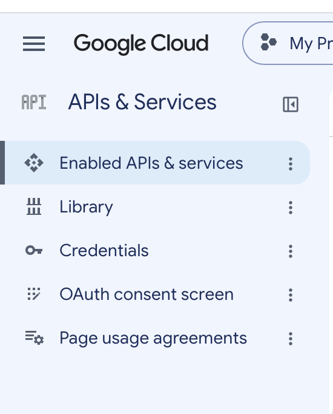
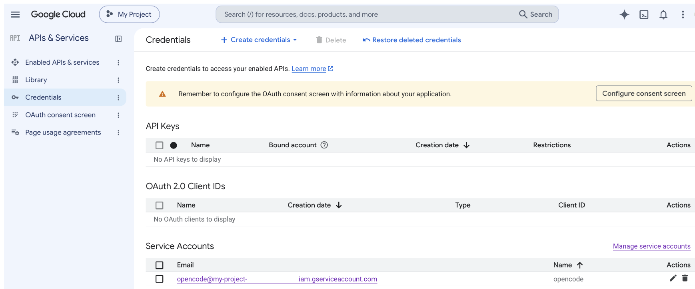
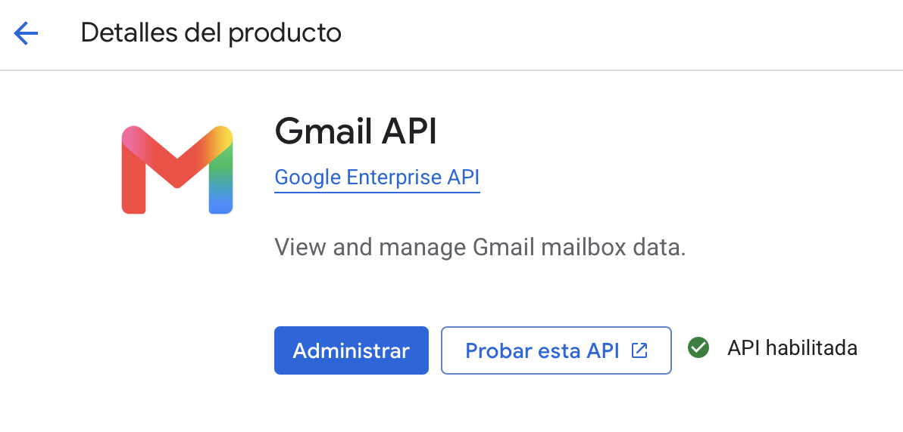
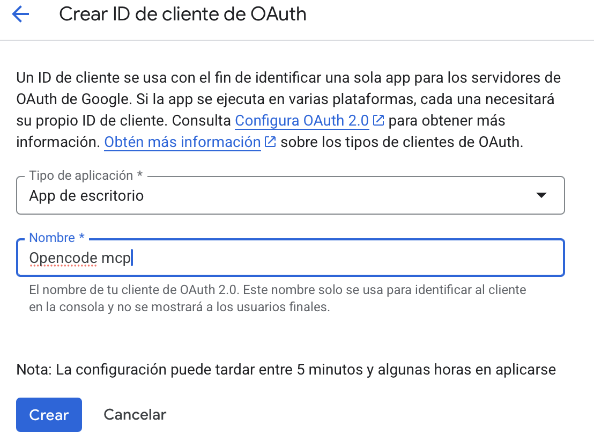

# 05 · Serveis de Google per a agents

> **Objectius de la sessió**
> - Connectar l'agent amb Google Sheets amb un compte de servei.
> - Connectar l'agent amb Gmail amb OAuth, només amb permís de lectura.
> - Encapsular una consulta repetida en una comanda.
>
> Cal haver fet la [sessió 04](04%20-%20MCPs%20GitHub,%20Playwright%20i%20MCP%20propi.md). Allà, GitHub i Playwright es van instal·lar **globalment**. Els MCPs de Google, en canvi, van **al projecte** (`opencode.json` del repositori), amb les credencials a la carpeta `.secrets/` del projecte: cada projecte fa servir els seus documents i el seu compte.

> 📋 Tots els prompts d'aquesta sessió, en ordre, són a [`assets/prompts-05-google.md`](assets/prompts-05-google.md).

| Bloc | Temps |
|---|---|
| Explicació · dues maneres d'accedir a Google, global o al projecte, requisits (§0) | 10 min |
| Explicació · OAuth, MCP de Gmail i `/gmail-important`, com a demostració del professor (§3–5) | 15 min |
| Activitat · compte de servei i MCP de Google Sheets, que inclou la tasca T5 (§1–2) | 45 min |
| **Total a classe** | **1 h 10 min** (25 min d'explicació i 45 min d'activitat) |
| Fora de classe | Res. Opcional: fer tu la part de Gmail (§3–5), ≈ 1 h |

Aquest tema es fa el mateix dia que el [tema 06](06%20-%20RAGs%20i%20serveis%20de%20dades.md): entre tots dos, 1 h d'explicació i 1 h 50 min d'activitat.

Hi ha dues maneres d'accedir a Google:

| | Compte de servei | OAuth |
|---|---|---|
| Qui accedeix | Un «usuari robot» amb el seu propi correu | Tu |
| Què veu | Només el que comparteixes amb ell | Tot el que permetis en autoritzar |
| Ús al curs | Sheets i Drive | Gmail |
| Credencial | `.secrets/google-service-account.json` | `.secrets/google-client-secret.json` |

> **Repositori de la sessió:** aquesta pràctica es fa directament al repositori **`lliuraments`**, no en un de nou: obre-hi OpenCode (`cd lliuraments` i `opencode`). El resultat de la pràctica de Google Sheets és la tasca T5. Les credencials de Google aniran a `.secrets/`, que ja és al `.gitignore`.

---

## 0. Requisits

Els dos MCPs d'aquesta sessió necessiten dues eines que fins ara no calien:

| Eina | Per a què | Comprova-ho |
|---|---|---|
| **Node.js 24.22 o superior** | L'MCP de Gmail (`@klodr/gmail-mcp`) necessita la 24.18 o superior, i el RAG de la sessió 06, la 24.22 | `node --version` |
| **`uv`** (gestor de paquets de Python) | L'MCP de Google Sheets s'executa amb `uvx` | `uvx --version` |

Si et falta Node.js 24, instal·la la versió LTS des de <https://nodejs.org>. Per instal·lar `uv`:

```bash
# macOS i Linux
curl -LsSf https://astral.sh/uv/install.sh | sh
```

```powershell
# Windows (PowerShell)
powershell -ExecutionPolicy ByPass -c "irm https://astral.sh/uv/install.ps1 | iex"
```

A macOS també el pots instal·lar amb `brew install uv`. Després, tanca i torna a obrir el terminal.

## 1. Compte de servei (Sheets i Drive)

1. A <https://console.cloud.google.com/cloud-resource-manager> crea un projecte (al curs, sota l'organització XTEC).

2. A *APIs i serveis › Biblioteca*, activa **Google Sheets API** i **Google Drive API**.

   

3. *APIs i serveis › Credencials › Crear credencials › Compte de servei*.

   

4. Obre el compte de servei: *Claus › Afegeix una clau › Crea una clau nova › JSON*. Guarda l'arxiu a `.secrets/google-service-account.json` del repositori `lliuraments`. Si l'organització bloqueja la creació de claus (política `iam.disableServiceAccountKeyCreation`), demana-ho a l'administrador o fes servir un projecte personal.
5. A Google Drive, **crea una carpeta** per al curs (per exemple, `IA curs`) i comparteix-la amb el correu del compte de servei com a **editor**. El correu té la forma `…@….iam.gserviceaccount.com` i és el camp `client_email` del JSON.

   <!-- TODO: captura del diàleg «Compartir» amb el compte de servei com a editor, amb el correu i les dades personals difuminats. -->

6. Copia l'**identificador de la carpeta**: és l'última part de la URL, `https://drive.google.com/drive/folders/`**`XXXXXXXX`**. El necessitaràs al prompt.
7. Dins de la carpeta, **crea tu** un full de càlcul buit que es digui `Lliuraments`. Un compte de servei no té espai propi a Drive: pot editar els documents de la carpeta compartida, però els documents els has de crear tu.

## 2. MCP de Google Sheets

L'MCP comunitari [`mcp-google-sheets`](https://github.com/xing5/mcp-google-sheets) ofereix 19 eines, que ocupen uns 13.000 tokens de context abans de començar a parlar. Amb `ENABLED_TOOLS` en deixem actives només quatre: llistar fulls, llegir i escriure.

> Google també té un MCP oficial per a Workspace, però ara mateix és una *Developer Preview* que funciona amb OAuth, no amb comptes de servei. Al curs fem servir `mcp-google-sheets`, que és més simple.

Executa aquest prompt a OpenCode dins del projecte (canvia `<ID_DE_LA_CARPETA>` per l'identificador del pas 6):
```text
Afegeix a l'opencode.json d'aquest projecte l'MCP comunitari de Google Sheets mcp-google-sheets (https://github.com/xing5/mcp-google-sheets) amb un compte de servei, seguint-ne la documentació. Arrenca'l amb uvx mcp-google-sheets@latest. Registra'l a mcp.servers amb la clau google-sheets.
Posa a environment:
- SERVICE_ACCOUNT_PATH: la ruta absoluta de .secrets/google-service-account.json (fes servir pwd per obtenir-la; l'MCP no accepta rutes relatives).
- DRIVE_FOLDER_ID: <ID_DE_LA_CARPETA>. És només l'identificador, no la URL sencera.
- ENABLED_TOOLS: get_sheet_data,update_cells,list_spreadsheets,list_sheets
Si opencode.json ja existeix, conserva'n la resta de configuració.
Afegeix a AGENTS.md (crea'l si no existeix) la secció # MCPs, si encara no hi és, i dins seu aquesta línia, exactament en anglès:
- Google Sheets MCP: edits spreadsheets in the shared Drive folder with the service account at .secrets/google-service-account.json. Do not create spreadsheets; the user creates them.
```

La ruta absoluta conté el nom de la teva carpeta d'usuari. No és cap secret, però vol dir que si mous o copies el projecte cal tornar a configurar l'MCP.

Reinicia OpenCode i comprova amb `opencode mcp list` (al terminal) que `google-sheets` surt connectat. Després, executa aquest prompt a OpenCode dins del projecte:
```text
Fes servir l'MCP de Google Sheets amb el full "Lliuraments" de la carpeta compartida.
Llegeix data/lliuraments.json i escriu-hi una fila per alumne amb: nom, pràctiques lliurades dins del termini, lliurades tard i pendents.
La fila 1 és la capçalera: Alumne, Lliurades, Tard, Pendents. Els alumnes van a partir de la fila 2.
```

**Comprova-ho:** obre el full a Google Sheets, tria un alumne i compara els seus tres números amb `data/lliuraments.json`.

## 3. OAuth (Gmail)

Gmail necessita accedir com **a tu**, no com a compte de servei: cal OAuth.

> **A classe** les seccions 3, 4 i 5 són una demostració del professor. Fer-les amb el teu compte és opcional, i la T5 no les necessita.

> ⚠️ **Privacitat.** Quan l'agent llegeix o resumeix correus, el contingut s'envia al proveïdor del model. Si el compte de l'escola té correus amb dades d'alumnes o famílies, fes la pràctica amb un **compte personal o de proves**.

1. A *APIs i serveis › Biblioteca*, activa **Gmail API**.

   

2. *APIs i serveis › Credencials › Crear credencials › ID de client OAuth*. La primera vegada et demana configurar la pantalla de consentiment. Amb un compte de l'organització (XTEC) tria **Internal**. Amb un compte personal tria **External** i, a *Audience › Test users*, afegeix el teu correu (si no, l'autorització falla). En mode *Testing*, els tokens caduquen als **7 dies** i caldrà tornar a autoritzar.
3. Torna a *Crear credencials › ID de client OAuth › Aplicació d'escriptori*.

   

4. Descarrega el JSON i guarda'l a `.secrets/google-client-secret.json` del repositori `lliuraments`.

## 4. MCP de Gmail

Fem servir [`@klodr/gmail-mcp`](https://github.com/klodr/gmail-mcp). L'autorització es fa **una vegada, al terminal**, i és en aquest moment que decidim què pot fer l'MCP. Amb `--scopes=gmail.readonly`, Google només li dona permís de lectura i l'MCP ni tan sols ofereix a l'agent les eines per enviar, moure o esborrar correus. Aquest és el límit real; el que diguem en un prompt només és una instrucció.

Al terminal, des de `lliuraments` (macOS i Linux):

```bash
export GMAIL_OAUTH_PATH="$PWD/.secrets/google-client-secret.json"
export GMAIL_CREDENTIALS_PATH="$PWD/.secrets/gmail-credentials.json"
npx -y @klodr/gmail-mcp auth --scopes=gmail.readonly
```

A Windows (PowerShell):

```powershell
$env:GMAIL_OAUTH_PATH = "$PWD\.secrets\google-client-secret.json"
$env:GMAIL_CREDENTIALS_PATH = "$PWD\.secrets\gmail-credentials.json"
npx -y @klodr/gmail-mcp auth --scopes=gmail.readonly
```

S'obre el navegador per autoritzar l'accés. Els tokens queden a `.secrets/gmail-credentials.json`, dins del projecte i ignorats pel `.gitignore`.

Executa aquest prompt a OpenCode dins del projecte:
```text
Afegeix a l'opencode.json d'aquest projecte l'MCP de Gmail @klodr/gmail-mcp (https://github.com/klodr/gmail-mcp), seguint-ne la documentació. Arrenca'l amb npx -y @klodr/gmail-mcp. Registra'l a mcp.servers amb la clau gmail.
Posa a environment les rutes absolutes (fes servir pwd; l'MCP no accepta rutes relatives):
- GMAIL_OAUTH_PATH: .secrets/google-client-secret.json
- GMAIL_CREDENTIALS_PATH: .secrets/gmail-credentials.json
No executis l'autorització: ja l'he feta al terminal. Conserva la resta de configuració d'opencode.json.
Afegeix a la secció # MCPs d'AGENTS.md aquesta línia, exactament en anglès:
- Gmail MCP: read-only access to my inbox (gmail.readonly scope). Never try to send, modify or delete emails.
```

Reinicia OpenCode, comprova amb `opencode mcp list` que `gmail` surt connectat i executa aquest prompt a OpenCode dins del projecte:
```text
Fes servir l'MCP de Gmail per resumir els 10 correus més importants dels dos últims dies. Mostra'n l'assumpte.
```

**Comprova-ho:** demana-li que marqui un correu com a llegit. Ha de respondre que no té cap eina per fer-ho.

## 5. Una comanda per a Gmail

Crea l'arxiu `.agents/commands/gmail-important.md`. OpenCode només troba les comandes a `.opencode/`: si `lliuraments` encara no té l'enllaç `.opencode` → `.agents`, crea'l com a la sessió 02 (secció 9).

```markdown
---
description: Show the 10 most important recent Gmail messages
agent: build
---
# /gmail-important — Top 10 most important Gmail messages

Use the Gmail MCP. It has read-only access.
Find the 10 most important recent emails in my inbox. Rank them, in this order, by:
1. Marked as important or starred.
2. Requiring an action, reply, decision or follow-up.
3. Sent by people rather than automated services.
4. More recent first.
Return only a numbered list with subject, sender and received date.
Do not modify, archive, mark as read, delete or reply to any email.
```

Reinicia OpenCode i executa `/gmail-important`.

> Fixa't que hi ha dos límits. L'última línia de la comanda és una **instrucció**: l'agent normalment la segueix, però un correu maliciós podria intentar convèncer-lo del contrari. El *scope* `gmail.readonly` és un **permís**: encara que l'agent ho intentés, no podria. Quan un MCP pot fer coses irreversibles, limita'l sempre amb permisos, no només amb instruccions.

## Tasca de la sessió · Projecte «Lliuraments» (T5)

**Objectiu:** que l'agent publiqui el resum per alumne en un full de càlcul.

La T5 **és el resultat de la pràctica** de Google Sheets (seccions 1 i 2): com que l'has fet al repositori `lliuraments`, no hi ha feina a part.

1. Comprova que el full «Lliuraments» té una fila per alumne i que els números són correctes.
2. Comparteix el full amb el professor (només lectura).
3. Demana a l'agent el commit, l'etiqueta `t5` i el push (sessió 01, apartat 17). Comprova abans amb `git status` que `.secrets/` no hi apareix.

**Lliurable:** enllaç al full i enllaç a l'etiqueta `t5` de `lliuraments`, amb l'MCP de Google Sheets a `opencode.json` i la seva línia a la secció `# MCPs` d'`AGENTS.md`.

**Ampliació (opcional):**

- Crea un segon full, «Notes», i demana a l'agent dades d'exemple per a 5 alumnes amb les notes «Ex, Pr1, Pr2, Obs», els pesos a la fila 2 (40%, 20%, 20%, 20%) i una columna «Total» amb la mitjana ponderada calculada amb una **fórmula** del full.
- Fes tu la part de Gmail (seccions 3–5).

## Resum

- Compte de servei per a documents compartits; OAuth quan l'agent ha d'actuar com a tu.
- Les credencials de Google, sempre a `.secrets/` i al `.gitignore`. A la configuració, amb rutes absolutes.
- Els MCPs de cada projecte van al projecte; els que fas servir a tot arreu (GitHub, Playwright), globals.
- Activa només les eines que necessites: menys context i menys risc.
- Un MCP amb accés al correu pot fer accions irreversibles: limita'l amb permisos (`gmail.readonly`), no només amb instruccions.
