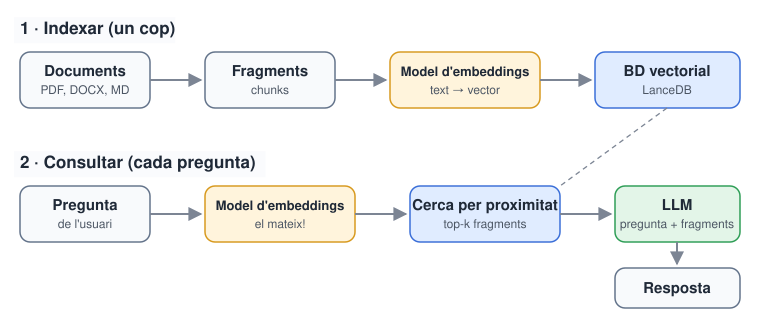
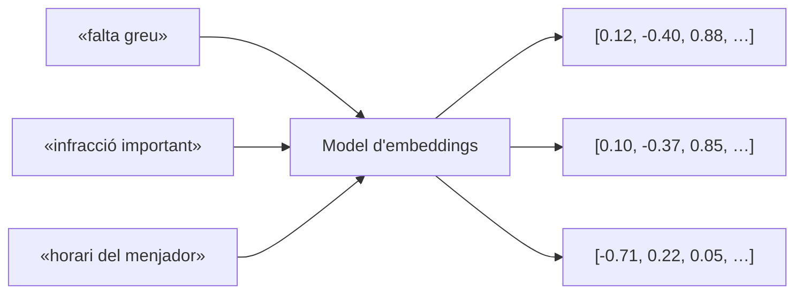
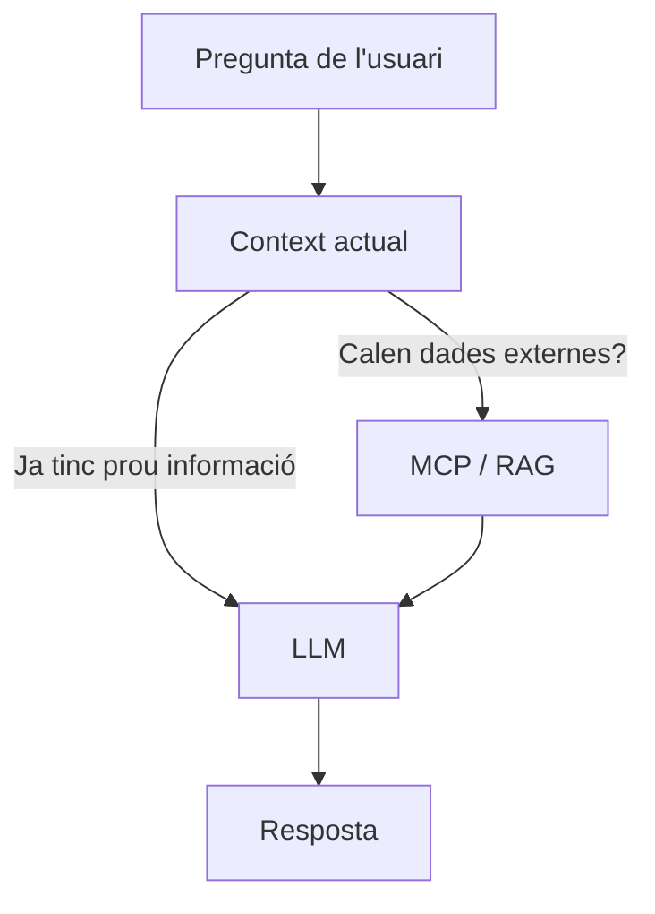

# 06 · RAGs i serveis de dades

> **Objectius de la sessió**
> - Entendre què és un RAG i com funcionen els *embeddings*.
> - Muntar un RAG local amb `mcp-local-rag` i LanceDB, i consultar-hi documents del centre.
> - Saber quan fer servir RAG, una base de dades o simplement el context.
>
> Cal haver fet la [sessió 05](05%20-%20Serveis%20de%20Google%20per%20a%20agents.md). Com els MCPs de Google, el RAG va **al projecte** (`opencode.json` del repositori), amb rutes absolutes. Requisit: Node.js 24.22 o superior (`node --version`), com a la sessió 05.

> 📋 Tots els prompts d'aquesta sessió, en ordre, són a [`assets/prompts-06-rag.md`](assets/prompts-06-rag.md).

| Bloc | Temps |
|---|---|
| Explicació · dades, RAG, fragments, embeddings, conservar els originals (§1–6) | 30 min |
| Explicació · cadena de decisions de l'agent (§8) | 5 min |
| Activitat · pràctica: RAG local (configurar, indexar, consultar, `AGENTS.md`) | 50 min |
| Activitat · com saber si el RAG funciona bé (§7) | 10 min |
| Activitat · tasca T6 | 10 min |
| **Total a classe** | **1 h 45 min** (35 min d'explicació i 1 h 10 min d'activitat) |
| Fora de classe | Res. Opcional: l'ampliació de la T6 |

Aquest tema es fa el mateix dia que el [tema 05](05%20-%20Serveis%20de%20Google%20per%20a%20agents.md), després de la pràctica de Google Sheets.

---

## 1. Tipus de dades per a un agent

| Dades | Exemple | Com hi accedeix l'agent |
|---|---|---|
| Poques i petites | Un README, un JSON de configuració | Directament al context (`@arxiu`) |
| Estructurades | Notes d'alumnes, comandes, inventari | MCP de base de dades o de Google Sheets (sessió 05) |
| Molts documents de text | Normatives, manuals, actes | **RAG** |
| Història del projecte | Decisions, errors, què es va fer ahir | Arxius com `DECISIONS.md` o `HANDOFF.md` (sessió 07) |

**Regla pràctica:** si el que cal saber cap còmodament al context, posa-ho al context. Si són centenars de pàgines, o només n'importa un fragment, fes servir RAG.

## 2. Què és un RAG

**RAG** (*Retrieval Augmented Generation*) dona al model una base de coneixement privada **sense entrenar-lo**: abans de respondre, es busquen els fragments rellevants i s'afegeixen al context.



Té dues fases:

1. **Indexar** (un cop): els documents es divideixen en fragments, es converteixen en vectors i es guarden en una base de dades vectorial.
2. **Consultar** (a cada pregunta): la pregunta també es converteix en vector, es busquen els fragments més propers i s'envien al model juntament amb la pregunta.

## 3. Fragments (*chunks*)

Els documents no s'indexen sencers: es tallen en fragments d'uns centenars de paraules, normalment amb una mica de solapament entre ells perquè una idea no quedi partida.

| Fragments… | Problema |
|---|---|
| Massa petits | Perden el context («el termini és de 3 dies»… de què?) |
| Massa grans | Barregen temes i omplen el context de soroll |

Quan un fragment no és suficient, es poden demanar els fragments veïns (a `mcp-local-rag`: `read_chunk_neighbors`).

## 4. Embeddings i dimensions

Un **embedding** és una representació numèrica d'un text en forma de vector. Textos amb significat semblant tenen vectors propers.

- Les **dimensions** són el nombre de valors de cada vector (habitualment 384, 768, 1024, 1536…).
- Cada dimensió capta un aspecte abstracte del significat; no són conceptes llegibles un per un.
- Es calculen amb un **model d'embeddings**, diferent del model de xat i molt més petit. Pot funcionar en local.



V1 i V2 són propers; V3 queda lluny.

**Distància**: es fa servir una funció matemàtica per decidir si dos vectors són prou propers. La més habitual és la **similitud del cosinus**; algunes bases de dades vectorials permeten escollir-ne d'altres (euclidiana, producte escalar).

> Important: els documents i les preguntes s'han de vectoritzar **amb el mateix model**. Vectors de models diferents no es poden comparar, encara que tinguin les mateixes dimensions. Si canvies de model d'embeddings, cal un índex nou.

## 5. LanceDB

**LanceDB** és la base de dades vectorial que fem servir. No només guarda text com una BD tradicional: guarda els embeddings i permet buscar per proximitat. És un arxiu local, sense servidor.

`mcp-local-rag` fa servir per defecte el model d'embeddings `Xenova/all-MiniLM-L6-v2`, de 384 dimensions. Es descarrega el primer cop (uns 90 MB) a `CACHE_DIR`. La cerca és **híbrida**: combina la proximitat dels vectors amb la coincidència de paraules clau.

> **Documents en català.** `all-MiniLM-L6-v2` està entrenat sobretot amb anglès. Amb documents en català funciona gràcies a la part de paraules clau, però un model multilingüe pot trobar millor els fragments quan la pregunta fa servir paraules diferents de les del document. Es canvia amb la variable `MODEL_NAME` (per exemple, `Xenova/paraphrase-multilingual-MiniLM-L12-v2`). Si ho proves, fes-ho amb un `DB_PATH` nou i compara les respostes amb les preguntes de la secció 7.

## 6. Puc esborrar els documents originals després d'indexar?

**No.** L'índex no substitueix els documents: n'és una **còpia derivada**, i els originals s'han de conservar a `documents/`.

| Motiu | Per què |
|---|---|
| Reindexar | Si canvies de model d'embeddings, de mida de fragments, d'eina o de versió, l'índex s'ha de tornar a generar **a partir dels originals** |
| Actualitzar | Un document modificat es torna a indexar des del fitxer. Sense original, l'índex queda congelat amb una versió antiga |
| Sincronitzar | `mcp-local-rag` pot sincronitzar l'índex amb la carpeta (`npx mcp-local-rag sync`), i aquesta operació **elimina de l'índex els fitxers que ja no hi són**. Esborrar els originals pot buidar el RAG |
| Comprovar | Les respostes citen fragments; per verificar-los, o llegir el document sencer, cal l'original |
| No és portable | Cada eina RAG guarda l'índex en un format propi. Si demà canvies d'eina, només els originals es poden reaprofitar |

Algunes bases de dades vectorials guarden el text de cada fragment juntament amb el vector, i d'altres només el vector i una referència al fitxer. Amb `mcp-local-rag` la documentació no garanteix que les consultes continuïn funcionant si s'esborra el fitxer original, de manera que no hi confiïs.

**I a l'inrevés: esborrar l'original no esborra la informació.** L'índex conté fragments i vectors derivats del document. Si un document s'ha de retirar (per privacitat o perquè ja no és vàlid):

1. Elimina'l de l'índex (`delete_file`, o el prompt «Elimina del RAG el document …»).
2. Després esborra o mou l'original.

Per això `.rag/` és tan sensible com `documents/`: tots dos al `.gitignore` si els documents són confidencials.

---

## Pràctica · RAG local a OpenCode

> **Repositori de la sessió:** com a la sessió 05, aquesta pràctica es fa directament al repositori **`lliuraments`**: obre-hi OpenCode (`cd lliuraments` i `opencode`). La tasca T6 és el darrer pas de la pràctica.

### Configurar

`mcp-local-rag` necessita **rutes absolutes**: amb rutes relatives, l'índex i els models es creen a la carpeta des d'on s'arrenca el servidor, que no sempre és la del projecte. Executa aquest prompt a OpenCode dins del projecte:
```text
Configura en aquest projecte un RAG local basat en mcp-local-rag i LanceDB.
- Crea (o mantén si existeix) la carpeta documents/ per als fitxers que s'han d'indexar.
- Crea .rag/ per a la base de dades i la cache dels models.
- Configura l'MCP de manera local al projecte, a opencode.json, amb la clau local-rag i l'ordre npx -y mcp-local-rag (sense instal·lar res).
- Posa a environment aquestes variables amb rutes absolutes (fes servir pwd per obtenir-les; l'MCP no accepta rutes relatives):
  BASE_DIR: la carpeta documents/
  DB_PATH: la carpeta .rag/lancedb
  CACHE_DIR: la carpeta .rag/models
- Si opencode.json ja existeix, integra-hi la configuració sense sobreescriure ni eliminar altres MCPs.
- Afegeix .rag/ al .gitignore.
Al final mostra els fitxers creats o modificats i el contingut de la configuració de local-rag.
```

Reinicia OpenCode i comprova amb `opencode mcp list` (al terminal) que `local-rag` surt connectat.

### Indexar

Afegeix documents a `documents/`. Per a la pràctica tens les NOFC ([`assets/DOC_ET_02_NOFC_V20.pdf`](assets/DOC_ET_02_NOFC_V20.pdf), 89 pàgines) i el PEC ([`assets/DOC_ET_01_PEC_V13.docx.pdf`](assets/DOC_ET_01_PEC_V13.docx.pdf), 43 pàgines) d'un centre; també pots fer servir els del teu. Copia'ls a `lliuraments/documents/` i executa aquest prompt a OpenCode dins del projecte:
```text
Sincronitza el RAG local amb tots els documents de la carpeta documents/ i espera que acabi. Després digues quants documents i fragments s'han indexat.
```

La primera vegada descarrega el model d'embeddings (uns 90 MB) i triga uns minuts. Comprova què s'ha indexat, al terminal i des de la carpeta `lliuraments`:

```bash
npx mcp-local-rag --db-path ./.rag/lancedb list --base-dir ./documents
```

Han de sortir els dos documents com a indexats. Sense `--base-dir`, `list` mostra els fitxers de la carpeta actual, no els de `documents/`.

<!-- TODO: captura de la sortida de «list» amb els dos documents indexats (refer-la amb les rutes absolutes). -->

### Consultar

Executa aquests prompts a OpenCode dins del projecte, un per un:
```text
Amb la informació del RAG local, què es considera una falta greu?
```
```text
Amb la informació del RAG local, a partir de quants minuts es considera un retard a classe?
```

### No haver de dir «amb el RAG local»

Afegeix aquesta secció a `AGENTS.md`. Diu a l'agent **quan** ha de consultar el RAG:

```markdown
# Local RAG
The `local-rag` MCP contains the authoritative project documentation.
For any question about the contents, rules, procedures, policies, agreements or information in the documents, always query `local-rag` before answering.
Use `query_documents` proactively, without requiring the user to mention the RAG.
If the first search is insufficient, search again with related terms and use `read_chunk_neighbors` when more surrounding context is needed.
Do not answer document-specific questions from general model knowledge when the answer can be obtained from the local RAG.
If the answer is not in the documents, say so instead of guessing.
```

`AGENTS.md` ja té una secció `# MCPs` (de la T4 i la T5): afegeix-hi **també** aquesta línia, sense tocar les altres:

```markdown
- local-rag MCP: contains the authoritative project documentation. See the Local RAG section.
```

Prova-ho sense esmentar el RAG. Executa aquest prompt a OpenCode dins del projecte:
```text
Què cal fer si un alumne es posa malalt dins del centre?
```

### Mantenir l'índex

Executa aquests prompts a OpenCode dins del projecte, un per un:
```text
Elimina del RAG el document documents/DOC_ET_01_PEC_V13.docx.pdf
```
```text
Torna a indexar documents/DOC_ET_01_PEC_V13.docx.pdf perquè ha estat modificat.
```

Per posar l'índex al dia amb tota la carpeta (fitxers nous, modificats i eliminats) hi ha la sincronització. Executa aquest prompt a OpenCode dins del projecte:
```text
Sincronitza el RAG local amb la carpeta documents/ i digues quins fitxers s'han afegit, actualitzat o eliminat de l'índex.
```

Recorda (secció 6): la sincronització elimina de l'índex els documents que ja no són a la carpeta. Els originals s'han de quedar a `documents/`.

## 7. Com saber si el RAG funciona bé

Un RAG pot respondre amb seguretat… a partir del fragment equivocat. Comprova-ho:

1. Prepara 5–10 preguntes de les quals **saps la resposta i en quin document és**.
2. Demana a l'agent que respongui **citant el document i el fragment** que ha fet servir.
3. Si el fragment no és el correcte: reformula amb termes del document, prova un model multilingüe (secció 5) o comprova que el document s'ha indexat (els PDFs escanejats sense text no s'indexen: l'eina no fa OCR).
4. Si la resposta no és als documents, l'agent ha de dir-ho, no inventar-la. Per això la secció *Local RAG* d'`AGENTS.md` ho diu a l'última línia.

---

## 8. Cadena de decisions de l'agent



## Tasca de la sessió · Projecte «Lliuraments» (T6)

L'enunciat de la T6 és a [enunciats/06 - Tasca T6.md](../enunciats/06%20-%20Tasca%20T6.md).

## Resum

- RAG = buscar fragments rellevants i afegir-los al context, sense entrenar el model.
- Documents i preguntes amb el mateix model d'embeddings; si el canvies, un índex nou.
- A la configuració de `mcp-local-rag`, rutes absolutes.
- L'índex és una còpia derivada: **conserva sempre els originals**, i per retirar un document elimina'l primer de l'índex.
- Indica a `AGENTS.md` quan s'ha de consultar el RAG, i verifica les respostes amb preguntes conegudes.
