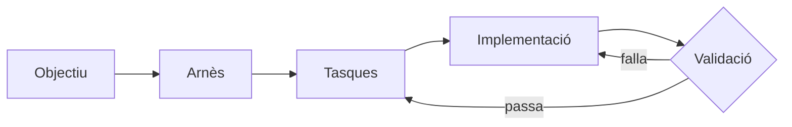
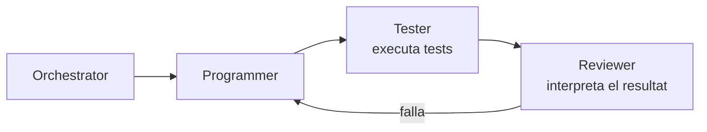
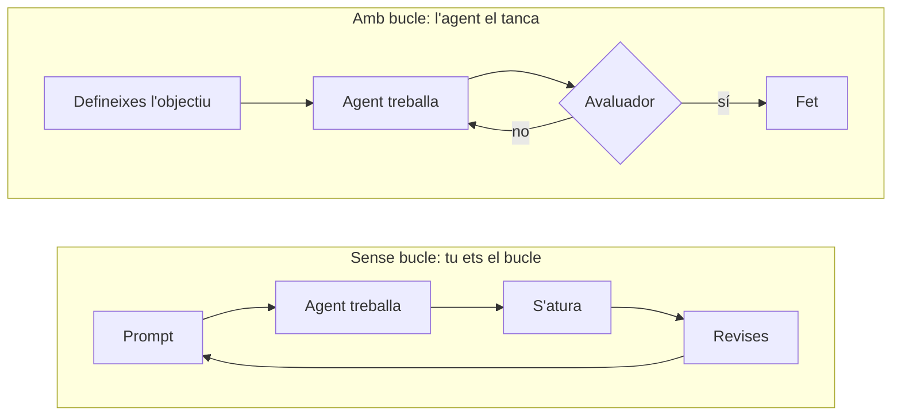

# 07 · ATD i treball autònom

> **Objectius de la sessió**
> - Descompondre un projecte gran en tasques atòmiques i validables (ATD).
> - Escriure cada tasca en un fitxer Markdown (`tasks/TXX-nom.md`) amb un `PLAN.md` que en porta l'estat.
> - Saber quan té sentit un bucle agèntic autònom i quan no.
> - Fer que l'agent treballi sol amb `/run-tasks`, programar-lo amb el programador del sistema i deixar el projecte preparat per continuar més tard.
>
> Cal haver fet la [sessió 02](02%20-%20Harness%20Engineering.md) (arnès i `/next-task`) i la [sessió 04](04%20-%20MCPs%20GitHub,%20Playwright%20i%20MCP%20propi.md) (MCPs de GitHub i Playwright, globals). La tasca T7 fa servir la issue de la T4.

> 📋 Tots els prompts d'aquesta sessió, en ordre, són a [`assets/prompts-07-atd.md`](assets/prompts-07-atd.md).

| Bloc | Temps |
|---|---|
| Explicació · part A: ATD i format de tasques (§1–8) | 30 min |
| Explicació · part B: bucles agèntics (§9–11) | 12 min |
| Explicació · part C: tasques programades, i part D: continuar més tard | 13 min |
| Activitat · pràctica 1: Sudoku, arnès i tasques | 45 min |
| Activitat · pràctica 2: `/next-md-task` i `/run-tasks 3` | 30 min |
| Activitat · tasca T7 | 45 min |
| **Total a classe** | **2 h 55 min** (55 min d'explicació i 2 h d'activitat) |
| Fora de classe | Res. Opcional: l'ampliació de la T7 |

La tasca programada de la part C només s'explica: fer-la és una ampliació opcional de la T7.

---

## Part A · Descomposició atòmica de tasques

### 1. Per què

El mode `build`, sol, té limitacions:

- No pot planificar projectes complexos.
- No pot mantenir una planificació entre sessions.

La solució és definir molt bé el context del projecte, **conjuntament amb el mateix agent**. La descomposició atòmica de tasques (ATD, *Atomic Task Decomposition*) divideix l'objectiu en subtasques petites i crea un entorn perquè l'agent pugui encarar projectes grans.



### 2. Objectiu, subtasques, validació

| | Per què |
|---|---|
| **Objectiu** clar | Una explicació pobra fa que l'agent no sàpiga què ha d'implementar |
| **Subtasques** | Com més complexa és una tasca, més es desvia l'agent. Dividir-la redueix la desviació |
| **Validació** | Si l'agent no pot comprovar que la implementació passa una prova, no sap si és correcta |

### 3. Separar planificació i execució

> *«Planificar i implementar són problemes diferents.»*

Els agents treballen millor amb contexts acotats:

1. Definir l'entorn i l'arnès.
2. Descompondre l'objectiu en tasques petites.
3. Implementar i validar cada tasca per separat.

### 4. Reduir el context

> *«La disciplina evita que l'agent s'allunyi de l'objectiu.»*

Dues maneres, relacionades:

- Fer servir **subagents** de treball.
- Dividir el problema en **tasques petites**.

Així cada tasca només té la informació necessària, i l'estat del projecte es guarda **fora de la conversa** (`AGENTS.md`, `PLAN.md`, `tasks/`). Agents, skills i documents actuen com a memòria externa.

### 5. Tasques atòmiques

> *«Una tasca ha de ser prou petita per poder-se implementar i validar.»*

Evita prompts *one-shot* com «Implementa un tetris». Una tasca atòmica:

- Té una única responsabilitat principal.
- Té acotades les dependències i les limitacions (què **no** ha de fer).
- Té un resultat mesurable o observable.
- Té criteris d'acceptació clars (sempre).
- Es pot validar amb un test (no sempre).

### 6. Validació i regressions

> *«Validar multiplica l'efectivitat del model.»*

- Una tasca no està feta fins que s'ha validat.
- El test dona a l'agent una referència externa de correcció.
- Els tests antics es conserven per evitar regressions.
- La validació pot ser contra logs d'execució o contra interfícies gràfiques.

Maneres de validar:

| Com | Eina |
|---|---|
| Executar el programa i llegir la sortida | `bash`, tests |
| Visualment, dins l'app o el sistema | Un MCP propi |
| Al web | MCP de Playwright (sessió 04) |

Organització de l'arnès: els rols de la sessió 02 (orchestrator, programmer, reviewer) més un **tester** que només executa els tests i en retorna la sortida:



El *tester* és opcional. L'arnès del Sudoku en tindrà un; a «Lliuraments» (T7) no n'hi ha, i és el `reviewer` qui executa els tests.

### 7. Com començar un projecte

**No comencis demanant el que vols implementar.** Explica el projecte i demana a l'agent que transformi els requisits en prompts separats per a l'arnès, la planificació i la implementació.

L'explicació inicial ha d'incloure:

- Objectiu del projecte.
- Limitacions del model.
- Forma de treball desitjada.
- Criteris de validació.

I ha de demanar:

**Definició de l'arnès**: agents, skills, `PLAN.md`, i `AGENTS.md` (un cop definides les tasques).

**Definició de cada tasca**:
- objectiu (arquitectura, requisits funcionals…),
- descripció suficient per treballar amb poc context,
- dependències,
- criteris d'acceptació,
- tests necessaris,
- una única responsabilitat.

### 8. Tasques en Markdown: `PLAN.md` + `tasks/T*.md`

A la sessió 02 les tasques eren a `docs/tasks.json` (SDD). Ara cada tasca té **el seu propi fitxer** i un `PLAN.md` en porta l'ordre i l'estat.

```text
PLAN.md                 ordre de les tasques i estat de cadascuna
tasks/
├── T01-model-tauler.md
├── T02-render-tauler.md
└── T03-validar-jugada.md
```

`PLAN.md` és **l'única font de l'estat**: els fitxers de tasca no el repeteixen, i així no es poden contradir.

```markdown
# PLAN · Sudoku

1:[done] T01 · Model del tauler
2:[done] T02 · Render del tauler
3:[ready] T03 · Validar una jugada
4:[backlog] T04 · Marcar errors a la interfície
```

| Estat | Significat |
|---|---|
| `N:[backlog]` | Definida, però encara li falten dependències |
| `N:[ready]` | Es pot començar: totes les dependències estan fetes |
| `N:[in progress]` | Un agent hi està treballant |
| `N:[in review]` | Implementada, pendent de validació |
| `N:[done]` | Validada |

`N` és la prioritat: entre les tasques `[ready]`, primer la de número més petit. Si la validació falla, la tasca **torna a `N:[ready]`** amb el motiu escrit a la línia de sota. Si es quedés a `[in review]`, el bucle no trobaria cap tasca `[ready]` i s'aturaria dient que no queda feina.

**Un fitxer de tasca** (Sudoku):

```markdown
# T03 · Validar una jugada

Depèn de: T01 (model del tauler), T02 (render del tauler)

## Objectiu
Funció pura `isValidMove(board, row, col, value)` a `src/rules.js`.

## Context
El tauler és una matriu 9×9 de números (0 = buit), definida a T01.
La interfície ja mostra el tauler (T02), però aquesta tasca no toca la interfície.

## No facis
- No modifiquis `src/render.js` ni l'HTML.
- No afegeixis dependències.

## Criteris d'acceptació
- Retorna `false` si el valor ja és a la fila, a la columna o al quadre 3×3.
- Retorna `true` en qualsevol altre cas.

## Tests
`tests/rules.test.mjs` amb un cas per a fila, columna, quadre i jugada vàlida. `npm test` en verd.
```

**Plantilla** per a `tasks/TXX-nom.md`:

```markdown
# TXX · Títol
Depèn de: —

## Objectiu
## Context
## No facis
## Criteris d'acceptació
## Tests
```

**JSON o Markdown?** Els dos formats conviuen al curs:

| | SDD · `docs/tasks.json` (sessió 02) | Markdown · `PLAN.md` + `tasks/T*.md` |
|---|---|---|
| Cada tasca | Títol, estat i criteris d'acceptació | Un fitxer amb objectiu, context, dependències, límits, criteris i tests |
| Context per tasca | Mínim: depèn de `AGENTS.md` i del codi | Autosuficient: la tasca explica tot el que cal |
| Ideal per | Moltes tasques petites i semblants | Projectes grans, tasques amb dependències, models petits |
| Estat | Camp `status` al JSON | Una línia per tasca a `PLAN.md` |

Comença amb **SDD** si les tasques són petites i el model és bo. Passa a **Markdown** quan les tasques necessiten context propi, tenen dependències o treballes amb models petits. Com que són fitxers de text, també els pot llegir i corregir una persona, i queden versionats amb git.

---

## Pràctica 1 · Sudoku amb tasques en Markdown

Objectiu: un Sudoku en HTML fet amb ATD, amb una tasca per fitxer.

> **Repositori de la sessió:** crea a GitHub un repositori nou i buit `ia-07-sudoku`, clona'l i obre-hi OpenCode (`cd ia-07-sudoku` i `opencode`), com a la sessió 01 (apartat 17). Demana a l'agent el `.gitignore` amb el mateix prompt d'aquella sessió. Totes dues pràctiques i la part C es fan en aquesta carpeta.

Copia [`assets/prompt-sudoku.md`](assets/prompt-sudoku.md) a `prompts/` i revisa'l. Després executa aquests quatre prompts a OpenCode, **un per un**: espera que acabi cada un abans d'enganxar el següent.

**1 · Generar els tres prompts.**

```text
Llegeix @prompts/prompt-sudoku.md i genera els tres prompts a prompts/. Canvis respecte a l'original:
- En lloc d'un únic tasks-sudoku.md, les tasques s'han d'escriure una per fitxer a tasks/TXX-nom.md, amb un PLAN.md que les llisti en ordre amb el seu estat.
- Fes servir aquests estats, tots amb el número de prioritat davant (també [done], que a l'original no en porta): N:[backlog], N:[ready], N:[in progress], N:[in review], N:[done].
- L'estat només es guarda a PLAN.md.
- Si la validació d'una tasca falla, torna a N:[ready] amb el motiu escrit a la línia de sota.
- L'arnès s'ha de crear a .agents/, amb .opencode com a enllaç (sessió 02).
```

**2 · L'arnès.**

```text
Implementa la descripció de @prompts/prompt-sudoku-arnes.md
```

**3 · Les tasques.**

```text
Implementa la descripció de @prompts/prompt-sudoku-tasques.md. Cada tasca de tasks/TXX-nom.md ha de seguir aquesta plantilla:
# TXX · Títol
Depèn de: —
## Objectiu
## Context
## No facis
## Criteris d'acceptació
## Tests
```

**4 · `AGENTS.md`.**

```text
Genera AGENTS.md per a aquest projecte a partir de l'arnès, PLAN.md i les tasques.
```

Revisa les tasques **abans** d'implementar-les: cada una té una sola responsabilitat? Es pot validar amb un test? Diu què no ha de fer? Les dependències de `PLAN.md` són correctes? Corregeix els fitxers a mà si cal: són teus.

> El prompt d'implementació (`prompt-sudoku-implementa.md`) no l'executis encara: a la pràctica 2 la implementació la portarà el bucle.

---

## Part B · Bucles agèntics

### 9. Què és un bucle

Un bucle agèntic és un sistema que:

1. Troba feina.
2. Invoca l'agent.
3. Verifica el resultat.
4. Guarda l'estat.
5. Decideix el pas següent.



### 10. Necessito un bucle?

> Un bucle només val la pena si la tasca **es repeteix** i hi ha **verificació automàtica**.

Cal poder treure la revisió humana, amb tests o amb avaluacions fetes per subagents.

| Bons candidats | **No** haurien de ser bucles |
|---|---|
| Classificar nous clients en categories | Reescriure l'arquitectura |
| Classificar incidències | Autenticació / OAuth |
| Corregir bugs amb test de reproducció | Pagaments i cobraments |
| Implementar tasques petites amb criteris clars | Contrasenyes i xifratge |
| | Pujades a producció |

> Qualsevol tasca amb **responsabilitat humana** NO ha de ser un bucle.

### 11. Peces d'un bucle

| Peça | Exemples |
|---|---|
| Disparador | cron, GitHub Actions, PM2, scripts, un *watcher*, **una tasca programada amb `opencode run`** |
| Context i skills | `AGENTS.md`, `.agents/skills/*/SKILL.md`, `.agents/commands/*.md` |
| Subagents | `.agents/agents/*.md`, invocats amb `@agent` |
| Connectors | MCPs, tools pròpies |
| Estat | **`PLAN.md`**, `STATUS.md`, SQLite, RAG |
| Verificació | tests, build, linter, typecheck, validador propi, Playwright |
| Aïllament | `git worktree add ../project-task-123 -b task-123` (una carpeta i una branca per tasca) |

## Pràctica 2 · Les comandes de tasca i de bucle

Al projecte `ia-07-sudoku`. Primer, la comanda que fa **una** tasca: l'equivalent de `/next-task` de la sessió 02, però sobre `PLAN.md`. Executa aquest prompt a OpenCode dins del projecte:

```text
Crea l'arxiu .agents/commands/next-md-task.md amb exactament aquest contingut. Si l'agent orquestrador de .agents/agents/ no es diu orchestrator, posa el seu nom a la línia agent:. Si l'orquestrador no pot editar PLAN.md o fer git commit, ajusta-li els permisos només per a això.
---
description: Implement and validate the highest-priority [ready] task in PLAN.md. One task only.
agent: orchestrator
---
# /next-md-task — one Markdown task

Use the agents defined in .agents/agents/.
1. Read PLAN.md. If a task is N:[in progress] or N:[in review] from an interrupted run, set it back to N:[ready]. Pick the N:[ready] task with the lowest N. If there is none, report it and stop.
2. Change its status to N:[in progress] in PLAN.md and read only its file in tasks/.
3. Delegate the implementation to the implementation subagent. Respect the "No facis" section of the task.
4. Change the status to N:[in review] and delegate the validation to the test and review subagents: npm test (all tests, not only the new ones) and every acceptance criterion. If the task changes the interface, also check it with the Playwright MCP at http://localhost:3000.
5. If the validation passes, set the status to N:[done], move to N:[ready] every N:[backlog] task whose dependencies are now all done, and make one commit "TXX: <title>".
6. If the validation fails, set the status back to N:[ready], write the reason on the line below the task in PLAN.md, do not commit, and stop.
Only the orchestrator edits PLAN.md. Never work on more than one task.
```

En un altre terminal, des de `ia-07-sudoku`, serveix el projecte i deixa'l obert. El Playwright el necessita, i si el Sudoku fa servir mòduls de JavaScript, obrir l'HTML directament des del disc (`file://`) no funciona:

```bash
npx serve .
```

Prova `/next-md-task` un cop i revisa el diff i `PLAN.md`. Després, el bucle:

```text
Crea l'arxiu .agents/commands/run-tasks.md amb exactament aquest contingut, i a la línia agent: posa el mateix agent que a next-md-task.md:
---
description: Run the /next-md-task workflow in a loop until no [ready] task is left, a task fails or the limit is reached.
agent: orchestrator
---
# /run-tasks — task loop

Read .agents/commands/next-md-task.md and follow its steps once per cycle. Do not change or duplicate its rules.
- Process only one task per cycle. Never work on more than one task at a time.
- Re-read PLAN.md before and after every cycle.
- Stop when there are no [ready] tasks, as soon as a cycle fails, or after $ARGUMENTS completed tasks (10 if no number is given).
- At the end, print a summary: tasks done in this run, the task that failed (if any) and what is left.
```

A classe, executa `/run-tasks 3` (tres tasques com a màxim) i segueix `PLAN.md` i `git log` mentre treballa. Quan s'aturi, obre el Sudoku a `http://localhost:3000`. La resta de tasques les pots fer a casa amb `/run-tasks`.

> El límit de tasques i l'aturada en cas d'error són fonamentals: un bucle sense límits pot gastar molts tokens o fer molts canvis incorrectes.

---

## Part C · Tasques programades

> **A classe** aquesta part només s'explica. Fer els quatre passos és una ampliació opcional de la T7, a `lliuraments`; també els pots provar a `ia-07-sudoku`.

Una tasca programada és un **disparador** per als bucles: el programador del sistema operatiu (`launchd` a macOS, `cron` o `systemd` a Linux, el Programador de tasques a Windows) executa `opencode run` a una hora concreta. `opencode run` envia un sol prompt sense obrir la interfície i acaba quan l'agent ha acabat. S'executa a la carpeta del projecte, amb el seu `opencode.json`, els seus agents i els seus MCPs.

> Amb OpenCode 1 es feia amb el plugin [OpenCode Scheduler](https://github.com/different-ai/opencode-scheduler). La darrera versió publicada (1.3.0) és un plugin d'OpenCode 1, i els plugins d'OpenCode 1 **no s'executen a OpenCode 2**: OpenCode no el pot carregar. Mentre no se'n publiqui una versió per a OpenCode 2, l'agent programa la tasca directament al sistema operatiu.

**1 · El prompt que s'executarà.** Dins d'`ia-07-sudoku`:

```text
Crea l'arxiu prompts/resum-diari.md amb exactament aquest contingut:
# Daily summary
You run unattended: nobody can answer questions or approve permissions.
1. Read PLAN.md and the git log of the last 24 hours.
2. Run npm test.
3. Overwrite STATUS.md with: tasks done today, tasks still pending, the task that failed (if any) and the test result.
Do not modify any other file.
```

**2 · L'script que el llança.** El programador del sistema no carrega la configuració del terminal (ni el `PATH` ni les variables d'entorn), per això l'script fa servir rutes absolutes:

```text
Crea l'script scripts/resum-diari.sh (a Windows, scripts/resum-diari.ps1). L'script ha d'entrar a la carpeta d'aquest projecte amb la seva ruta absoluta i executar, amb la ruta absoluta de l'executable opencode:
opencode run --file prompts/resum-diari.md "Follow the instructions in the attached file."
Ha d'afegir la data, la sortida i els errors a logs/resum-diari.log. Afegeix logs/ al .gitignore. No l'executis.
```

**3 · Programar-lo.** Digues explícitament que és una tasca **programada**; si no, l'agent pot executar les instruccions en aquell moment:

```text
Programa scripts/resum-diari.sh perquè el sistema operatiu l'executi cada dia a les 21:00 amb el nom resum-diari (launchd a macOS, cron a Linux, Programador de tasques a Windows). No l'executis ara. Digues-me on l'has registrat i com es desactiva.
```

**4 · Comprovar-ho sense esperar fins a les 21:00.** Al terminal, des d'`ia-07-sudoku`, executa l'script (`bash scripts/resum-diari.sh`, o `powershell -File scripts\resum-diari.ps1` a Windows). Quan acabi (uns minuts), comprova que s'ha creat `STATUS.md` i llegeix el final de `logs/resum-diari.log`.

Recomanacions:

- Les tasques programades **no poden preguntar**: `opencode run` rebutja qualsevol petició de permís i ho escriu al log (`permission requested: … auto-rejecting`). Si el projecte té `ask` per a `npm test` o per editar fitxers, la tasca no ho podrà fer. `opencode run --auto` aprova tot el que no està denegat: no el facis servir en tasques programades. És millor permetre a `opencode.json` només el que la tasca necessita.
- Les claus han d'arribar a OpenCode sense el terminal: amb la carpeta `.secrets/` (sessió 01) funciona, perquè `{file:…}` es llegeix des de la carpeta del projecte.
- L'ordinador ha d'estar engegat a l'hora programada.
- Millor un projecte dedicat a cada tasca programada, amb el seu propi arnès (`.agents/agents`).
- Guarda els prompts programats en una carpeta:

```text
prompts/
├── resum-diari.md
├── manteniment-setmanal.md
└── arregla-bugs.md
```

---

## Part D · Continuar més tard

Prompts útils per guardar l'estat **fora de la conversa**:

| Situació | Prompt |
|---|---|
| Continuar una tasca més tard | «Atura't, però abans crea `RESUME.md` amb l'estat actual: què està acabat, què falta, decisions preses, errors coneguts i quin hauria de ser el pas següent.» |
| Passar la feina a un altre agent | «Crea `HANDOFF.md` amb només la informació necessària perquè un altre agent pugui continuar des d'una conversa nova sense tornar a investigar el projecte.» |
| Guardar decisions | «Actualitza `DECISIONS.md` amb les decisions tècniques d'avui i una frase explicant-ne el motiu.» |
| Deixar el projecte segur | «Abans d'acabar, comprova que compila, executa els tests i escriu a `STATUS.md` què funciona i què no.» |
| Reduir context | «Resumeix el context necessari per continuar aquesta tasca en menys de 500 paraules i desa'l a `CONTEXT.md`.» |
| Evitar repetir investigació | «Crea `FINDINGS.md` amb el que ja has comprovat, incloses les hipòtesis descartades.» |

## Tasca de la sessió · Projecte «Lliuraments» (T7)

**Objectiu:** que l'agent implementi la funcionalitat que vas descriure com a issue a la T4, ara escrita com a tasca en Markdown.

**Repositori:** `lliuraments`. Obre-hi OpenCode (`cd lliuraments` i `opencode`).

> 📋 Els prompts de la T7 són a [`assets/prompts-07-atd.md`](assets/prompts-07-atd.md), apartat T7.

1. **La tasca.** Amb l'MCP de GitHub, demana a l'agent que llegeixi la issue de la T4 i redacti una tasca `tasks/TXX-nom.md` amb la plantilla de la secció 8. Numera-la amb el primer número que no faci servir `docs/tasks.json` (normalment, T04). `PLAN.md` ja existeix (és el pla de la T1): afegeix-hi al final una secció `## Tasques` amb la tasca i l'estat `1:[ready]`, sense tocar la resta. Revisa la tasca abans de continuar.
2. **La comanda.** Copia `/next-md-task` de la pràctica 2 a `.agents/commands/` i adapta-la amb un prompt:
   - als agents del projecte (sessió 02): `orchestrator`, `programmer` i `reviewer`; no hi ha *tester*, i és el `reviewer` qui executa `npm test`;
   - a `PLAN.md`: les tasques i el seu estat només són a la secció `## Tasques`;
   - la validació és `npm test` i els criteris d'acceptació. Si a la T4 vas donar Playwright al `reviewer`, també una comprovació de la web a `http://localhost:3000/webs/…`.

   Deixa `/next-task` (JSON) tal com està: els dos formats conviuen.
3. **Executa-la.** Surt d'OpenCode i torna-hi a entrar. Executa `/next-md-task` i segueix `PLAN.md` mentre treballa. Si la tasca falla, llegeix el motiu a la línia de sota, corregeix la tasca o el codi i torna-la a executar: ja torna a ser `[ready]`. Per veure el resultat, `npx serve .` en un altre terminal i obre `http://localhost:3000/webs/…`.
4. La comanda ja fa el commit de la tasca. Demana a l'agent l'etiqueta `t7` i el push (sessió 01, apartat 17).

**Lliurable:** enllaç a l'etiqueta `t7` de `lliuraments`, amb la secció `## Tasques` de `PLAN.md` amb la tasca a `[done]`, el fitxer `tasks/T*.md`, la comanda `/next-md-task` adaptada i el commit de la tasca.

**Ampliació (opcional):**

- Més tasques i el bucle: escriu-ne dues més, copia també `/run-tasks` i executa'l.
- Una tasca programada: `prompts/resum-diari.md` i `scripts/resum-diari.sh` (o `.ps1`) amb els prompts de la part C, i executa l'script un cop perquè es generi `STATUS.md`.
- Continuar més tard: demana a l'agent `DECISIONS.md` i `HANDOFF.md` (part D).
- Tanca la issue amb un comentari que enllaci el commit de la tasca.

## Resum

- Objectiu → arnès → tasques atòmiques → implementació validada.
- SDD (JSON) per a tasques petites i semblants; Markdown (`tasks/T*.md` + `PLAN.md`) per a tasques amb context propi i dependències.
- Planificar i implementar per separat; l'estat fora de la conversa, a `PLAN.md`.
- Un bucle només si la tasca es repeteix i es pot validar automàticament; mai per a tasques amb responsabilitat humana.
- `/run-tasks` fa una sola tasca per cicle, s'atura si falla i té un límit; una tasca que falla torna a `[ready]` amb el motiu.
- Una tasca programada (programador del sistema + `opencode run`) n'és el disparador: s'ha de demanar explícitament que la programi, i la tasca no pot fer preguntes.
