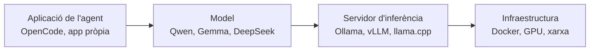
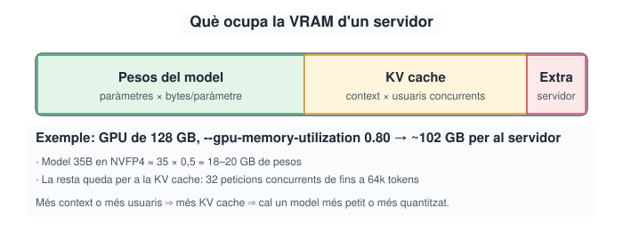
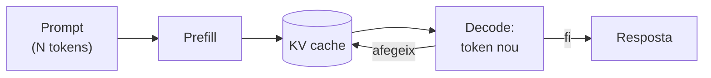
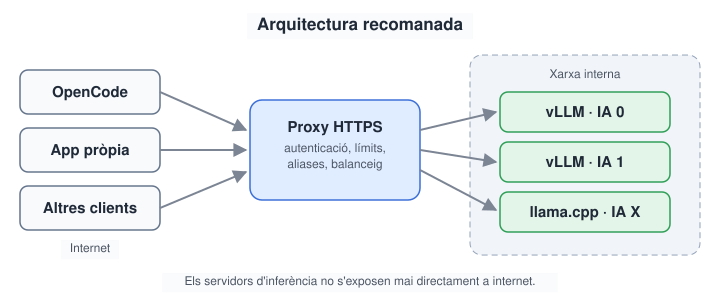
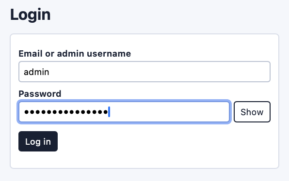
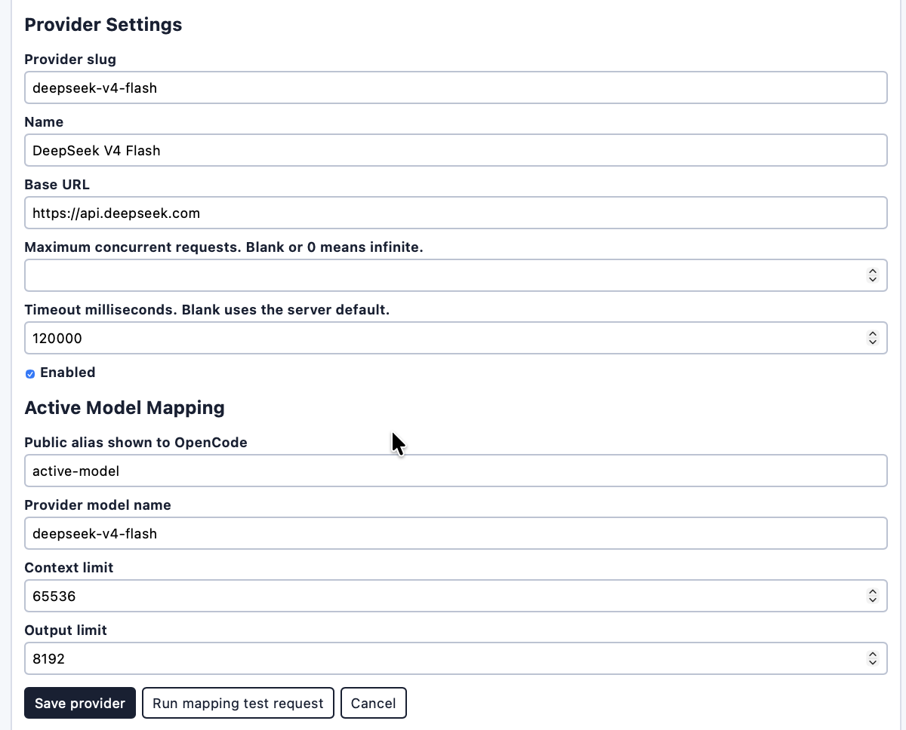
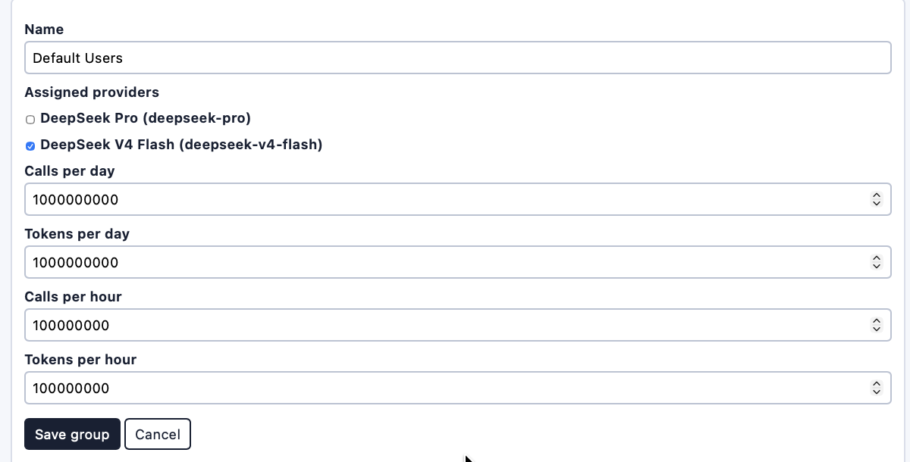

# 08 · Servidors d'inferència

> **Objectius de la sessió**
> - **Conceptes:** entendre què limita un servidor d'inferència (memòria, KV cache, context, quantització) i escollir model i servidor.
> - **Velocitat en equips petits:** saber per què el *decode* és lent i com l'acceleren l'especulació, els MoE repartits entre GPU i RAM i la cache de prefix (TensorFold i Strata).
> - **Desplegament:** posar en marxa vLLM o llama.cpp amb Docker i GPU NVIDIA, connectar-hi OpenCode i protegir-ho amb un proxy.
>
> Cal haver fet la [sessió 02](02%20-%20Harness%20Engineering.md) (`/next-task`) i la [sessió 03](03%20-%20Function%20calling%20i%20models%20locals.md) (format OpenAI i Ollama). La tasca T8 fa servir `/next-task` (T2).

> 📋 Tots els prompts d'aquesta sessió, en ordre, són a [`assets/prompts-08-inferencia.md`](assets/prompts-08-inferencia.md).

Aquesta sessió amplia la part de models locals de la sessió 03 (Ollama) i és on es tracten la mida dels models i la quantització.

| Bloc | Temps |
|---|---|
| Explicació · conceptes: memòria, KV cache, context, quantització, quin servidor (§1–9) | 30 min |
| Explicació · velocitat en equips petits i paràmetres dels models (§10–11) | 10 min |
| Explicació · demostració: connectar OpenCode al servidor i proxy (§17–18) | 15 min |
| Explicació · on són els flags de vLLM, llama.cpp, Docker i `compose` (§12–16) | 5 min |
| Activitat · tasca T8, passos 1–4 | 1 h 30 min |
| Activitat · presentació del projecte final | 20 min |
| **Total a classe** | **2 h 50 min** (1 h d'explicació i 1 h 50 min d'activitat) |
| Fora de classe | Redactar el projecte final (PDF). Opcional: passos 5 i 6 de la T8 |

> A classe, la part 2 es fa com a demostració del professor sobre el servidor del curs. De la secció 10 s'expliquen el perquè i les tres tècniques; el detall de TensorFold i Strata és lectura. Les taules de paràmetres de les seccions 12–16 són material de consulta: no cal memoritzar-les. Els flags corresponen a vLLM 0.32 i llama.cpp b12321 (novembre de 2026); canvien sovint, comprova'ls amb `--help`.

---

# Part 1 · Conceptes

## 1. On som



Un **servidor d'inferència** ha de respondre peticions a un model, **diverses alhora**. Fa servir GPUs (o NPUs, *neural processing units*) i gestiona la memòria per atendre-les.

## 2. Memòria clàssica i memòria unificada

| Tipus | Com funciona | Exemples |
|---|---|---|
| Clàssica | La GPU té la seva **VRAM**; la CPU té la RAM del sistema | PCs i servidors amb gràfica NVIDIA |
| Unificada | CPU i GPU (i NPU, si n'hi ha) accedeixen a la mateixa RAM (no hi ha VRAM separada) | Apple Silicon, NVIDIA DGX Spark, AMD Strix Halo |

La velocitat d'accés a la memòria (**ample de banda**, GB/s) limita la velocitat del sistema. La memòria unificada sol ser més gran (models més grans) però més lenta (respostes més lentes). La secció 10 en treu les conseqüències.

## 3. Què ha de cabre a la VRAM



| Element | Depèn de |
|---|---|
| Pesos del model | Paràmetres × bytes per paràmetre (quantització) |
| KV cache | Context × usuaris concurrents |
| *Overhead* del servidor | Recursos interns del programa |

Conseqüència:

> Més usuaris amb més context ⇒ models més petits.
> Models més grans ⇒ menys usuaris, menys context i més lentitud.

## 4. Com es calcula la inferència

Quan l'usuari envia un prompt, el text es divideix en **tokens**, que es processen en dues fases:

| Fase | Què fa | Coll d'ampolla |
|---|---|---|
| **Prefill** | Llegeix tots els tokens del prompt de cop | Càlcul (GPU) |
| **Decode** | Genera un token, l'afegeix a la llista i torna a començar | Velocitat de memòria |



## 5. KV cache

Guarda els vectors interns d'atenció (claus i valors) dels tokens ja processats, per no haver de recalcular tot el context a cada token nou.

- Accelera molt la fase de decode.
- Creix a mesura que creix la conversa i la resposta.
- Ocupa VRAM (o memòria unificada):

> més context = més VRAM · més usuaris simultanis = més VRAM · converses més llargues = més VRAM

Es pot calcular:

```text
KV cache per token = 2 (K i V) × capes × caps KV × dimensió per cap × bytes per valor
```

Exemple amb un model dens de 8B (32 capes, 8 caps KV, dimensió 128, FP16 = 2 bytes): 2 × 32 × 8 × 128 × 2 = 131.072 bytes ≈ **128 KB per token**. Una conversa de 32k tokens ocupa ≈ **4 GB** de KV cache, i quatre usuaris amb 32k cadascun, ≈ 16 GB: més que els pesos del model en Q4. Els valors de cada model són al seu `config.json` (`num_hidden_layers`, `num_key_value_heads`, `head_dim`).

La KV cache també es pot quantitzar (per exemple `--kv-cache-dtype fp8` a vLLM) per fer-hi cabre més context.

> Molts models recents (Qwen3.6/3.8, Gemma 4, Nemotron) combinen capes d'atenció completa amb capes d'atenció lineal o de finestra, que no guarden tot el context. La fórmula només s'aplica a les capes d'atenció completa: la KV cache real és més petita. Els logs del servidor (T8, pas 5) en donen el valor exacte.

## 6. Context

El context és la quantitat de tokens que el model processa en una tasca. En un agent hi ha de cabre: prompt del sistema + historial + resultats d'eines + fitxers llegits + errors de terminal + instruccions del projecte…

> **Per a agents es recomana un context de 32k tokens o més.**
> Duplicar el context pot consumir molta més memòria, encara que el model sigui el mateix.

## 7. Models: mida, tipus i quantització

Conceptes bàsics:

- Mida en paràmetres: B = milers de milions (10⁹). Més gran no sempre és millor.
- **Dense**: tots els paràmetres a cada token. **MoE**: només s'activen uns quants experts per token (`35B A3B` = 35B totals, ~3B actius), però s'han de carregar tots a memòria i poden necessitar *backends* específics per anar ràpid.
- Memòria dels pesos ≈ paràmetres × bytes per paràmetre.

### Formats de quantització

| Format | Memòria | Qualitat | Ús habitual |
|---|---|---|---|
| FP16 / BF16 | Alta (2 bytes) | Alta | Servidors de gamma alta |
| FP8 | Mitjana (1 byte) | Bona | vLLM en servidors mitjans |
| Q8 | Mitjana (~1 byte) | Molt bona | llama.cpp |
| Q4 | Baixa (~0,5 bytes) | Acceptable | Màquines locals |
| Q2–Q3 | Molt baixa | Dolenta en models petits; acceptable en MoE molt grans | Maquinari molt limitat (Strata, secció 10) |

### Mètodes de quantització

No només compten els bits, també **com** es quantitza:

| Mètode | Mida respecte FP16 | Característiques |
|---|---|---|
| **AWQ** | ~25% (4 bits) | Té en compte les activacions i protegeix els pesos més importants |
| **GPTQ** | ~25% (4 bits) | Quantitza capa per capa minimitzant matemàticament l'error introduït |
| **FP8** | 50% | Referència actual: valors *float* de 8 bits, pràcticament sense pèrdua respecte FP16 |
| **NVFP4** | ~25% | Format de NVIDIA (4 bits *float* amb escalats), bon rendiment i poca pèrdua. El càlcul FP4 **natiu** només és a GPUs Blackwell (RTX sèrie 50, B200, DGX Spark); en altres GPUs (p. ex. Hopper) s'executa amb *kernels* com Marlin, que descomprimeixen els pesos al vol |
| **MLX** (4/6/8 bits) | ~25–50% | Format d'Apple per a Apple Silicon (Ollama, LM Studio, TensorFold) |
| **EXL3** | variable (2–8 bits) | Quantització amb bits fraccionaris (p. ex. 3,5 bits), molt precisa per la seva mida |
| **INT4 simple (RTN)** | 25% (0,5 bytes/paràmetre) | Arrodoniment directe a enters de 4 bits, sense calibratge: el més fàcil de fer, però amb més pèrdua. AWQ i GPTQ també produeixen pesos INT4, però escollits amb més cura |

Els noms dels GGUF de llama.cpp (`Q4_K_M`, `IQ3_S`, `Q2_K`…) indiquen els bits (el número) i la variant del mètode.

## 8. Hugging Face

[Hugging Face](https://huggingface.co/) és el «GitHub» dels models d'IA:

| Secció | Contingut |
|---|---|
| Models | LLMs, visió, àudio… |
| Datasets | Dades per entrenar i provar |
| Spaces | Petites apps web per provar models |

Ens interessa perquè hi ha models gratuïts amb la seva fitxa (estadístiques, paràmetres recomanats) i és d'on els descarreguen vLLM, llama.cpp (`-hf`), TensorFold i Strata.

Amb un token (*Settings › Access Tokens*) es poden descarregar models privats o *gated*, amb menys limitacions i més ràpid.

## 9. Quin servidor?

| | Ollama | LM Studio | llama.cpp | vLLM |
|---|---|---|---|---|
| Instal·lació | Fàcil | Fàcil | Mitjana | Difícil |
| Formats | GGUF / Safetensors / MLX | GGUF / MLX | GGUF | Safetensors (HF) |
| Concurrència | Baixa (1 petició alhora per defecte, `OLLAMA_NUM_PARALLEL`) | Baixa | Mitjana (4 *slots* per defecte) | **Alta** |
| Configurable | Poc | Molt | Molt | Molt |
| Millor per | Local | Local | Local, màquines modestes, maquinari heterogeni | **Servidors** |

Ollama fa servir MLX a Apple Silicon i llama.cpp a la resta. llama.cpp descarrega models directament de Hugging Face (`-hf usuari/model:Q4_K_M`) i pot deixar els experts dels MoE a la CPU (`--n-cpu-moe`), cosa que permet models més grans que la VRAM.

### Per què vLLM a un servidor

vLLM està dissenyat per atendre el màxim de peticions possibles en una GPU gestionant la KV cache de manera eficient:

- **Paged Attention**: divideix la KV cache en pàgines en lloc de reservar un gran bloc per petició, i aprofita millor la memòria.
- **Continuous Batching**: intercala peticions noves amb les que ja s'estan processant; la GPU no espera i els temps de resposta baixen.
- **Prefix caching** i **chunked prefill**, activats per defecte: reaprofita la KV cache dels prompts que comencen igual i trosseja els prompts llargs perquè no bloquegin els altres usuaris.

Això és clau per a agents: diversos subagents poden enviar peticions **en paral·lel**, i totes comencen amb el mateix prompt de sistema i `AGENTS.md`.

Per a arquitectures heterogènies (diverses màquines, CPU+GPU, processament en xarxa), llama.cpp sol ser més flexible.

## 10. Velocitat d'inferència en equips petits

Un **equip petit** és una o poques màquines (un PC amb una gràfica de joc, un Mac, un DGX Spark) que fan servir d'una a cinc persones. Aquí el que importa no és atendre cent usuaris, sinó que **un agent vagi prou ràpid** per no esperar-lo.

### Per què el decode és lent

A cada token nou, el servidor ha de **llegir de memòria tots els pesos actius** del model. Per això:

```text
tokens/s màxims ≈ ample de banda de la memòria ÷ bytes de pesos actius per token
```

| Exemple (Q4, ~0,5 bytes/paràmetre) | Pesos llegits per token | DGX Spark (273 GB/s) |
|---|---|---|
| Model dens de 27B | ≈ 14 GB | ≈ 19 tok/s com a màxim |
| MoE 35B A3B (3B actius) | ≈ 1,5 GB (+ atenció) | molt més: el límit passa a ser el càlcul |

Conseqüències: un MoE amb pocs paràmetres actius és molt més ràpid que un dens de la mateixa mida; i per anar més ràpid cal **llegir menys** o **aprofitar més cada lectura**.

### Tres tècniques

| Tècnica | Idea | La fan servir |
|---|---|---|
| **Descodificació especulativa** | Un model petit (*drafter*) o els caps MTP del mateix model (secció 11) proposen diversos tokens; el model gran els **verifica tots en una sola passada**. Si n'encerta 3 de 4, una lectura dels pesos dona 3 tokens. El resultat és el mateix que sense especulació: només canvia la velocitat | vLLM (`--speculative-config`), llama.cpp, TensorFold, Strata |
| **MoE repartit entre memòries** | L'atenció i els experts que més es fan servir van a la VRAM; la resta, a la RAM, calculats per la CPU. Un model de 100B+ funciona amb una gràfica de 12 GB | llama.cpp (`--n-cpu-moe`), Strata |
| **Cache de prefix** | Guarda la KV cache del principi del prompt (sistema + `AGENTS.md` + fitxers) i la reaprofita a la petició següent. En un agent, el *prefill* passa de segons a gairebé res | vLLM (per defecte), llama.cpp, TensorFold, Strata (també a disc) |

### TensorFold

[TensorFold](https://github.com/ashhart/TensorFold) ([tensorfold.dev](https://tensorfold.dev)) és un servidor d'un sol binari, escrit en Zig, que treu el màxim de velocitat d'una màquina: **Apple Silicon** (M1–M5, Metal) i **NVIDIA** amb CUDA 13 (sèries 30, 40, 50 i, sobretot, **DGX Spark**). Llicència Apache-2.0.

- **Com va més ràpid:** descodificació especulativa exacta (caps MTP i el *drafter* DFlash2), *batching* de diverses peticions en una sola passada (`--parallel N`, per defecte `auto`), cache de prefix (`--prompt-cache-gib`) i *tensor parallel* entre dos o tres DGX Spark.
- **Formats:** MLX 4/6/8 bits, NVFP4/FP8 i EXL3. **No** llegeix GGUF.
- **Models:** només els *qualificats* (la llista del README: Qwen3.5/3.8, Nemotron 3.5, GLM…). Un model no qualificat pot no arrencar.
- **API:** compatible amb OpenAI (i amb Anthropic) a `http://127.0.0.1:8080/v1`.

```bash
# macOS
brew install ashhart/tensorfold/tensorfold
tensorfold pull mlx-community/Qwen3.5-2B-MLX-4bit@93760be4f1f69842a46bc13dbdc0f19e291392a3
tensorfold serve mlx-community/Qwen3.5-2B-MLX-4bit --name local-model --context 8192 --no-thinking
tensorfold benchmark          # mesura la velocitat a la teva màquina
```

A Linux es descarrega el `.tar` de la *release* (binari `tensorfold-native`). El `@…` del `pull` fixa la versió exacta del model.

Xifres **publicades pel mateix projecte** (Qwen3.8-27B, un DGX Spark):

| | TensorFold | vLLM amb MTP |
|---|---|---|
| Un usuari, codi | 57,8 tok/s | 23,4 tok/s |
| Un usuari, xat | 50,0 tok/s | 25,4 tok/s |
| 48 peticions, 16 alhora | 161,7 tok/s amb 25,4 GiB | 132,1 tok/s amb 51,7 GiB |

### Strata

[Strata](https://github.com/Niko1221/Strata) és una aplicació d'escriptori i una CLI (`strata`) per fer servir **MoE enormes en un PC normal**: Qwen3.8 Flash Next (~125B), Qwen3.6-35B-A3B i DeepSeek V4.1 Flash. Llicència MIT; part del motor es basa en llama.cpp.

- **Com funciona:** reparteix el model en tres nivells. A la **VRAM**, l'atenció, els *routers* i els experts més usats («cada GB de més ≈ 700 experts més»); a la **RAM**, tots els experts, calculats per la CPU en paral·lel; al **disc SSD**, una taula de n-grames per a l'especulació. A més, MTP (1,6–1,8× més ràpid), KV cache de 8 bits i cache de prefix a disc.
- **Maquinari:** NVIDIA RTX 20–50, AMD RX 7000/9000, Intel Arc, Apple M1 o posterior, Strix Halo, DGX Spark. **Mínim:** 12 GB de gràfica i 32–64 GB de RAM. Les descàrregues són de 66–76 GB.
- **API:** compatible amb OpenAI (i amb Anthropic) a `http://127.0.0.1:8080/v1`.

```bash
# Linux / macOS (a Windows hi ha instal·lador i un script de PowerShell)
curl -fsSL --connect-timeout 15 --max-time 120 \
  https://github.com/Niko1221/Strata/releases/latest/download/install.sh -o install.sh
sh install.sh
strata launch --plan --family qwen --model q2_0           # què descarregarà i com ho repartirà; no canvia res
strata launch --family qwen --model q2_0 --yes --no-tui   # descarrega, serveix i mostra l'adreça
strata connect opencode                                   # mostra la configuració d'OpenCode
strata bench run                                          # mesura la velocitat
```

Altres opcions: `--context 32k|64k|128k`, `--parallel N` (per defecte, una conversa alhora) i `--access local|lan|tailscale|cloudflare`. Si l'obres a la xarxa, posa-hi una clau (`--api-key-env`) i, per a més d'una persona, un proxy (secció 18).

Xifres **publicades pel mateix projecte** (RTX 5070 de 12 GB, 64 GB de DDR5, Qwen3.8 Flash Next Q2_0): 87 tok/s amb 1k de context, 82 amb 32k i 74 amb 128k; *prefill* de 1.300–2.100 tok/s. Amb la quantització IQ3_S, més qualitat, ~52 tok/s.

### Quin escollir

| Situació | Opció | Per què |
|---|---|---|
| Començar, provar models petits en un portàtil | Ollama / LM Studio | S'instal·len en un minut; models d'un clic |
| PC modest o sense gràfica, qualsevol GGUF, repartir entre CPU i GPU | llama.cpp | El més flexible i el que admet més models i maquinari |
| Una persona amb una gràfica de joc (12–16 GB) i 64 GB de RAM que vol un MoE de 100B+ per programar | **Strata** | Fa cabre i corre de pressa models que no hi cabrien; la qualitat en 2–3 bits és la d'un model gran |
| Un Mac (Apple Silicon) o un DGX Spark per a una o poques persones, amb un dels models qualificats | **TensorFold** | La màxima velocitat per usuari i diverses peticions alhora amb poca memòria |
| Servidor compartit per molts usuaris o molts agents en paral·lel, models nous el primer dia | vLLM (+ proxy) | Concurrència alta, el més madur i el que suporta més models |

> ⚠️ **TensorFold i Strata tenen pocs mesos de vida.** Canvien cada setmana, suporten pocs models i tenen camins experimentals. Les xifres de dalt les publiquen els mateixos autors: comprova-les a la teva màquina (T8, pas 6) abans de decidir. Amb Strata, el primer token amb 128k de context pot trigar minuts, i la quantització de 2–3 bits perd qualitat respecte a la 4 bits.

## 11. Paràmetres dels models

A més del servidor, cal configurar el model. **No tots els models tenen totes les capacitats.**

| Paràmetre | Significat |
|---|---|
| thinking / reasoning | Activa o desactiva el raonament |
| tools | Format de sortida de les crides a eines |
| multimodal | Processament d'imatges i àudio |
| MTP | *Multi-Token Prediction*: el model porta uns caps extra que proposen diversos tokens; el servidor els verifica (descodificació especulativa, secció 10). Només accelera si el servidor l'activa |
| instruct | Model entrenat per seguir instruccions en format conversa (no garanteix *tool calling*) |
| chat template | Format de conversa del model; ha de ser compatible entre el servidor i el model |

---

# Part 2 · Desplegament

## 12. vLLM

API compatible amb OpenAI, funciona molt bé amb Docker Compose.

| Paràmetre | Significat |
|---|---|
| `--model` (o argument de `vllm serve`) | Ruta local o identificador de Hugging Face |
| `--served-model-name` | Nom amb què el veuen els clients |
| `--host 0.0.0.0` | Accepta peticions de qualsevol IP |
| `--port 8000` | Port (models diferents en ports diferents) |
| `--max-model-len` | Context màxim: entrada + sortida |
| `--gpu-memory-utilization` | Fracció de la memòria de la GPU que es reserva vLLM (pesos + KV cache). Per defecte 0,92 a la 0.32 i automàtic a la 0.33. Si la GPU només és per a vLLM, no cal tocar-lo; posa'l si la comparteixes o amb memòria unificada (DGX Spark), on el sistema també la necessita: 0,8 per a un model, 0,4–0,5 si n'hi ha dos |
| `--dtype auto` | Tipus de dades dels pesos (`auto` = el del model, o `float16`/`bfloat16`) |
| `--quantization` | Mètode de quantització. Normalment no cal: vLLM el llegeix del checkpoint |
| `--kv-cache-dtype` | Format de la KV cache (`fp8` per estalviar memòria) |
| `--max-num-seqs` | Peticions concurrents màximes |
| `--max-num-batched-tokens` | Tokens que es processen junts en un pas (el pressupost de cada lot) |
| `--enable-auto-tool-choice` | El model decideix si fa servir una eina |
| `--tool-call-parser` | Com s'interpreten les crides a eines del model (format OpenAI) |
| `--reasoning-parser` | Com se separa el raonament de la resposta (depèn del model) |
| `--limit-mm-per-prompt` | Límits multimodals, p. ex. `'{"image":4,"video":0}'` |
| `--speculative-config` | Descodificació especulativa (secció 10), p. ex. amb els caps MTP del model: `'{"method":"mtp","num_speculative_tokens":3}'` |

La cache de prefix i el *chunked prefill* estan activats per defecte: ja no cal posar `--enable-prefix-caching` ni `--enable-chunked-prefill`.

### NVFP4 a GPUs Blackwell

Per a `Qwen3.6 35B A3B NVFP4` a DGX Spark o RTX sèrie 50 (arquitectura SM12x), la recepta oficial de vLLM fa servir el *backend* **Marlin** per als experts:

```text
--moe-backend marlin
```

No cal `--quantization`: vLLM detecta NVFP4 al checkpoint (si el poses, és `modelopt_fp4`). També hi ha *backends* FP4 natius per a SM12x (`--moe-backend flashinfer_b12x --linear-backend flashinfer_cutlass`): segons la versió de vLLM i el model, un o altre va més ràpid. Prova'ls amb el mateix prompt i compara els tok/s.

> Checkpoint NVFP4 ≠ càlcul FP4 natiu. Mira els logs de vLLM per saber quin *backend* s'ha triat.

## 13. llama.cpp

La solució per a màquines modestes i alt rendiment amb poca concurrència. També ofereix API compatible amb OpenAI (`llama-server`) i permet repartir el model entre GPU i CPU (*offloading*). Les versions recents ho ajusten gairebé tot soles: sovint n'hi ha prou amb el model i el nom.

| Paràmetre | Significat |
|---|---|
| `-m`, `--model` | Ruta local al model GGUF |
| `-hf usuari/model[:quant]` | Descarrega el model de Hugging Face, p. ex. `-hf usuari/model-GGUF:Q4_K_M` |
| `-a`, `--alias` | Nom amb què el veuen els clients (se'n poden posar diversos separats per comes) |
| `--host`, `--port` | Igual que vLLM (per defecte, port 8080) |
| `-c`, `--ctx-size` | Context **total**. Per defecte 0: el del model |
| `-np`, `--parallel` | Peticions concurrents (*slots*). Per defecte `auto` (4) amb la **KV cache unificada**: tots els *slots* comparteixen un sol bloc de `ctx-size` tokens, i una petició pot fer servir tot el context si les altres no l'ocupen. Amb `--no-kv-unified`, cada *slot* té fix `ctx-size / parallel` (amb `-c 65536 -np 4`, 16k per petició) |
| `-ngl`, `--n-gpu-layers` | Capes que es carreguen a la **GPU** (la resta, a la CPU). Per defecte `auto`; també `all` o un número |
| `--fit` | Per defecte `on`: redueix capes a la GPU i context perquè el model hi càpiga |
| `-cmoe`, `--n-cpu-moe N` | Deixa a la CPU els experts MoE de totes les capes (o de les N primeres): l'atenció va a la GPU i el model pot ser més gran que la VRAM |
| `--threads` | Fils de CPU per al càlcul |
| `--batch-size`, `--ubatch-size` | Mida dels lots i sublots del *prefill* |
| `--jinja`, `--chat-template` | Plantilla de conversa del model (Jinja, activada per defecte; necessària per a les eines) |
| `--flash-attn` | *Flash attention* (`on`, `off` o `auto`, per defecte `auto`): optimitza la memòria amb contexts llargs |

```bash
llama-server -hf usuari/model-GGUF:Q4_K_M -a active-model \
  --host 0.0.0.0 --port 8080 -c 65536 --n-cpu-moe 20
```

Per a OpenCode, `limit.context` és el context que pot tenir **una** petició: amb la KV unificada, `ctx-size` si l'agent treballa sol; si hi ha diversos agents alhora, fes servir `--no-kv-unified` i posa `ctx-size / parallel`.

## 14. Docker

Avantatges: mateixa configuració a tots els servidors, instal·lació reproduïble, ports controlats, volums per als models, variables d'entorn, fàcil d'aturar i reiniciar.

Per gestionar Docker sense `sudo`:

```bash
sudo groupadd docker 2>/dev/null || true   # crea el grup si no existeix
sudo usermod -aG docker "$USER"            # afegeix l'usuari
newgrp docker                              # aplica el canvi sense reiniciar
docker ps                                  # comprova
```

### Docker i NVIDIA

Instal·la el NVIDIA Container Toolkit (cal el driver de NVIDIA ja instal·lat):

```bash
sudo apt-get update && sudo apt-get install -y --no-install-recommends ca-certificates curl gnupg2
curl -fsSL https://nvidia.github.io/libnvidia-container/gpgkey \
  | sudo gpg --dearmor -o /usr/share/keyrings/nvidia-container-toolkit-keyring.gpg
curl -fsSL https://nvidia.github.io/libnvidia-container/stable/deb/nvidia-container-toolkit.list \
  | sed 's#deb https://#deb [signed-by=/usr/share/keyrings/nvidia-container-toolkit-keyring.gpg] https://#g' \
  | sudo tee /etc/apt/sources.list.d/nvidia-container-toolkit.list
sudo apt-get update
sudo apt-get install -y nvidia-container-toolkit
sudo nvidia-ctk runtime configure --runtime=docker
sudo systemctl restart docker
```

`/etc/docker/daemon.json` ha de quedar semblant a:

```json
{
  "runtimes": {
    "nvidia": { "args": [], "path": "nvidia-container-runtime" }
  }
}
```

```bash
docker info | grep -i runtimes     # ha de mostrar: nvidia runc …
```

Perquè Docker esperi la GPU en arrencar la màquina (*drop-in* de systemd). La unitat `nvidia-gpu-reset.target` és pròpia de DGX OS: comprova que existeix amb `systemctl list-units | grep nvidia` abans de fer-la servir.

```bash
sudo mkdir -p /etc/systemd/system/docker.service.d
sudo tee /etc/systemd/system/docker.service.d/docker-override.conf >/dev/null <<'EOF'
[Unit]
After=nvidia-gpu-reset.target
Wants=nvidia-gpu-reset.target
EOF
sudo systemctl daemon-reload
sudo systemctl restart docker
systemctl cat docker     # comprova que hi apareix l'override
```

## 15. Un `compose` per model

Cada model té el seu arxiu `compose-*.yml` amb la configuració real (imatge, flags de vLLM o llama.cpp, volums). Per canviar de model, atura l'actual i arrenca l'altre:

```bash
docker compose -f compose-qwen36.yml down
docker compose -f compose-gemma4.yml up -d
docker compose -f compose-gemma4.yml logs -f
```

| Arxiu | Funció |
|---|---|
| `compose-*.yml` | Configuració de cada model |
| `tokens.env` | Token de Hugging Face (opcional; recomanat per evitar *rate limits* i accedir a models *gated*). Al `.gitignore` |

Errors típics sense token: `401 Unauthorized`, `403 Forbidden`, `Repository not found`, `Cannot access gated repo`, `rate limit`.

### Exemple mínim

Un `compose-qwen36.yml` per a vLLM. `tokens.env` conté una línia `HF_TOKEN=…`, i els flags de `command` són els de les seccions 12 i 17:

```yaml
services:
  vllm:
    image: vllm/vllm-openai:latest
    container_name: qwen36
    restart: unless-stopped
    ipc: host
    ports:
      - "8000:8000"
    env_file: tokens.env
    volumes:
      - qwen36-hf-cache:/root/.cache/huggingface
      - qwen36-vllm-cache:/root/.cache/vllm
    deploy:
      resources:
        reservations:
          devices:
            - driver: nvidia
              count: all
              capabilities: [gpu]
    command: >
      --model nvidia/Qwen3.6-35B-A3B-NVFP4
      --served-model-name active-model
      --host 0.0.0.0 --port 8000
      --max-model-len 65536
      --gpu-memory-utilization 0.80
      --enable-auto-tool-choice --tool-call-parser qwen3_coder
      --reasoning-parser qwen3

volumes:
  qwen36-hf-cache:
  qwen36-vllm-cache:
```

Fixa la versió de la imatge (en lloc de `latest`) quan el servidor ja funcioni, perquè una actualització no canviï els flags.

### Caches

Dona a cada model els seus volums Docker persistents, perquè no torni a descarregar els pesos ni a recompilar cada cop que arrenca:

```text
qwen36-hf-cache    → /root/.cache/huggingface
qwen36-vllm-cache  → /root/.cache/vllm
```

```bash
docker volume ls                   # llista els volums
docker system df -v                # espai de cada volum
docker volume rm qwen36-vllm-cache # esborra un volum (el model s'haurà de tornar a preparar)
```

### Comandes útils

```bash
nvidia-smi                         # estat de la GPU
watch -n 1 nvidia-smi              # monitor en temps real
nvidia-smi dmon                    # útil si la memòria surt com N/A
nvidia-smi pmon                    # processos que fan servir la GPU
curl http://127.0.0.1:8000/v1/models   # models actius (normalment 'active-model')
docker ps
docker logs -f <contenidor>        # logs d'un model
```

## 16. Patrons dels `compose-*.yml`

| Paràmetre | Valor habitual |
|---|---|
| `--served-model-name active-model` | Nom genèric (llama.cpp: `--alias`): els clients no canvien encara que canviï el model |
| `--host 0.0.0.0 --port 8000` | Accessible des de la xarxa al port 8000 |
| `--gpu-memory-utilization 0.80` | 80% de la memòria: el servidor del curs és un DGX Spark (memòria unificada) |
| `--max-model-len 65536` | 64k tokens en total (entrada + sortida) |
| `--max-num-seqs 32` | 32 peticions concurrents |
| `--max-num-batched-tokens 65536` | Igual que `max-model-len` |

### Configuració per model: Gemma 4

Gemma 4 (E2B, E4B, 12B, 26B-A4B, 31B) necessita vLLM 0.25 o posterior i els seus propis *parsers* i plantilla (la plantilla és a la carpeta `examples/` del repositori de vLLM):

```text
--enable-auto-tool-choice
--tool-call-parser gemma4
--reasoning-parser gemma4
--chat-template examples/tool_chat_template_gemma4.jinja
--override-generation-config '{"temperature": 0, "top_p": 0.95, "top_k": 64}'
--default-chat-template-kwargs '{"enable_thinking": false}'
```

- Es recomana `temperature` 1, però produeix respostes desestructurades i errors a OpenCode; per això 0.
- Es recomana desactivar el *thinking* per evitar pensaments infinits, a canvi de perdre qualitat en programació.

## 17. Connectar OpenCode al servidor

Els paràmetres de `opencode.json` (sessió 01) han de coincidir amb els del servidor. OpenCode 2 ha canviat el nom d'alguns camps del proveïdor; encara llegeix els arxius en el format d'OpenCode 1, però **ignora** `"reasoning": true` (només en deixa un avís al registre). Si fas servir OpenCode 2, fes servir el format nou, com a la sessió 01, i no barregis els dos formats dins d'un mateix proveïdor.

| vLLM | OpenCode 1 (`provider`) | OpenCode 2 (`providers`) |
|---|---|---|
| `--served-model-name active-model` | clau del model: `"active-model"` | clau del model: `"active-model"` |
| `--host` / `--port` | `options.baseURL`: `http://IP:8000/v1` | `settings.baseURL`: `http://IP:8000/v1` |
| `--max-model-len 65536` | `limit.context`: `65536` | `limit.context`: `65536` |
| (límit de sortida desitjat) | `limit.output`: `8192` | `limit.output`: `8192` |
| `--limit-mm-per-prompt '{"image":4,…}'` | `modalities.input`: `["text", "image"]` | `capabilities.input`: `["text", "image"]` |
| `--enable-auto-tool-choice --tool-call-parser …` | `"tool_call": true` | `capabilities.tools`: `true` |
| `--reasoning-parser …` | `"reasoning": true` (OpenCode 2 l'ignora) | `capabilities.reasoning`: `{ "supported": true, "effort": ["low", "medium", "high"] }` |
| (paquet del proveïdor) | `npm`: `"@ai-sdk/openai-compatible"` | `package`: `"@opencode/ai/providers/openai-compatible"` |

El proveïdor amb el format d'OpenCode 2, igual que a la sessió 01 però apuntant al servidor:

```json
{
  "providers": {
    "curs": {
      "name": "Servidor del curs",
      "package": "@opencode/ai/providers/openai-compatible",
      "settings": {
        "baseURL": "http://IP:8000/v1",
        "apiKey": "{file:.secrets/agent_key}"
      },
      "models": {
        "active-model": {
          "name": "Active Model",
          "limit": { "context": 65536, "output": 8192 },
          "capabilities": {
            "input": ["text", "image"],
            "output": ["text"],
            "tools": true,
            "reasoning": { "supported": true, "effort": ["low", "medium", "high"] }
          }
        }
      }
    }
  }
}
```

La comanda de vLLM corresponent:

```bash
vllm serve nvidia/Qwen3.6-35B-A3B-NVFP4 \
  --served-model-name active-model \
  --host 0.0.0.0 --port 8000 \
  --moe-backend marlin \
  --kv-cache-dtype fp8 \
  --gpu-memory-utilization 0.80 \
  --max-model-len 65536 \
  --max-num-seqs 32 \
  --max-num-batched-tokens 65536 \
  --limit-mm-per-prompt '{"image":4,"video":0}' \
  --enable-auto-tool-choice \
  --tool-call-parser qwen3_coder \
  --reasoning-parser qwen3
```

(`qwen3_xml`, que surt en receptes antigues, és un altre nom de `qwen3_coder`.) Per activar la descodificació especulativa amb els caps MTP del model, afegeix `--speculative-config '{"method":"mtp","num_speculative_tokens":3}'` i compara els tok/s amb i sense.

**`limit.output` vs `max_tokens`**

- `max_tokens` s'envia al servidor amb cada petició: «no em retornis més de X tokens».
- `limit.output` informa OpenCode que el model no pot generar més de X tokens; OpenCode ho fa servir per calcular el pressupost de context, quan compactar i altres límits interns.

## 18. Arquitectura recomanada: proxy



El proxy protegeix, valida i distribueix les crides:

- **No exposis mai vLLM (ni llama.cpp, TensorFold o Strata) a internet.**
- Un sol punt d'entrada HTTPS.
- El proxy decideix com s'exposen els models, encara que canviïn.
- Amaga la configuració real.
- Reparteix la càrrega entre servidors.

### Administració del proxy

Es pot entrar com a usuari (amb correu electrònic) o com a `admin`. La contrasenya d'admin es defineix a `settings.env` (`ADMIN_PASSWORD`), que mai no s'ha de pujar al repositori.



**Proveïdors**

| Camp | Significat |
|---|---|
| Provider slug | Nom intern del proveïdor |
| Name | Nom visible |
| Base URL | URL de les crides tipus OpenAI |
| Public alias | Nom exposat: el que els clients posen a `opencode.json` |
| Provider model | Nom del model al proveïdor |
| Context limit | Context disponible per als usuaris (cal posar-lo a `opencode.json`) |
| Output limit | Límit de sortida (cal posar-lo a `opencode.json`) |



**Grups**: cada grup d'usuaris té assignats els proveïdors on van les seves peticions. Si n'hi ha diversos, les crides es balancegen segons el rendiment recent de cada proveïdor.



## Tasca de la sessió · Projecte «Lliuraments» (T8)

L'enunciat de la T8 és a [enunciats/08 - Tasca T8.md](../enunciats/08%20-%20Tasca%20T8.md).

## Resum

- La VRAM ha de contenir pesos + KV cache + *overhead*; el context i la concurrència la fan créixer.
- La quantització permet models més grans en menys memòria, amb compromisos. Els MoE no estalvien memòria (cal carregar tots els experts), però són més ràpids perquè cada token només fa servir una part dels paràmetres.
- El *decode* el limita l'ample de banda de la memòria. En equips petits, la descodificació especulativa (MTP, *drafters*), els MoE repartits entre GPU i RAM i la cache de prefix multipliquen la velocitat.
- Local: Ollama, LM Studio, llama.cpp. Màxima velocitat en un Mac o DGX Spark: TensorFold. MoE enormes en un PC de joc: Strata. Servidor per a molts usuaris: vLLM amb Docker. TensorFold i Strata són molt nous: comprova'n les xifres.
- Els paràmetres de `opencode.json` han de coincidir amb els del servidor; amb OpenCode 2, les capacitats van a `capabilities`.
- Davant dels servidors, sempre un proxy HTTPS.
